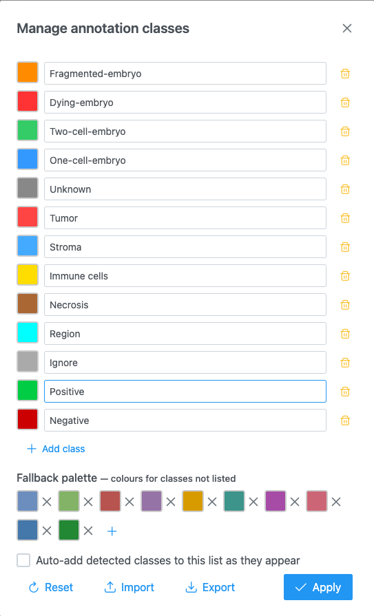
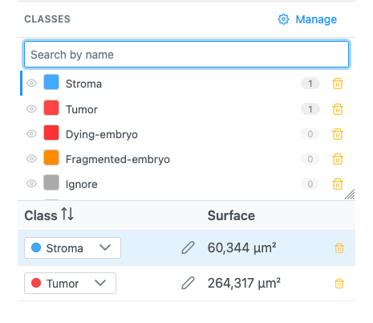
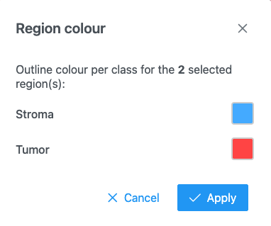
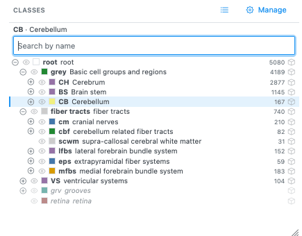

# Annotation classes

Every region has a **class** (a label such as `Tumor`), and every class has a colour. Classes live in the
Region Editor's **Classes** panel and in the **Manage annotation classes** dialog. See
[Annotation classes](../reference/annotation-classes.md) for the full reference.

## Classify one region

1. Open the Region Editor with { .siv-icon }.
2. Click the region's **Class** cell and pick a class from the dropdown. Its colour follows the class.
3. For a name that is not in the list, click <i class="pi pi-pencil"></i> in the cell, type the name and
   press ++enter++ (++esc++ cancels).

## Relabel many regions at once

1. Select the regions: in the table, click the first row and ++ctrl++-click or ++shift++-click others; or
   on the image, ++shift++-click them in **Selection mode**.
2. Click <i class="pi pi-tags"></i> **Edit class on selected rows**.
3. Pick a class in **Choose a class…** (it applies straight away), or type a new name in **…or a new
   class** and press ++enter++ or click <i class="pi pi-plus"></i>.

Shortcut: with regions selected, click a class name in the **Classes** panel to apply it to them.

## Set up class presets for a project

A preset gives a class name a fixed colour. Every region with that class, including regions loaded later
from a GeoJSON file, is drawn in that colour, so an annotation type always looks the same.

1. In the Region Editor's **Classes** header, click <i class="pi pi-cog"></i> **Manage**.
2. Click **Add class**. Type the class name exactly as it appears in your data (for example `Tumor`) and
   pick its colour from the swatch. Repeat for each class.
3. Remove classes you do not need with their trash icon.
4. Set **Label matching**: **Exact** (default) or **Normalized**, which ignores case and surrounding
   spaces so that `tumor ` matches `Tumor`.
5. Click **Apply**.

!!! info "Where presets are saved"
    In an application with a server (such as JAX Image Tools), presets are saved for your user account and
    follow you across images and sessions. In the demo, or any host without that storage, they last only
    until you reload the page; export them to keep them.

!!! warning
    **Reset** and **Import** take effect immediately, without **Apply**. Closing the dialog with × discards
    other unapplied edits.

## Share presets with your team

1. In **Manage**, click **Export**. The browser saves `annotation-classes.json` with the classes, the
   fallback palette, the auto-add setting and the matching mode.
2. Send the file to a colleague.
3. They open **Manage**, click **Import** and pick the file. The message "Classes imported" confirms it.

A file that is not a class list is rejected with "Import failed".

## Choose colours for classes that have no preset

Classes that are not in your list get a colour from the **fallback palette**. The same name always gets the
same colour.

1. In **Manage**, under **Fallback palette**, click a swatch to change it, × to remove it, or + to add one.
2. Click **Apply**.

## Recolour every region of a class

Click the class's colour swatch in the **Classes** panel (or in **Manage**) and pick a colour. All regions
of that class update at once.

{ width="420" }

Regions whose colour you set individually are not changed (see below).

## Give a few regions their own colour

1. Select the regions.
2. Click <i class="pi pi-palette"></i> **Edit colour of selected regions**.
3. The **Region colour** dialog has one colour per class among the selection; unclassified regions are
   grouped as **Unclassified**. Pick the colours and click **Apply**.

These regions keep their colour even if their class's colour changes later.

{ width="380" }

## Hide a class

Click the <i class="pi pi-eye"></i> next to the class in the **Classes** panel. Its regions are hidden on the
image; click again to show them.

## Remove a class

Click its trash icon in the **Classes** panel or in **Manage**. Its regions go back to the class **Region**.
The default class **Region** cannot be removed while it is in use.

## Find a class in a long list

Type in **Search by name** at the top of the **Classes** panel. Press ++enter++ to pick the first match.

## Work with a class tree (atlases)

Region sets imported with a hierarchy, such as a brain atlas, show their classes as a tree.

1. Click <i class="pi pi-plus-circle"></i> / <i class="pi pi-minus-circle"></i> to expand or collapse a
   branch.
2. Click a class (or press ++enter++ on it) to pick it **and all its subclasses**; their regions are
   selected. ++shift++-, ++ctrl++- or ++cmd++-click adds to the pick.
3. The eye hides a class and its subclasses; a partly hidden branch shows a partial eye.
4. Switch between tree and flat list with <i class="pi pi-sitemap"></i> / <i class="pi pi-list"></i>.

Classes that have no region on the current slice are greyed out.

{ width="420" }

## About the auto-add setting

**Auto-add detected classes to this list as they appear** in **Manage** adds classes found in loaded files to
your presets. Note that while the Region Editor is open, class names found on the image's regions (for
example `sam` or `cell` from AI segmentation) are added to the class list anyway, whatever this setting.
Remove the ones you do not want with their trash icon.

## Which class do new regions get?

Newly drawn regions always start in the class **Region**. AI segmentation adds regions in the class **sam**
(SAM) or **cell** (Cellpose). Classify them afterwards with the steps above.
