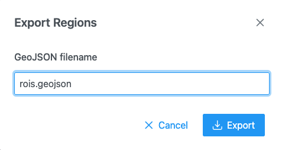
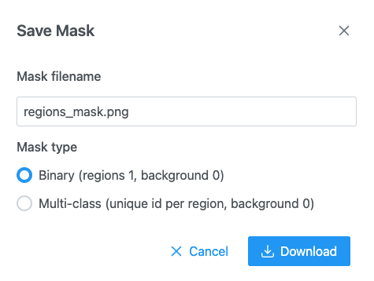

# Import and export

Regions live in the browser's memory, one set per image (and per slice of a stack). They survive switching
images, but not a page reload, so export or save them to keep them. Formats and rules are in
[GeoJSON import and export](../reference/geojson.md).

## Export regions as GeoJSON

1. Open the Region Editor.
2. Click <i class="pi pi-download"></i> **Download regions as geojson file**.
3. In **Export Regions**, keep or change the file name (default: the image name with `.geojson`) and click
   **Export**.

{ width="420" }

For a stack stored as one file, all slices are exported together, each feature carrying its slice number.
For a stack that is a folder of files, one GeoJSON is written per slice.

## Import a GeoJSON file

1. Open the image the regions belong to.
2. In the Region Editor, click <i class="pi pi-upload"></i> **Import regions** and pick a `.geojson` or
   `.json` file.

**What you should see:** a "Regions imported" message and the regions on the image, coloured by their class
presets.

!!! warning "Importing replaces the current regions"
    Importing a single GeoJSON file replaces the regions on this image; it does not add to them. Export the
    current regions first if you want to keep them.

A feature without a classification gets the class **Cell**. Polygons, multi-polygons (with holes) and line
strings are read; points are not supported.

## Round-trip annotations with QuPath

SIV writes and reads the QuPath GeoJSON layout: each feature's `properties.classification` holds `{name,
color}`, and slices are recorded in `geometry.plane.z`.

From QuPath to SIV:

1. In QuPath, select the annotations and use **File → Export objects as GeoJSON** (export as a
   FeatureCollection).
2. In SIV, open the same image and click <i class="pi pi-upload"></i> **Import regions**.

From SIV to QuPath:

1. In SIV, export the regions as above.
2. In QuPath, drag the `.geojson` file onto the image.

Class names are kept; set up the same names as [class presets](classes.md#set-up-class-presets-for-a-project)
so colours match. Feature ids and extra properties from the original file are preserved on export.

## Import a folder of per-slice GeoJSON files

For a z-stack annotated slice by slice:

1. In the Region Editor, click <i class="pi pi-folder-open"></i> **Import a folder of per-slice GeoJSON
   files**.
2. Pick the folder. Files are matched to slices in natural name order (`slice_2` before `slice_10`).

If the folder holds a `regionset.json`, its class tree and display style are used.

## Import a label volume

A label volume is a 3D image whose voxel values are class ids (NIfTI or NRRD).

1. In the Region Editor, click <i class="pi pi-upload"></i> **Import regions**.
2. Select the `.nii`, `.nii.gz` or `.nrrd` file **together with** its ontology JSON (the class list), in one
   go.

SIV slices the volume, outlines each label on each slice, and names the classes from the ontology: an
Allen structure graph gives acronyms, a `regionset.json` gives its class tree. Without an ontology each
label becomes `label <value>`. The volume's slices must have the same size as the image; otherwise a
"Different size" message explains the mismatch.

## Import from an OME-Zarr store or a zip

- **OME-Zarr:** use <i class="pi pi-folder-open"></i> and pick the store's folder. SIV reads its first label
  image (NGFF 0.4 or 0.5).
- **Zip:** a `.zip` of any of the above can be opened from a folder pick or from the server.

## Import regions from the server

In an application with a server, click <i class="pi pi-cloud-download"></i> **Import regions from server**
and pick a GeoJSON file, a folder of per-slice files or a label volume. Very large files load as a
[region source](../reference/geojson.md) drawn tile by tile.

## Save regions to the server

1. Click <i class="pi pi-save"></i> **Save regions to server**.
2. Keep or change the **GeoJSON filename** and confirm. If the file exists you are warned and asked to
   confirm the overwrite.

A folder stack saves one file per slice without asking for a name.

## Export a mask image

For training a model or analysis in another tool:

1. Click { .siv-icon } **Download mask of the regions as PNG**.
2. Choose the mask type:
    - **Binary (regions 1, background 0)**: region pixels are white (255), the rest black.
    - **Multi-class (unique id per region, background 0)**: each region gets its own value (1, 2, 3…). The
      PNG is 8-bit for up to 255 regions and 16-bit above.
3. Click save. Progress shows "Rasterizing regions…" then "Encoding PNG…"; you can cancel.

The mask has the image's size. For images over 100 megapixels it is downscaled, and a "Mask downscaled"
message gives the size used. Overlapping regions: later regions are painted over earlier ones.

{ width="460" }

## Open annotations without an image

In the demo, **Open annotations…** in the header opens GeoJSON files, a label volume with its ontology or a
`.zip` on a blank canvas, to inspect them without the image (up to 8192 pixels per side).

## Export or import class presets

See [Share presets with your team](classes.md#share-presets-with-your-team).
