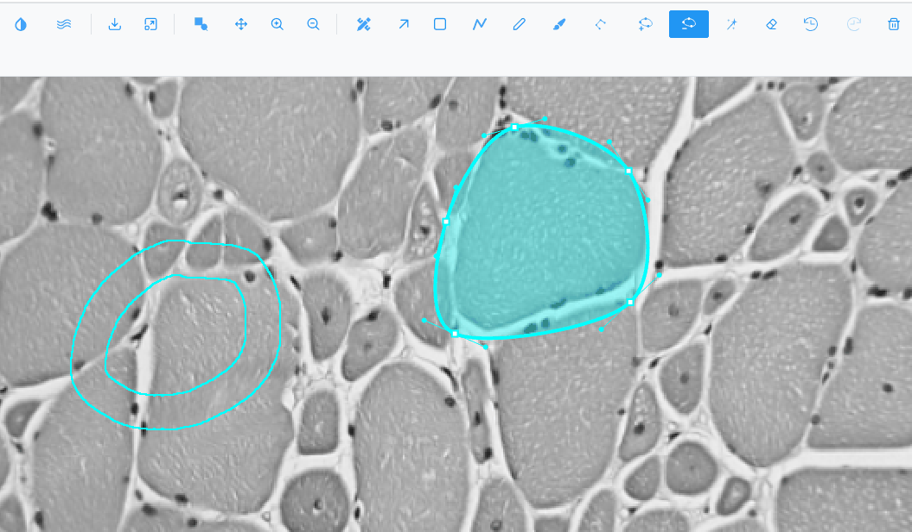
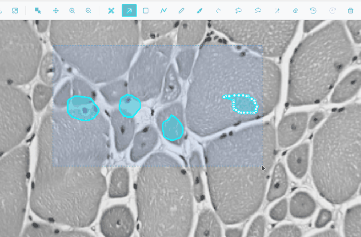

# Drawing and editing regions

Recipes for drawing regions and changing their shape. Every tool and option is listed in
[Region tools](../reference/region-tools.md) and [Region actions](../reference/region-actions.md).

The drawing tools work in the 2D views. The vertex tools (Polygon, Add vertex, Delete vertex) and the Bézier
conversions are only available in the **Image** view. Clicking the active tool's button again turns it off,
and so does ++s++ (**Selection mode**).

## Draw a rectangle

Press ++r++ (or click <i class="pi pi-stop"></i>) and drag. Rectangles keep their own type: with
**Selection mode** you can drag their handles to resize them, and they export as 4-corner polygons.

## Draw a freehand outline

Press ++f++ (or click <i class="pi pi-pencil"></i>) and drag around the object. The shape closes when you
release.

## Draw a precise polygon

1. Click { .siv-icon } **Draw a polygon** (Image view).
2. Click to place each vertex.
3. Click the first vertex again (within about 8 pixels of it) to close the polygon. At least 3 vertices
   are needed.

## Draw an open line

Press ++l++ (or click { .siv-icon } **Draw a polyline**) and drag. The line
is not closed. It has no area, is exported as a GeoJSON `LineString`, and is left out of merges and other
area operations.

## Outline an object automatically with the wand

1. Press ++w++.
2. Click inside the object. The wand grows a region over the neighbouring pixels similar to the one you
   clicked.
3. Tune **Sens.** in the toolbar (0.5 to 10, default 2): higher is stricter and gives a smaller region,
   lower is looser. The new value applies from your next click.
4. Click again, or drag, to keep extending the same region.

Variations:

- ++ctrl++-click (++cmd++ on macOS): exact-match flood fill, without smoothing or a tolerance.
- ++shift++-click or ++shift++-drag on a region: erase pixels from it.
- Click inside an existing region: the wand adopts it and extends it.
- Grow into another region: the two are merged.

!!! note
    The wand reads the pixels as displayed. Changing contrast or colours in Channels & Histogram, or zooming,
    changes what it considers similar. If it leaks into the background, raise **Sens.** or improve the
    contrast first.

## Paint a region with the brush

1. Click { .siv-icon } **Brush**.
2. Set **Size** (5 to 300, default 40).
3. Drag to paint. The painted area is the region.

- Start painting on an existing region to extend it.
- Painting across another region merges the two.
- Hold ++shift++ while painting to erase.
- A drag that starts away from the current stroke starts a new region.

The brush has no shortcut key and no cursor outline; the stroke shows its width as you paint.

## Make a region with a hole (a donut)

Use either tool:

- **Brush:** paint a closed ring and leave the centre unpainted, or ++shift++-paint a pocket inside a
  region.
- **Wand:** ++shift++-click inside a region to erase an enclosed area.

The hole's vertices can be dragged, added and deleted like the outer ring's. Holes are subtracted from the
area in the Region Editor and kept in GeoJSON exports.

## Move or reshape a region

1. Press ++s++ and click the region. It is drawn thicker and its handles show.
2. Drag the body to move the region. Drag a rectangle's handles to resize it. Drag a polygon's vertices to
   reshape it.
3. To add a vertex, click { .siv-icon } **Add a vertex** and click an
   edge of the selected region.
4. To remove one, click { .siv-icon } **Delete a vertex** and click
   it.

## Remove many vertices at once

1. Press ++e++ (**Vertex eraser**).
2. Set **Radius** in the toolbar (5 to 300, default 20).
3. Click or drag over outlines. Vertices inside the circle are removed from any region, including holes,
   and the outline is rejoined at the circle's edge.

A polygon left with fewer than 3 vertices, or a polyline with fewer than 2, is deleted. A hole left with
fewer than 3 vertices is removed.

## Smooth a region into a Bézier curve

1. In the Image view, select one or more polygons or rectangles.
2. Right-click and choose **Convert to Bézier**.
3. Drag the curve's anchors and handles to adjust it.

To go back, right-click and choose **Convert to polygon**.

## Select several regions

- ++shift++-click, ++ctrl++-click or ++cmd++-click regions in **Selection mode** to add or remove them.
- Drag a box on empty space in **Selection mode** to select every region it touches.

- Right-click and choose **Select all regions**.
- In the Region Editor table, ++ctrl++-click and ++shift++-click rows.

## Merge regions into one

1. Select two or more closed regions.
2. Right-click and choose **Merge / group**.

The result takes the class and colour of the first selected region. If the pieces do not touch, it is one
region with several parts. Holes are kept. Polylines are ignored.

## Split a multi-part region

Select it, right-click and choose **Ungroup**. Each part becomes its own region.

## Select everything outside your regions

1. Select one or more closed regions.
2. Right-click and choose **Inverse**.

The result is a region covering the whole image, with your regions cut out as holes. The original regions
are replaced. If nothing closed is selected, a message says there is nothing to invert.

## Reduce the number of vertices

Wand, brush and segmentation outlines can have thousands of vertices. To lighten them:

1. Select the regions.
2. Right-click, choose **Simplify**, then **Light (1 px)**, **Medium (3 px)** or **Strong (8 px)**.
3. For another value, choose **Custom…**, set **Altitude threshold** (1 to 20 px) and click **Apply**.

Vertices closer than the threshold to the line between their neighbours are removed, on outer rings and
holes. Rectangles and polylines are not changed, and Bézier regions become plain polygons.

## Delete regions

- Select them and press ++delete++, ++backspace++ or ++d++, or click <i class="pi pi-trash"></i> in the
  toolbar.
- In the Region Editor, click a row's trash icon, or <i class="pi pi-times-circle"></i> **Delete all
  regions** (with a confirmation).

## Undo and redo

- ++ctrl+z++ (++cmd+z++ on macOS) undoes the last region action.
- ++ctrl+shift+z++ or ++ctrl+y++ redoes it.

Up to 10 actions can be undone. A whole wand, brush or eraser drag counts as one action, as does a whole
segmentation run or merge. Switching to another image clears the history, and any new action clears what
can be redone.

## Round rectangles to tile sizes

In the Region Editor, click **x512**. Every rectangle's width and height is rounded to the nearest multiple
of 512 pixels, for example to prepare training tiles. Other shapes are not changed.

!!! warning
    A side shorter than 256 pixels rounds to 0. Make rectangles at least 256 pixels on each side first.

## Show region labels or fill regions

In the Region Editor toolbar:

- <i class="pi pi-tag"></i> shows each region's class name on the image. With many regions this slows
  drawing down.
- <i class="pi pi-stop-circle"></i> fills regions in their colour, like an atlas, with the labels inside.
