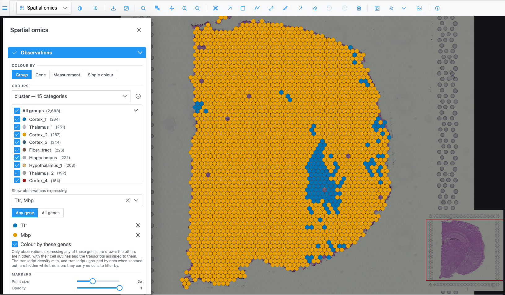
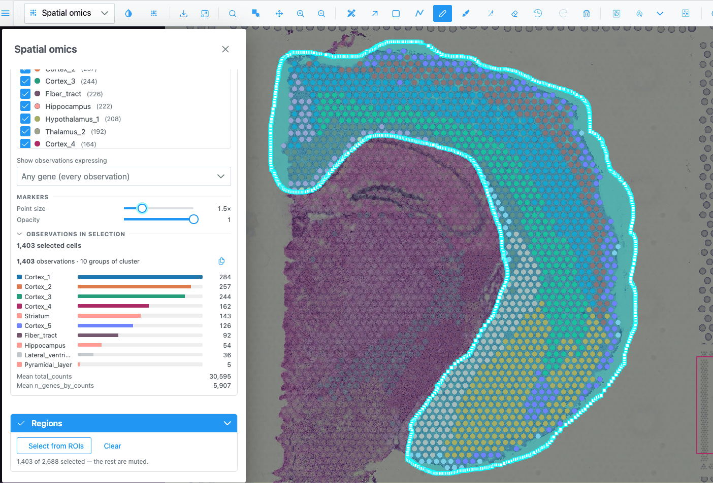
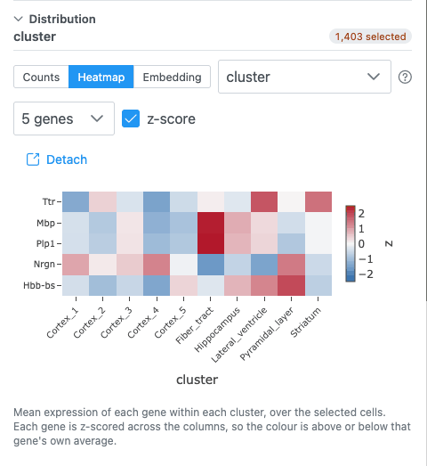

# Spatial omics

Recipes for spatial-omics datasets: cells or spots measured in a tissue section. The panel and charts are
described in [Spatial omics](../reference/spatial-omics.md) and
[Distribution charts](../reference/distribution-charts.md).

## Open a dataset in the spatial view

1. Open the dataset (in the demo: the **spatial-omics** folder of the gallery).
2. If it has a tissue image, the image opens first: pick **Spatial omics** in the plot-type dropdown. If its
   cells have z coordinates you can pick **Spatial omics 3D** instead.
3. Click { .siv-icon } **Spatial omics controls** to open the panel.

A dataset with no image and no volume (such as seqFISH) opens directly in a spatial view. A dataset with a
reference volume (such as the Allen Brain Cell Atlas) opens the volume in the **Image** view first.

## Colour observations by cell type or cluster

1. In the panel, **Observations → Colour by**, choose **Group**.
2. Pick the column in the **Groups** dropdown. Related columns (for example k-means with k = 2 … 10) are
   listed once, with a second dropdown for the variant.

## Hide some groups

Untick their checkboxes in the Groups list. **All groups (total)** shows or hides them all.

## Change a group's colour

Click the group's colour dot, pick a colour, or click **Reset to default**. Custom colours reset when you
open another dataset.

## Colour observations by a gene

1. **Colour by → Gene**.
2. Type part of the gene name in **Search *N* genes…** and pick it.
3. Adjust the scale: **Colormap** (empty means "match the image"), **Log scale**, and **Clip outliers**
   (None, 1%, 2% or 5%).

## Colour by a measurement

**Colour by → Measurement**, then pick a column such as total counts. Options show their unit.

## Show only cells that express given genes

1. In **Show observations expressing**, pick one or more genes.
2. With several genes, choose **Any gene** or **All genes**.
3. Leave **Colour by these genes** on to colour each cell by the picked gene it expresses most; turn it off
   to keep the **Colour by** colours.

Cells that do not express the genes (value 0) are hidden, with their outlines and transcripts. Click a
gene's swatch to change its colour and the icon used on 2D markers; click × to remove it.

{ width="420" }

## Make markers bigger or more transparent

Under **Markers**, set **Point size** (0.25× to 5×) and **Opacity** (0.1 to 1). These only change how markers
are drawn, not what is selected.

## Show cell outlines instead of dots

When the dataset has cell segmentations:

1. Set **Show as** to **Cell segmentations**.
2. In 2D, choose **View cells as**: **Fill**, **Outline** or **Both**, and which **Boundaries** to draw
   (for example cell and nucleus).
3. Set the fill opacity.

In 3D, choose **By cell type** (one surface per type) or **Individual cells**.

## Select observations inside a region

1. Draw one or more regions on the spatial view with any region tool (++f++, ++r++, the wand…).
2. In the panel, expand **Regions** and click <i class="pi pi-object-group"></i> **Select from ROIs**.
3. Click **Clear** to drop the selection.

The selected observations stay bright and the rest are muted. The charts, the **Observations in selection**
summary and the embedding follow the selection. Regions can stay hidden while you select (the **Regions**
switch is off by default).

## Select cells inside a 3D brain region (atlas)

For a dataset with a reference volume and no tissue image (such as the Allen Brain Cell Atlas):

1. Pick **Spatial omics 3D**.
2. Open the Region Editor and pick one or more classes in its class tree (click; ++shift++-click to add).
   You can also click a region's surface in the 3D view with **Selection mode**.
3. In the **Spatial omics** panel, **Regions → Select from ROIs**. The hint says it selects inside the
   volume of the picked classes.

Without picked classes, a region drawn over the 3D cloud cuts through its full depth as seen from the
camera. Orbit and draw again to cut from another angle.

## Select a whole group by clicking

- Click a group's **name** in the Groups list. Click again to clear.
- Click a marker on the map to select its group. Click again to clear. (Not while colouring by a gene.)

## Count what is in the selection

Look at **Observations in selection**: number of observations, number of groups and a bar per group.
<i class="pi pi-copy"></i> copies the counts as tab-separated text, ready to paste into a spreadsheet.

{ width="420" }

## Compare a gene across clusters

1. **Colour by → Gene** and pick the gene.
2. Expand **Distribution**, choose **Violin** or **Box**, and set the grouping to the cluster column.

With a selection, only the selected observations are charted.

## Build a heatmap of marker genes

1. Expand **Distribution** and choose **Heatmap**.
2. Pick the grouping column (the heatmap's columns).
3. Pick the genes in **Pick genes for the rows**.
4. Keep **z-score** on to compare genes on their own scale; turn it off to compare raw means.

If the data source supports it, **All genes** shows every gene against every cell, zoomable: scroll to zoom
(++shift++: genes only, ++alt++: cells only), drag to pan, double-click to reset, click a gene to colour the
map by it.

## Select cells by lassoing an embedding

1. **Colour by → Group** so the embedding is coloured like the map.
2. **Distribution → Embedding**. If there are several (UMAP, PCA, t-SNE), choose one.
3. Use the lasso or box tool in the chart's toolbar and draw around points.

Those cells are selected on the map too. An empty lasso clears the selection.

## Compute a t-SNE in the browser

Offered when the dataset has a PCA, no t-SNE, and at most 5,000 observations:

1. **Distribution → Embedding**, choose **t-SNE (compute)** or **t-SNE 3D (compute)**.
2. Click **Compute**. The button shows an estimated duration. The run happens in the background; the panel
   stays usable and **Cancel** stops it.

The result is not saved: reloading the page or switching dataset discards it.

## Put a chart in its own window

Click <i class="pi pi-external-link"></i> **Detach**. The chart moves to a window you can drag and resize next
to the map. **Put back**, or closing the window, returns it to the panel.

## Import your own cell groups

If the data source supports it, a <i class="pi pi-plus-circle"></i> button sits next to the **Groups**
dropdown.

1. Prepare a CSV, TSV or TXT file with two columns: `cell_id` and `group`.
2. Click <i class="pi pi-plus-circle"></i> **Import cell groups** and pick the file.

A new categorical column, named after the file, is added and can be used to colour, group and chart.

## Show transcripts

For datasets with transcript positions (for example Xenium):

1. Expand **Transcripts** and pick genes in **Search for genes to visualize…**, or use **⋮ → Add marker
   genes of clusters…** to add the top genes of each cluster.
2. Choose **View transcripts as**: **Points**, **Icons** or **Density Map**.
3. If "Max points reached" appears, zoom in, pick fewer genes or raise **Max markers**.

## Start over

Click **Reset** at the bottom of the panel. Colours, filters, opacity and visibility go back to their
defaults and the selection is cleared.
