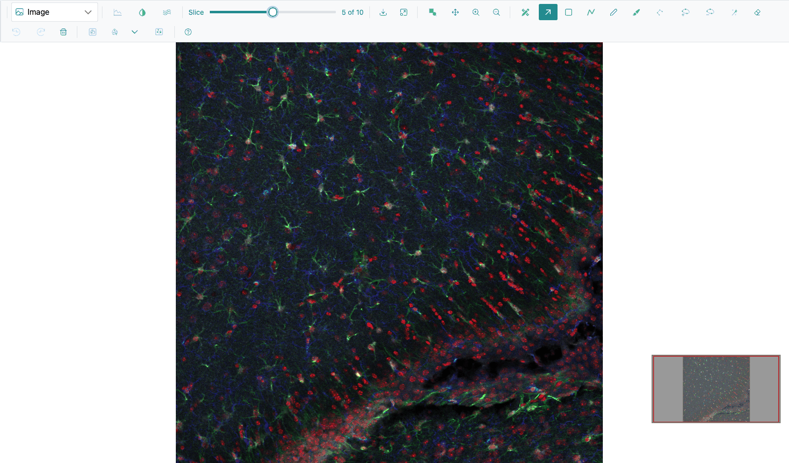
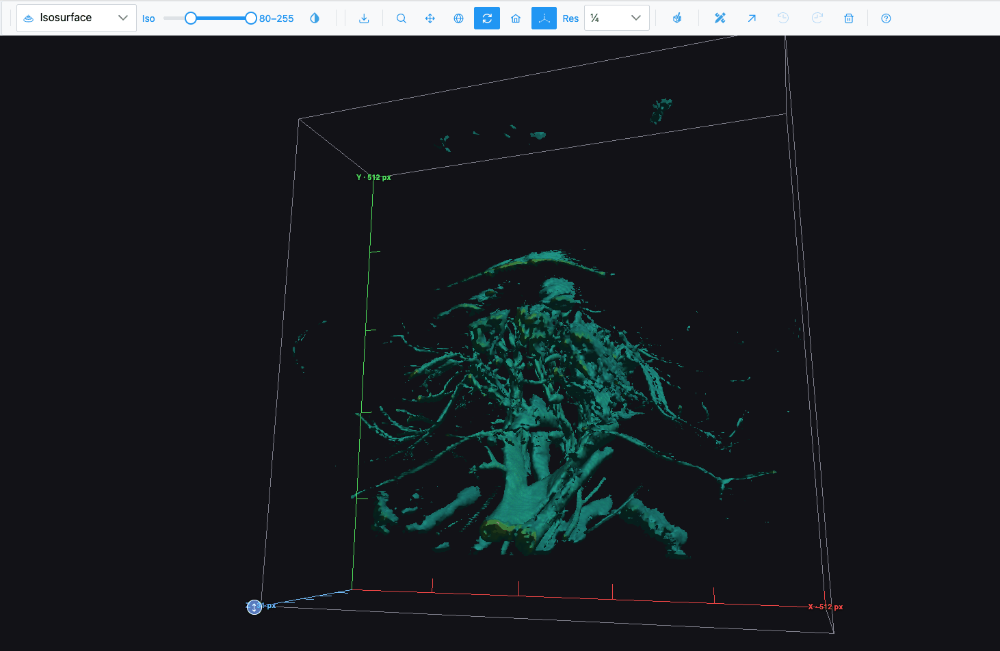
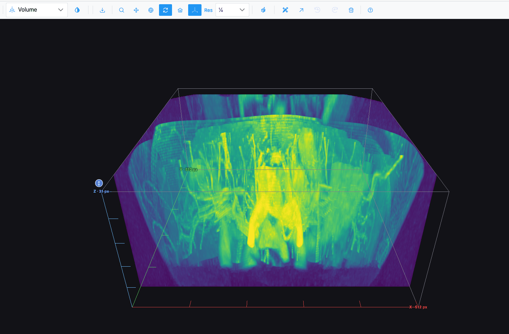
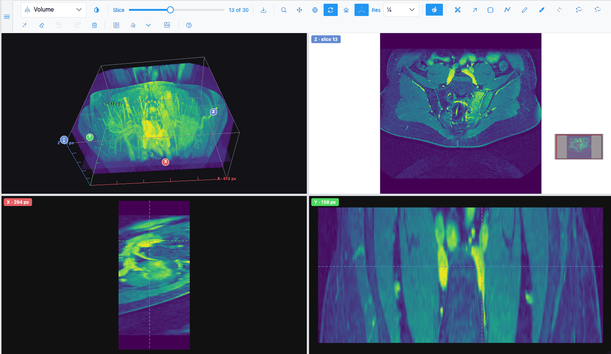
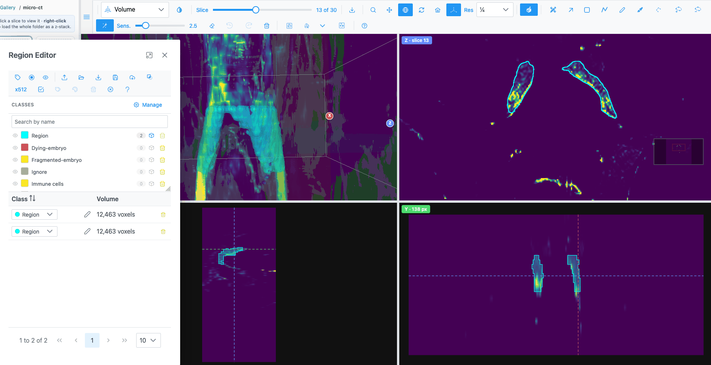

# Stacks and 3D

Recipes for z-stacks, volumes and the 3D plot types. See
[Stacks, volumes and 3D](../reference/stacks-3d.md) for every control.

## Step through the slices of a stack

1. Open a z-stack. In the demo, open the **micro-ct** folder and **right-click** a slice to load the folder
   as a stack, or open the TIFF **GFPA_IBA1_…_zstack_Series002.tif**.
2. Drag the **Slice** slider in the toolbar, or press ++left++ and ++right++ while the pointer is over the
   image.

The readout "*z* of *max*" counts from 0. In the Image view, slices you have visited are kept in memory, so
going back is instant, and zoom and pan are kept from slice to slice.

!!! note
    The arrow keys step slices in the **Image** view and in the slice editor. In other views, click the
    slider first, then use the arrow keys.

## Animate through a stack as a heatmap

1. With a stack open, pick **Heatmap**.
2. Click <i class="pi pi-images"></i> **Stack mode**. Every frame is loaded ("Loading frames...", with a
   **Cancel** button).
3. Use the **Z-plane:** slider under the plot. It numbers slices from 1.

Click <i class="pi pi-image"></i> **Single image mode** to go back. In single-image mode, zooming fetches the
visible area at full resolution.

## See a stack as a 3D volume

1. Open a grayscale or multichannel z-stack.
2. Pick **Volume** in the plot-type dropdown. A badge shows "Building … in 3D…" while it loads.
3. Drag to rotate, scroll to zoom.

The volume is a maximum-intensity projection. A multichannel stack draws one tinted layer per channel, in the
colours set in Channels & Histogram.

## Show surfaces at an intensity

1. With a z-stack open, pick **Isosurface**.
2. Move the **Iso** band slider in the toolbar (0–255, mapped onto the stack's own intensity range). Narrow
   it to isolate bright structures; widen it to see more.

## Get more (or less) detail in 3D

Use the **Res** dropdown in the toolbar: **Full**, **½**, **¼** (default) or **⅛**. Higher resolution shows
more detail but takes longer and uses more graphics memory. Changing it reloads the view; the box's
proportions do not change.

## Stretch or flatten the volume in Z

1. In the **Volume** view, find the round blue ↕ grip at the centre of the box's top face.
2. Drag it up to stretch the volume in Z, down to flatten it (180 pixels of drag doubles or halves the
   height, between 0.1× and 10×).
3. Double-click the grip to reset.

## Control the 3D camera

| Want to | Do |
| --- | --- |
| Rotate | Drag (default mode is **Turntable rotation** <i class="pi pi-sync"></i>) |
| Zoom | Scroll, or choose <i class="pi pi-search"></i> **Zoom** and drag |
| Pan | Choose <i class="pi pi-arrows-alt"></i> **Pan** and drag |
| Start again | <i class="pi pi-home"></i> **Reset camera to default** |
| Hide the axes and scale | { .siv-icon } **Toggle 3D axes / scale** |
| See surfaces as wireframes | <i class="pi pi-share-alt"></i> **Toggle wireframe** |

In the Volume, Isosurface and Surface views, **Orbital rotation** and **Turntable rotation** behave the same.

## Draw regions on a volume with the slice editor

1. In the **Volume** or **Isosurface** view, click { .siv-icon } **Slice
   editor**.
2. The view splits in four: the 3D volume (top left), the current slice with every region tool (top right),
   and the sections through X and Y (bottom).
3. Draw on the slice as in the Image view. Change slice with the **Slice** slider, the arrow keys, or by
   dragging the Z plane in the 3D view.
4. Click a point in an X or Y section to move the slice and the other section there.
5. Drag the dividers to resize the panes (or focus a divider and use the arrow keys).

Click the button again to close the editor. It stays open if you switch to another plot type and back.

## Show a class of regions as a 3D surface

1. Draw or import regions on several slices of a stack.
2. In the **Volume** view, open the Region Editor.
3. Click <i class="pi pi-box"></i> **Show in the volume, in 3D** next to a class. Its outlines from every
   slice are joined into a translucent surface.
4. With **Selection mode**, click a surface to pick its class; ++shift++-click adds another.

The table's **Volume** column shows each class's volume over the whole stack. In the Region Editor toolbar,
<i class="pi pi-eye"></i> lets you see regions through the volume.

## Render a single image as a 3D surface

Pick **Surface** in the plot-type dropdown. The image's intensities become heights. For a stack, the
**Slice** slider chooses which slice is shown as the surface.
