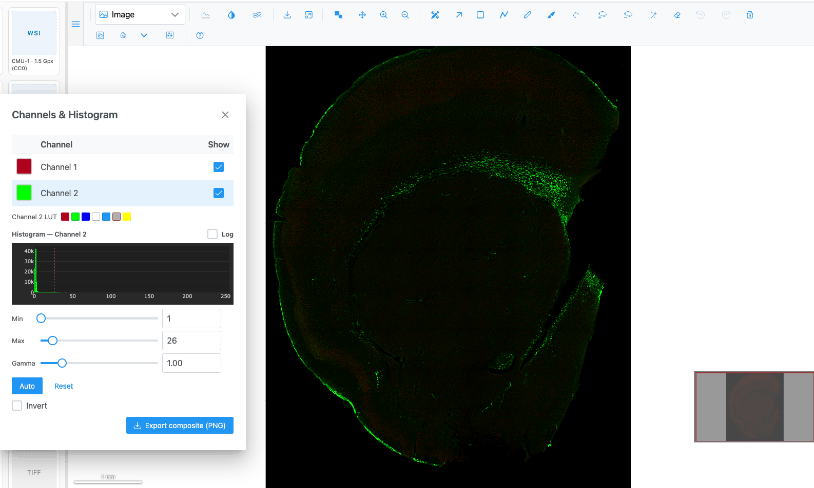
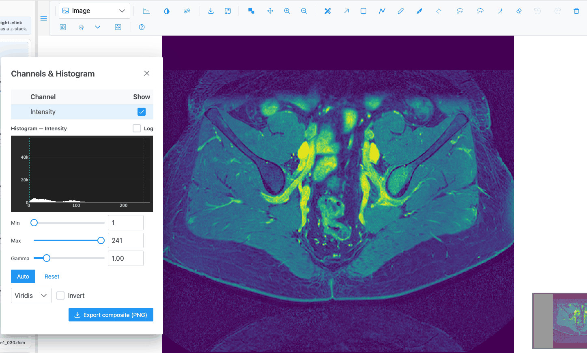
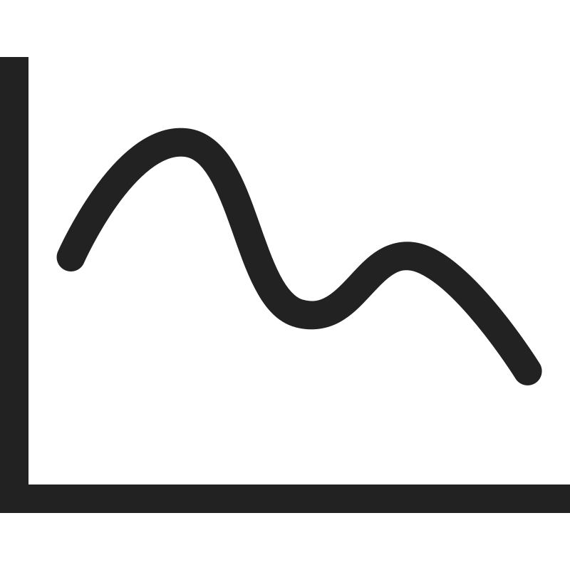
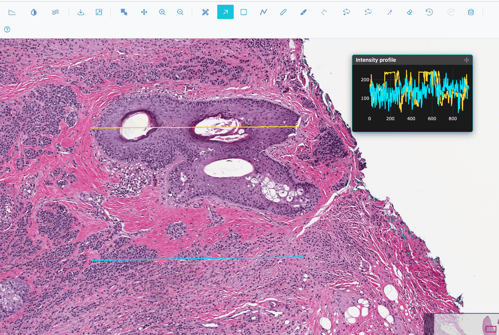
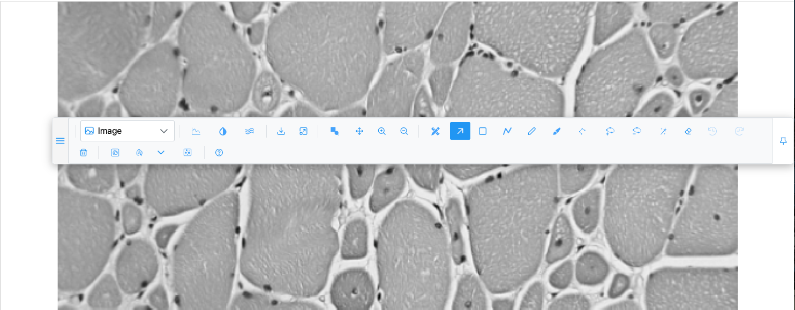

# Viewing and display

Recipes for looking at images: contrast, colour, channels, pixel rendering, exporting what you see and
arranging the toolbar. The controls are described in full in
[Channels & Histogram](../reference/channels-histogram.md) and [Navigation](../reference/navigation.md).

## Adjust brightness and contrast

Make a dim image, or a dim channel, readable.

1. Click { .siv-icon } **Channels & Histogram**.
2. For a multichannel or RGB image, click the row of the channel to adjust. The histogram shows that
   channel.
3. Drag **Max** down until the structures you care about are bright. Drag **Min** up to darken the
   background. You can also type exact values in the boxes next to the sliders.
4. To let SIV choose, click **Auto**: min and max are set so that 0.1% of the pixels saturate at each end.
5. Tick **Log** above the histogram if most pixels pile up in a few bins; it only changes the histogram's
   y axis, not the image.

Min can never exceed max; moving one past the other pushes it along. The image updates live.

!!! tip "16-bit images"
    For images with more than 8 bits per pixel, the histogram and sliders use the image's native values
    (for example 0–4095), not 0–255. **Auto** is computed from the native histogram.

## Brighten mid-tones with gamma

1. In **Channels & Histogram**, select the channel.
2. Move **Gamma** (0.1 to 5, default 1). Values below 1 brighten the mid-tones; values above 1 darken them.

## Undo contrast changes

Click **Reset** in Channels & Histogram. It restores the selected channel's window to 0–255, gamma to 1
and its default colour.

## Show or hide channels

1. In **Channels & Histogram**, untick **Show** for the channels to hide.
2. If the channels are grouped (a chevron and a count next to a group name), the group's checkbox shows or
   hides all its channels at once. It is ticked only when all of them are shown, and its tooltip says how
   many are shown.

!!! note
    A multichannel image opens with only its first 4 channels visible, unless the image says otherwise. Tick
    the others to show them.

!!! warning
    Hiding the only channel of a grayscale image leaves the view blank. Tick **Show** again.

## Change a channel's colour

1. In **Channels & Histogram**, click the colour swatch at the start of the channel's row. (Swatches show
   for RGB and multichannel images.)
2. Pick a colour in the honeycomb, type a hex code such as `#FF00FF`, or use the H, S and L sliders or R, G,
   B fields.

The image recolours when you click a honeycomb cell or release a slider, not while you drag.

For the usual fluorescence colours, click one of the swatches in the **LUT** row under the table: Red,
Green, Blue, Gray, Cyan, Magenta or Yellow.

## Apply a colormap to a grayscale image

1. Open a grayscale image, for example a **micro-ct** slice in the demo.
2. In **Channels & Histogram**, open **Colormap** and pick a scale. They are grouped as Sequential,
   Perceptually Uniform Sequential (Viridis, Magma, Inferno, Cividis…), Diverging, Cyclic, Qualitative and
   Miscellaneous, each with a preview.
3. Tick **Invert** to invert the image.

The default colormap is **Greys Inv**. Colormaps are only offered for single-channel grayscale images; RGB
and multichannel images use per-channel colours instead.

## Inspect raw pixels or smooth the image

The Image view opens showing raw pixels (nearest neighbour): zoomed in, each pixel is a crisp block, so you
can see exact values. To blend them, click { .siv-icon } **Smoothen**. The
icon turns white while smoothing is on. Click again to go back to raw pixels. The setting stays when you
switch images.

## Export what you see as a PNG

=== "The current view"

    Click <i class="pi pi-download"></i> **Download image as PNG**. You get the current view at screen
    resolution, with your colours and contrast. In the Image view, the regions, scale bar and minimap are not
    included.

=== "The whole image, full resolution"

    In **Channels & Histogram**, click **Export composite (PNG)**. In the Image view SIV stitches the image
    at the largest available resolution (up to 32 megapixels), applies your channel colours and contrast,
    and saves `<name>_composite.png`. Tiles that fail to load leave gaps.

In the 3D views, both buttons save a screenshot of the canvas named `napari-js.png`.

## Export the original data as a 16-bit TIFF

1. Open a high-bit-depth image (more than 8 bits per pixel).
2. In **Channels & Histogram**, choose which channels to include with their **Show** checkboxes.
3. Click **Export 16-bit TIFF**. The server builds a multi-band OME-TIFF of the visible channels at their
   native bit depth, saved as `<name>_16bit.ome.tif`.

The button only appears for images over 8 bits. If the image is still being cached on the server, nothing is
saved yet; try again a little later.

## Measure a distance with the scale bar

The scale bar at the bottom left of the Image view shows a round length (1, 2 or 5 × 10ⁿ µm, switching to
mm as you zoom out) and updates as you zoom. It is shown only for images that record their pixel size. For
a profile along a line, use an [intensity profile line](#plot-intensity-along-a-line).

## Plot intensity along a line

1. In the **Image** or **Heatmap** view, click { .siv-icon } **Add an
   intensity line**. A horizontal line appears across the middle of the view, and the **Intensity profile**
   inset opens with its plot.
2. Drag the line's ends onto the structure to measure. The plot updates as you drag.
3. Click the button again to add another line, in a new colour, below the first.
4. To remove a line, click it to select it and press ++delete++ or click <i class="pi pi-trash"></i>.

The x axis is in µm when the image records its pixel size, otherwise in pixels. Values are the displayed
8-bit intensities (luminance for RGB images), not the native 16-bit values. See
[Intensity profile lines](../reference/intensity-profiles.md).

## Get back to the whole image

Click <i class="pi pi-window-maximize"></i> **Fit to view**, or right-click and choose **Autoscale**.

## Jump around a large image

Drag the red rectangle in the minimap at the bottom right, or click elsewhere in the minimap. On a
gigapixel slide it is faster than panning.

## Move the toolbar over the image

1. Drag the <i class="pi pi-bars"></i> handle at the left end of the toolbar onto the image. The toolbar
   floats.
2. Drag it again by the same handle to move it.
3. Click <i class="pi pi-thumbtack"></i> **Dock to top** to put it back.

!!! tip
    The floating toolbar can be dragged partly or fully off-screen. If you lose it, reload the page: the
    toolbar always starts docked.

## View an image as a heatmap, contour or surface

Pick **Heatmap**, **Contour** or **Surface** in the plot-type dropdown. The list only contains what the
image can show: Contour needs a grayscale or multichannel image, and the 3D volume views need a z-stack.
See [Plot types](../reference/plot-types.md).

In the Heatmap view, zooming re-fetches the visible part at screen resolution, so detail sharpens after a
zoom.
