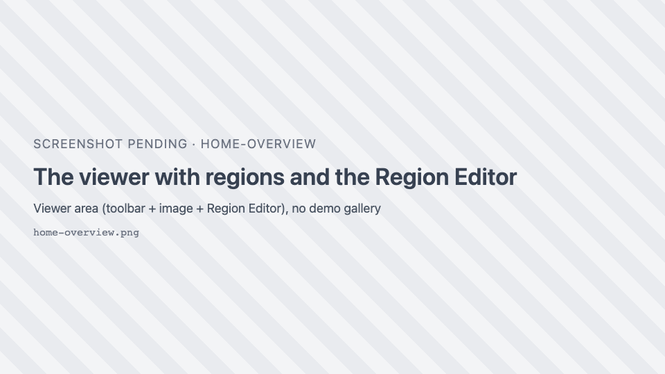

# SIV user guide

**SIV** (sci-image-visualizer) is the image viewer and annotation tool inside JAX Image Tools and other JAX
applications. It runs entirely in the browser and handles everything from a small PNG to a gigapixel
whole-slide image, multichannel fluorescence, z-stacks and micro-CT volumes, and spatial-omics datasets. You
can draw, edit and classify regions on any of them, and segment cells with AI models that run on your own
machine.

## How this guide is organised

-   :material-school: **[Tutorials](tutorials/index.md)**

    ---

    Start here if you are new. Short guided lessons that take you from opening an image to an exported,
    classified set of annotations.

-   :material-hammer-wrench: **[How-to guides](how-to/index.md)**

    ---

    Recipes for a specific task: "make a dim channel visible", "segment every cell in an area", "select
    the cells inside a region".

-   :material-book-open-variant: **[Reference](reference/index.md)**

    ---

    Every button, slider, menu entry and shortcut: what it does, when it is available, and its defaults
    and limits.

-   :material-clipboard-check: **[QA test plan](qa/index.md)**

    ---

    Numbered test cases, one per behaviour, with steps and expected results, for verifying a release.

## What SIV can do

| Area                    | Highlights                                                                                                   | Read more                                                  |
| ----------------------- | ------------------------------------------------------------------------------------------------------------ | ---------------------------------------------------------- |
| Viewing                 | Tiled, deep zoom on gigapixel images; minimap; scale bar in physical units; raw-pixel or smoothed rendering   | [Navigation](reference/navigation.md)                      |
| Plot types              | Image, Heatmap, Contour, Surface, Volume, Isosurface, Spatial omics (2D and 3D)                               | [Plot types](reference/plot-types.md)                      |
| Display                 | Per-channel colour, visibility, min/max, gamma, colormaps, histogram, composite export                       | [Channels & Histogram](reference/channels-histogram.md)    |
| Stacks and volumes      | Slice slider, z-stacks, 3D volume and isosurface rendering, 3D camera                                        | [Stacks, volumes and 3D](reference/stacks-3d.md)           |
| Measuring               | Intensity profile lines; region areas in µm² or mm²                                                          | [Intensity profiles](reference/intensity-profiles.md)      |
| Drawing regions         | Rectangle, polyline, freeform, polygon, brush, magic wand, vertex tools, undo/redo                           | [Region tools](reference/region-tools.md)                  |
| Editing regions         | Merge, ungroup, inverse, simplify, Bézier conversion, holes (donuts)                                         | [Region actions](reference/region-actions.md)              |
| Organising annotations  | Region Editor table, annotation classes with colour presets, bulk relabelling                                | [Region Editor](reference/region-editor.md)                |
| Exchanging annotations  | GeoJSON import and export (QuPath-compatible)                                                                | [GeoJSON](reference/geojson.md)                            |
| AI segmentation         | Segment Anything (box and point prompts) and Cellpose, in the browser                                        | [AI segmentation](reference/segmentation.md)               |
| Spatial omics           | Cells or spots over the tissue, coloured by cluster or gene; select from regions; distribution charts       | [Spatial omics](reference/spatial-omics.md)                |

## Getting help in the app

The <i class="pi pi-question-circle"></i> **Help** button at the end of the toolbar opens the
[toolbar reference](reference/toolbar.md) of this guide in a new tab, and the Region Editor's
<i class="pi pi-question"></i> button opens the [Region Editor reference](reference/region-editor.md).
Most buttons also show a tooltip when you hover over them.

!!! tip "Try it without installing anything"
    The [live demo](https://thejacksonlaboratory.github.io/sci-image-visualizer/) runs SIV with a gallery of
    sample images, whole-slide images and spatial-omics datasets. Every tutorial and QA case in this guide
    can be followed there.

## Conventions

- **Bold** text is a label you see on screen: a button tooltip, a menu entry, a dialog title.
- Keys look like ++ctrl+z++. On macOS, read ++ctrl++ as ++cmd++ unless the text says otherwise.
- Icons are shown as they appear in the toolbar, for example { .siv-icon } for the Wand.
- "Image view" means the **Image** plot type, the default 2D view of an image.
