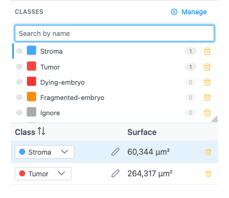
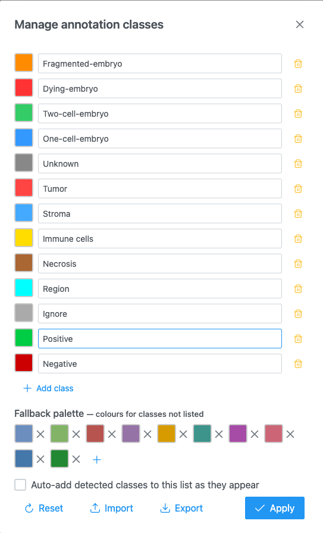

# Annotation classes

A **class** is the name a region carries: "Tumor", "Stroma", "Nucleus". Each class has a colour, so a given
annotation type looks the same on every image and in every session.

## How a region gets its colour

1. If you set a colour on that region yourself (**Region colour** dialog), that colour is kept.
2. Otherwise, if its class is in your **class list**, the class colour is used. This overrides the colour
   stored in a GeoJSON file, so imported annotations follow your colours.
3. Otherwise, if the imported file defines a colour for the class, that colour is used for the session.
4. Otherwise the class gets a stable colour from the **fallback palette**, chosen from its name (the same
   name always gets the same colour).

Changing a class colour recolours every region of that class at once.

New regions drawn with the tools get the class **Region**. Regions from AI segmentation get **sam** (SAM)
or **cell** (Cellpose), and are coloured like any other class.

## The Classes panel

{ width="420" }

The **Classes** panel in the [Region Editor](region-editor.md) lists the classes, most used first.

| Element | What it does |
| --- | --- |
| **Search by name** | Filters the list; ++enter++ picks the first match. |
| Eye <i class="pi pi-eye"></i> | **Hide this class** / **Show this class** on the image. |
| Colour swatch | Changes the class colour; every region of the class follows. |
| Name | With rows selected: click to apply the class to them ("Apply "X" to the selected region(s)"). |
| Count | Number of regions in the class (in volume views, over the whole stack). |
| Trash | **Remove class**. Its regions revert to **Region**. The default class cannot be removed while in use. |
| <i class="pi pi-cog"></i> **Manage** | Opens **Manage annotation classes**. |

!!! note
    The tooltip on a class name says "Set "X" active — new regions use it". In this version, newly drawn
    regions still get the class **Region**: classify them after drawing (select, then click the class).

While the Region Editor is open, any class found on the image's regions that is not in your list is added to
it automatically.

## Manage annotation classes

{ width="460" }

<i class="pi pi-cog"></i> **Manage** opens a dialog to edit the class list:

| Section | What it does |
| --- | --- |
| Class rows | A colour swatch, the **Class name** (type it exactly as it appears in your data) and <i class="pi pi-trash"></i> **Remove class**. |
| **Add class** | Adds a row (grey). |
| **Fallback palette** | Colours given to classes not in the list. Remove one with ×, add one with +. |
| **Auto-add detected classes to this list as they appear** | Adds unknown classes found in loaded files to the list (off by default). |
| **Label matching** | **Exact** (default) or **Normalized**: ignores case and surrounding spaces, so `tumor` matches `Tumor`. |
| **Reset** <i class="pi pi-refresh"></i> | Restores the default classes and palette. Applies at once. |
| **Import** <i class="pi pi-upload"></i> | Loads a class list from a JSON file. Applies at once. |
| **Export** <i class="pi pi-download"></i> | Saves the list as `annotation-classes.json`, to share with colleagues. |
| **Apply** <i class="pi pi-check"></i> | Saves your edits. Blank and duplicate names are dropped, and the regions of removed classes revert to **Region**. |

Closing the dialog with × discards edits (but not a Reset or Import already done).

### Default classes

| Class | Colour | Class | Colour |
| --- | --- | --- | --- |
| Fragmented-embryo | `#FF8C00` | Tumor | `#FF4444` |
| Dying-embryo | `#FF3333` | Stroma | `#44AAFF` |
| Two-cell-embryo | `#33CC66` | Immune cells | `#FFDD00` |
| One-cell-embryo | `#3399FF` | Necrosis | `#AA6633` |
| Unknown | `#888888` | Region | `#00FFFF` |
| Positive | `#00CC44` | Ignore | `#AAAAAA` |
| Negative | `#CC0000` | | |

Default fallback palette: `#6C8EBF`, `#82B366`, `#B85450`, `#9673A6`, `#D79B00`, `#3C948B`, `#A64CA6`,
`#CC6677`, `#4477AA`, `#228833`.

### Where the class list is kept

When the host application stores preferences (JAX Image Tools does), the class list is saved **per user on
the server** and follows you across images and sessions. Otherwise it lasts for the session only. Use
**Export** / **Import** to move it between users or deployments.

### Class list file

```json
{
  "classes": [
    { "name": "Tumor", "color": "#FF4444" },
    { "name": "Stroma", "color": "#44AAFF" }
  ],
  "fallbackPalette": ["#6C8EBF", "#82B366"],
  "autoPromote": false,
  "matchMode": "exact"
}
```
