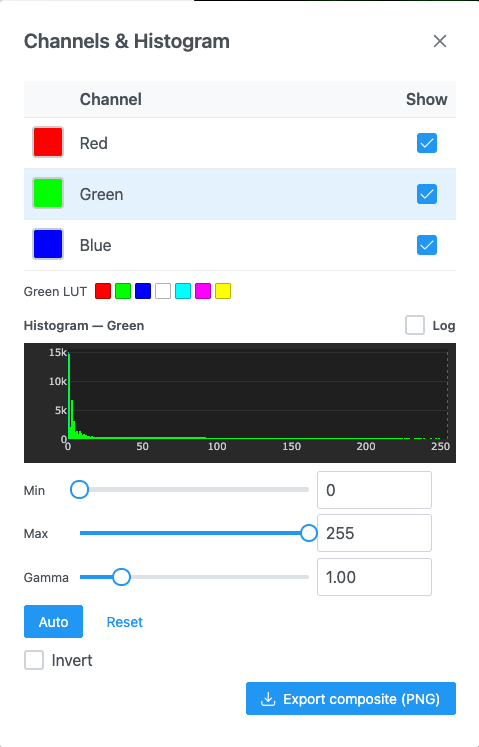
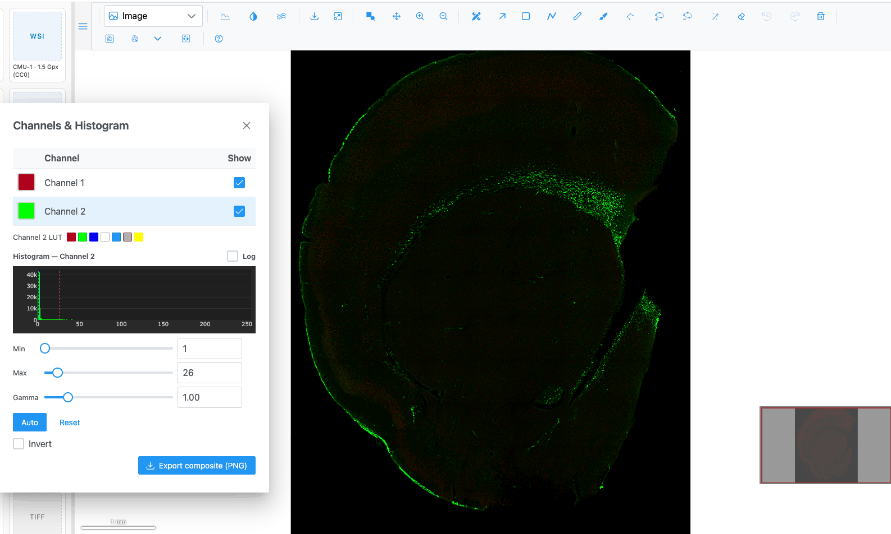
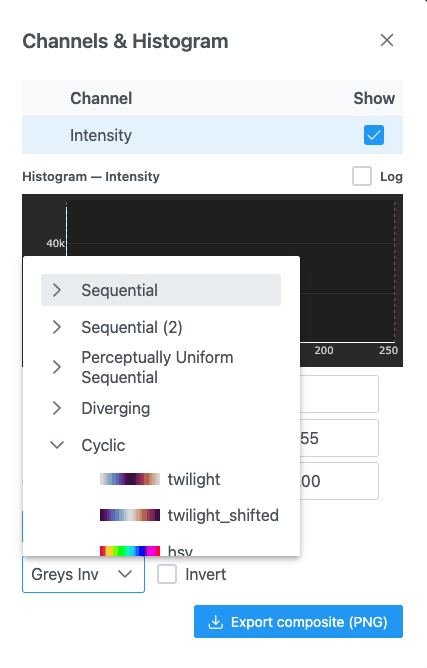
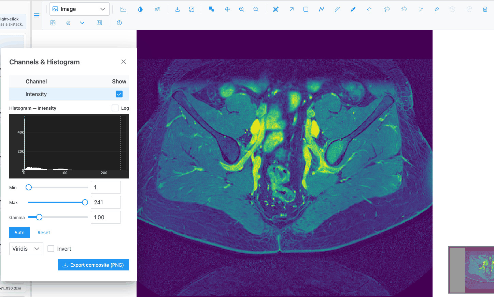

# Channels & Histogram

The **Channels & Histogram** dialog controls how pixel values become colours: which channels are shown, in
what colour, with what brightness, contrast and gamma, and which colormap a grayscale image uses. Open it
with the { .siv-icon } button. It is available in every plot type.

{ width="460" }

The dialog floats over the image: you can drag it, resize it and keep it open while you work. Every change
applies live to the view (colour pickers apply when you release them).

## Channel table

| Column | What it does |
| --- | --- |
| Colour swatch | The channel's colour. Click it to open the colour picker. Shown for RGB and multichannel images. |
| **Channel** | The channel name. Click the row to select the channel: the histogram and sliders below then apply to it. |
| **Show** | Shows or hides the channel. |

Default channels:

| Image | Channels |
| --- | --- |
| Grayscale | One channel, **Intensity** |
| RGB | **Red**, **Green**, **Blue** |
| Multichannel (fluorescence) | The names and colours the image carries, or "Channel 1", "Channel 2"… with red, green, blue, white, cyan, magenta, yellow. **Only the first 4 channels are shown at first.** Tick the others to show them. |

When the image groups its channels (for example by acquisition round), the table shows a folding row per
group. The group checkbox is ticked only when every channel in it is shown (its tooltip says "*n* of *m*
shown"). Clicking it shows or hides the whole group.

!!! warning
    On a grayscale image, unticking **Intensity** hides the only channel, and the image goes blank. Tick it
    again to bring it back.

### Colour picker

Click a swatch to open the picker: a honeycomb palette, a hex field (`#RRGGBB`), the system colour picker,
hue/saturation/lightness sliders and red/green/blue fields (0–255). A palette click applies and closes the
picker; the sliders apply when released. Click outside to close it.

### LUT presets

For RGB and multichannel images, the **<channel> LUT** row offers seven one-click colours for the selected
channel: Red, Green, Blue, Gray, Cyan, Magenta and Yellow (the Fiji palette).

## Histogram

**Histogram — <channel>** shows the distribution of the selected channel's values in 256 bins, drawn in the
channel's colour. Dotted markers show the current **Min** (cyan) and **Max** (red). Tick **Log** for a
logarithmic count axis, which makes small populations visible.

For 8-bit images the histogram is sampled from the displayed tiles. For images deeper than 8 bits (16-bit
microscopy), it comes from the server, and the axis and sliders use the image's own values over its
observed range.

## Brightness, contrast and gamma

| Control | Range | Default | What it does |
| --- | --- | --- | --- |
| **Min** | 0–255 (8-bit) or the native range | 0 | Values at or below Min are drawn black (or transparent for a channel). |
| **Max** | 0–255 (8-bit) or the native range | 255 | Values at or above Max are drawn at full colour. |
| **Gamma** | 0.1–5 (step 0.01) | 1.00 | Below 1 brightens dim values; above 1 darkens them. |
| **Auto** | — | — | Sets Min and Max to saturate 0.1% of pixels at each end. |
| **Reset** | — | — | Restores Min 0, Max 255, gamma 1 and the channel's default colour. |

Min can never pass Max: dragging one pushes the other. A small spinner shows next to a control while the
view updates. Settings apply per channel.

## Colormap and Invert

{ width="460" }

**Colormap** (grayscale images only) maps intensities to a colour scale. The default is **Greys Inv**. The
list is grouped, with a preview of each colormap:

| Group | Colormaps |
| --- | --- |
| Sequential | Greys, Purples, Blues, Greens, Oranges, Reds, YlOrBr, YlOrRd, OrRd, PuRd, RdPu, BuPu, GnBu, YlGnBu, PuBuGn, BuGn, YlGn, Greys Inv, Greens Inv, YlOrRd Inv, YlGnBu Inv |
| Sequential (2) | binary, gist_yarg, gist_gray, gray, bone, pink, spring, summer, autumn, winter, cool, Wistia, hot, afmhot, gist_heat, copper, Bluered |
| Perceptually Uniform Sequential | Viridis, Magma, Inferno, Cividis, Electric, Plasma |
| Diverging | PiYG, PRGn, BrBG, PuOr, RdGy, RdBu, RdYlBu, RdYlGn, Spectral, coolwarm, bwr, seismic, berlin, managua, vanimo, Picnic, Portland |
| Cyclic | twilight, twilight_shifted, hsv |
| Qualitative | Pastel1, Pastel2, Accent, Dark2, Set1, Set2, Set3, tab10, tab20, tab20b, tab20c |
| Miscellaneous | flag, prism, ocean, gist_earth, terrain, gist_stern, gnuplot, gnuplot2, CMRmap, cubehelix, brg, gist_rainbow, rainbow, jet, turbo, nipy_spectral, gist_ncar, Blackbody |

**Invert** (all images) inverts the displayed intensities. To reverse a colormap, pick its "Inv" variant
where one exists.

## Export

| Button | Shown | What it saves |
| --- | --- | --- |
| **Export composite (PNG)** | Always | Image view: the whole image with the current channels, colours and contrast, at full resolution up to 32 megapixels (larger images are saved at the largest level that fits), as `<image>_composite.png`. Heatmap: the plot as a PNG. 3D views: a canvas screenshot (`napari-js.png`). |
| **Export 16-bit TIFF** | The selected channel is deeper than 8 bits | A multi-band TIFF of the visible channels at their native bit depth, built by the server, as `<image>_16bit.ome.tif`. Nothing is saved while the server is still caching the image. |

## What is kept

- Display settings stay while you re-plot the same image (for example switching plot type). Opening a
  different image starts from that image's defaults.
- Nothing in this dialog is saved across a page reload.
