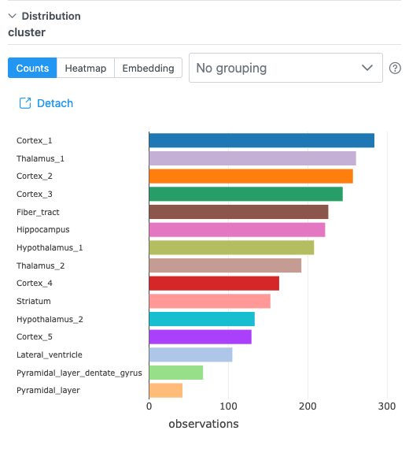
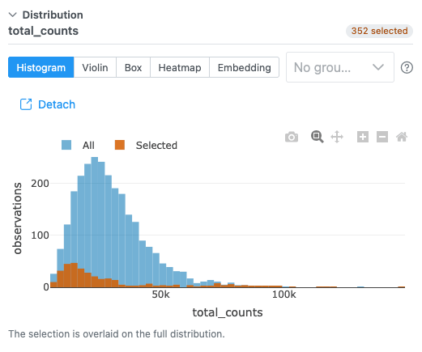
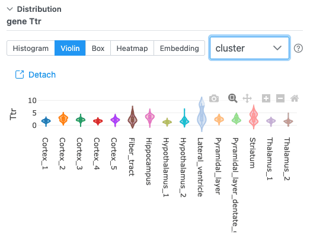
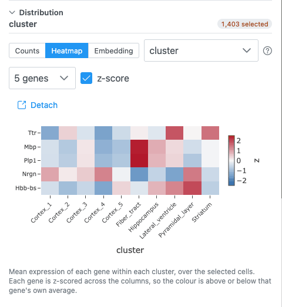
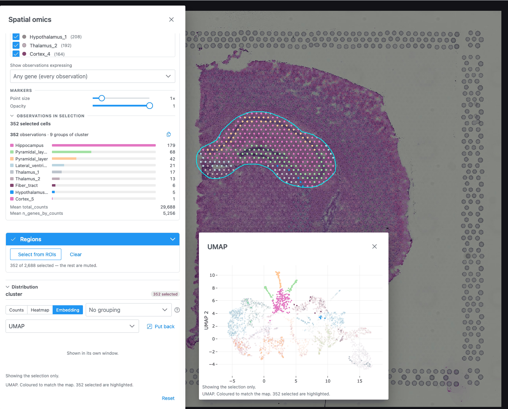

# Distribution charts

The **Distribution** section of the [Spatial omics panel](spatial-omics.md) charts whatever the map is
coloured by, so the chart and the map always agree. When observations are selected, the charts show or
highlight the selection.

The header names what is charted ("gene Ttr", or the column name), with a "*n* selected" badge while there is
a selection. Each chart type answers a different question. The <i class="pi pi-question-circle"></i> beside
the tabs explains the one on screen, including what it must *not* be read for.

| Chart | Offered when the map is coloured by | Shows |
| --- | --- | --- |
| **Counts** | a group (categorical column) | How many observations in each category |
| **Histogram** | a gene or measurement | How the value is distributed |
| **Violin** | a gene or measurement | The value's distribution per group, as a smoothed density |
| **Box** | a gene or measurement | Median, quartiles and range per group |
| **Heatmap** | always | Mean expression of picked genes per group |
| **Embedding** | the dataset publishes an embedding (UMAP, PCA, t-SNE) | The cells in the embedding space |

The chart switches to **Counts** when you colour by a group, and to **Histogram** when you colour by a
value (unless Heatmap or Embedding is showing). With no colouring, the panel asks you to colour the map by a
column or a gene first.

**Grouping** (Violin, Box, Heatmap): pick a categorical column to split by. "No grouping" draws one trace.

## Counts

{ width="460" }

Horizontal bars, largest at the top. The 25 largest categories are shown; the rest are folded into
"other (*N* categories)" in grey. With a selection, the full counts (**All**) are drawn faint, with the
**Selected** counts over them. A category is a label, not a magnitude, so counts are the only distribution
it has.

## Histogram

{ width="460" }

The number of bins is the square root of the number of observations, between 10 and 100. The x axis is the
value, or `log1p(value)` when **Log scale** is on. With a selection, the **Selected** histogram is overlaid
on the full one (**All**), not replacing it.

## Violin and Box

{ width="460" }

One violin or box per group, in the map's colours (empty groups are dropped). Violins show an inner box and
the mean. With a selection, only the selected observations are charted ("Showing the selection only.").
Each trace is thinned to 20,000 points for speed.

- **Violin** shows the shape: two groups with the same median can have one peak or two.
- **Box** shows median, quartiles and range, but hides whether a group is bimodal.

## Heatmap

{ width="460" }

Mean expression of each picked gene (rows) within each group (columns).

| Control | Default | What it does |
| --- | --- | --- |
| **Pick genes for the rows** | the gene the map is coloured by | One row per gene. No limit on the number of genes. |
| Grouping | the first categorical column | The column the heatmap's columns come from. |
| **z-score** | on | Scales each gene across the groups, so a colour means "above or below this gene's own average". Off: raw means, so one highly expressed gene can saturate the scale. |

- Up to **40** group columns are shown (the strongest); the note says when some were left out.
- With a selection of up to **200** cells, each selected cell gets its own column.
- A group needs at least 3 measured cells to get a mean.
- Colours: blue–white–red around 0 when z-scored; white to dark blue for raw means. Missing values are gaps.

### All genes

When the dataset and the server support it, a **Picked genes / All genes** switch appears. **All genes** draws
every gene against every cell as a zoomable image:

| Control | Choices | Default |
| --- | --- | --- |
| View | **Cells** (a column per cell, sorted by group) / **Groups** (each gene's mean per group) | Cells |
| Scale (Cells) | **Expression** / **Per gene (0–1)** | Expression |
| Scale (Groups) | **z-score per gene** / **Mean expression** / **Per gene (0–1)** | z-score per gene |
| **Detected genes only** | Leave out genes never detected | on |
| **Find a gene** | Exact, then prefix, then substring match | — |
| **Reset zoom** | — | — |

Scroll to zoom (++shift++: genes only, ++alt++: cells only), drag to pan, double-click to reset. Click a gene
to colour the map by it. Zoomed out, a pixel is the mean of a block of cells and genes; zoom in for single
cells and gene names. The first time for a grouping takes one pass over the expression matrix.

## Embedding

The cells in an embedding space (UMAP, PCA or t-SNE), coloured like the map when it is coloured by a group.
Choose the embedding in the dropdown when the dataset has several. 3D embeddings can be rotated.

- **Lasso or box-select points to select them on the map**: both views read the same selection. An empty
  lasso clears it. Unselected points are dimmed.
- Only **PCA** labels its axes with a percentage, because only its axes explain a measurable share of the
  variance. UMAP and t-SNE axes are arbitrary: do not read the distance between distant clusters, or the
  direction of an axis.
- A legend is drawn for up to 10 categories.

### Computing t-SNE in the browser

For a dataset with a PCA, no t-SNE and at most **5,000** observations, the dropdown offers **t-SNE (compute)**
and **t-SNE 3D (compute)**. Click **Compute** (the button shows the estimated time) to run it in the
background on your GPU; the panel stays usable and **Cancel** stops it. The result is not saved: a reload
computes it again. Larger datasets say t-SNE is not offered, because it would take too long in the browser.

## Detach

**Detach** <i class="pi pi-external-link"></i> moves the chart into its own window, so it can sit beside the
map. The panel then says "Shown in its own window." The window can be moved and resized; switching chart
type keeps it where it is. **Put back** <i class="pi pi-window-minimize"></i>, or closing the window, returns
the chart to the panel.

