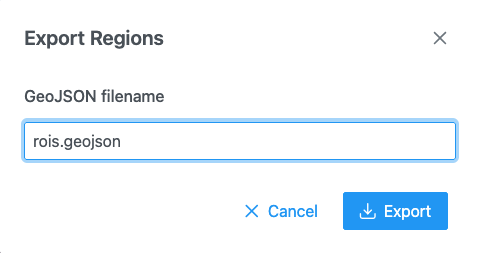
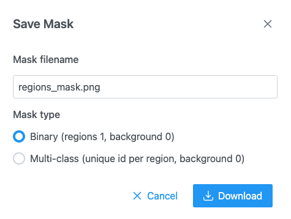

# GeoJSON import and export

Regions are exchanged as **GeoJSON**, in the same shape QuPath uses, so annotations move between SIV,
QuPath and analysis scripts. You can also export regions as a **mask** image.

## Export

{ width="420" }

In the [Region Editor](region-editor.md), click <i class="pi pi-download"></i> **Download regions as geojson
file**. The **Export Regions** dialog proposes `<image name>.geojson` (or `rois.geojson`). Click **Export**.

- The file holds every region of the current image, plus the remaining features of a large region set.
- For a stack opened from a single file, every slice's regions are saved in one file, each with its slice
  number. For a stack opened from a folder of files, one GeoJSON is saved per slice file.
- Intensity profile lines are never exported.

### Save to server

When the host application stores files, <i class="pi pi-save"></i> **Save regions to server** opens **Save
Regions As** with a **GeoJSON filename** (default `<image name>.geojson`). If the file exists, the dialog
warns "This file already exists and will be overwritten." and asks for confirmation. **Saving regions…**
shows progress, with **Cancel**.

## File format

```json
{
  "type": "FeatureCollection",
  "features": [
    {
      "type": "Feature",
      "id": "a1",
      "geometry": { "type": "Polygon", "coordinates": [[[10, 10], [200, 10], [200, 150], [10, 150], [10, 10]]] },
      "properties": { "classification": { "name": "Tumor", "color": [255, 68, 68] } }
    }
  ]
}
```

| Region | GeoJSON geometry |
| --- | --- |
| Rectangle | `Polygon` with a 5-point ring (read back as a rectangle) |
| Polygon, freeform, brush, wand | `Polygon`; extra rings are holes |
| Multi-part region | `MultiPolygon` |
| Polyline | `LineString` |
| Bézier region | `Polygon` of the flattened curve, with the curve's anchors and handles in `properties` so SIV can restore it |

- `properties.classification` holds the class `name` and its `color` as `[r, g, b]`.
- A region on slice *z* of a stack carries `geometry.plane = {"c": -1, "z": z, "t": 0}` (QuPath's schema).
  Slice 0 has no `plane`.
- A feature's `id` and any other `properties` from an imported file are kept on export.
- Coordinates are image pixels.

## Import

Click <i class="pi pi-upload"></i> **Import regions** in the Region Editor and choose a file.

!!! warning "Importing replaces"
    Importing a GeoJSON file **replaces** the regions of the current image. Export them first if you want
    to keep them.

| Input | How to import | What you get |
| --- | --- | --- |
| GeoJSON (`.geojson`, `.json`) | <i class="pi pi-upload"></i> | The file's regions. A file with slice numbers (`plane.z`) is split across the stack's slices. |
| Large GeoJSON (1,000,000 characters or more) | <i class="pi pi-upload"></i> | A **region set**, drawn at a level of detail that suits the zoom. See [Limits](limits.md#regions). |
| Folder of per-slice GeoJSON files | <i class="pi pi-folder-open"></i> | One file per slice, in natural name order (`slice_2` before `slice_10`). A `regionset.json` in the folder supplies the class tree and style. |
| Label volume (`.nii`, `.nii.gz`, `.nrrd`) + ontology JSON | <i class="pi pi-upload"></i> (choose both files) | One class per label. Class names come from a `regionset.json`, an Allen structure graph (acronyms), or are "label *n*". |
| OME-Zarr store (its `labels/`) | <i class="pi pi-folder-open"></i> | The first label image, as a label volume. |
| `.zip` of any of these | <i class="pi pi-folder-open"></i> (zip inside the folder) or from the server | Its contents. |
| From the server | <i class="pi pi-cloud-download"></i> | A GeoJSON file, a folder of per-slice files or a label volume picked on the server. |

Reading rules:

- `classification` may be a string or `{ "name", "color" }`. A feature with **no classification** gets the
  class **Cell**.
- A single axis-aligned rectangle ring is read back as a rectangle.
- Class colours follow your [class list](annotation-classes.md) when the class is in it; otherwise the file's
  own colour is kept for the session.
- A file may carry a `classHierarchy` (`name`, `title`, `parent`, `color`, `order`) for a class tree, and a
  `style` (`fillOpacity`, `stroke`, `strokeWidth`, `labels`, `highlight`).
- Supported geometries: `Polygon`, `MultiPolygon`, `LineString`. Points are not supported.

Errors you may see: "Invalid GeoJson file: must contain the 'features' key.", "Invalid GeoJson file: must
contain the 'coordinates' key.", "Error parsing json string: …", "Different size" (a label volume that
does not match the image), and "Import discarded" (you changed image while the file was read).

## Masks

{ width="420" }

{ .siv-icon } **Download mask of the regions as
PNG** saves a mask image the size of the image, for training or analysis. Default name
`<image name>_mask.png`.

| Mask type | Pixel values |
| --- | --- |
| **Binary (regions 1, background 0)** | Regions are 255 (white), background 0. |
| **Multi-class (unique id per region, background 0)** | Each region has its own id (1, 2, 3…). 8-bit up to 255 regions, 16-bit above. |

- Later regions paint over earlier ones where they overlap.
- The mask covers the regions of the current slice (not the features of a large region set).
- Images larger than 100 megapixels are saved downscaled, with the message "Mask downscaled".
- **Rasterizing regions…** and **Encoding PNG…** show progress; **Cancel** stops.
