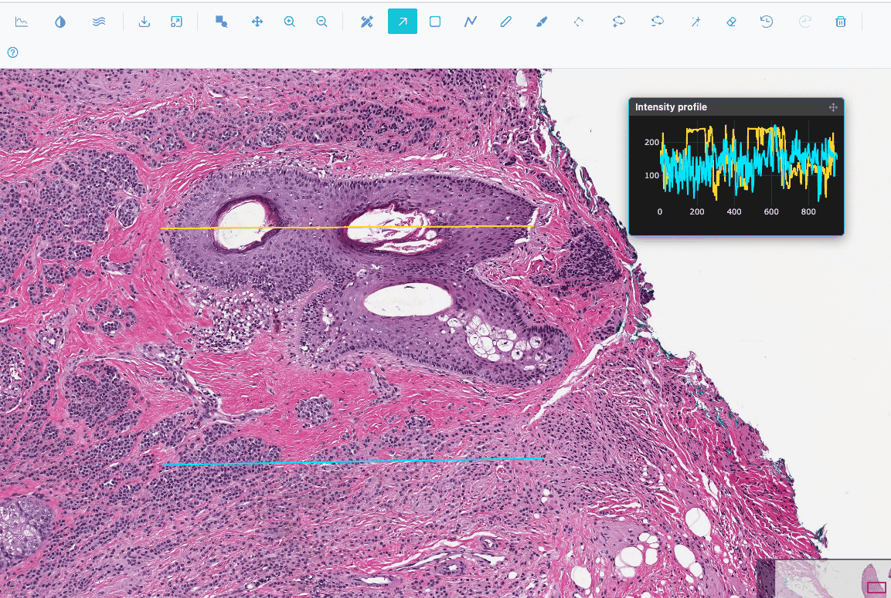
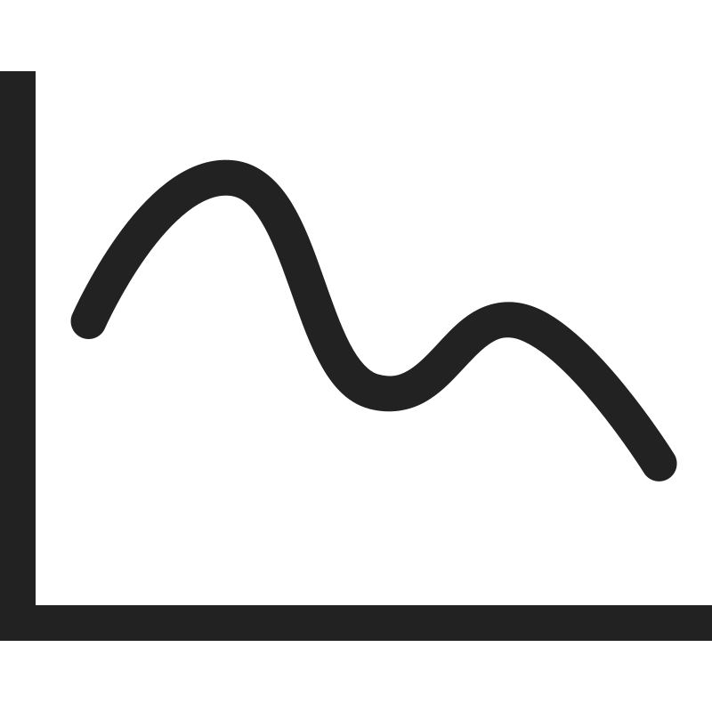

# Intensity profile lines

An intensity profile plots pixel intensity along a line, for example across a membrane or a nucleus.

!!! warning "Work in progress"
    Intensity profiles are not yet stable. Values are display values (8-bit, after contrast), not the
    image's native 16-bit data.

## Adding lines

Click { .siv-icon } **Add an intensity line** (Image and Heatmap views).

- Each click adds a horizontal line across the middle two-thirds of the visible image. Each new line is
  placed a little lower than the previous one.
- Each line gets its own colour, cycling through yellow, cyan, pink, green, orange, purple, red and aqua.
- In the Image view the new line is selected, so you can drag its endpoints straight away.

## The Intensity profile inset

A floating **Intensity profile** panel opens at the top right of the view. Drag it by its header
<i class="pi pi-arrows-alt"></i> to move it.

- One trace per line, named "Line 1", "Line 2"…, in the line's colour.
- X axis: **Position (µm)** when the image has a physical pixel size, otherwise **Position (px)**. Y axis:
  **Intensity**.
- The traces update live while you drag a line. In the Image view they are re-sampled at the current zoom
  each time the view settles.
- RGB images are sampled as luminance.

## Removing lines

Select a line and press ++del++ or click **Delete selected region** <i class="pi pi-trash"></i>. The inset
closes when no line is left.

Profile lines are not regions: they are not listed in the Region Editor and are never exported.
