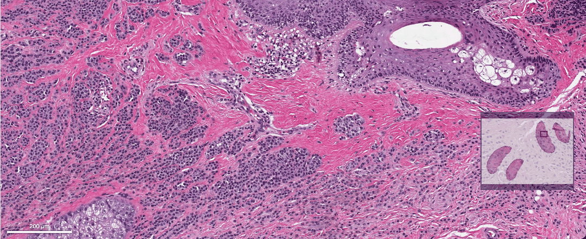
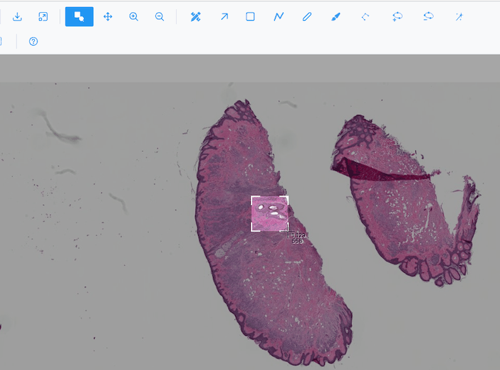
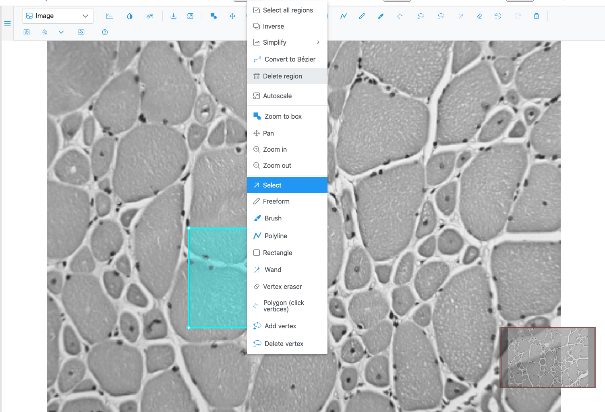

# Navigation

How to move around an image: zooming, panning, the minimap, the scale bar, the right-click menu, and
saving what you see.

## Image view

The Image view loads only the tiles needed for the current zoom, so even gigapixel whole-slide images
open quickly.

| Action | How |
| --- | --- |
| Pan | Drag the image (no tool active, or **Pan** ++p++). |
| Zoom with the mouse | Scroll the wheel or trackpad. Zoom follows the pointer. |
| Click to zoom | Click the image to zoom in toward the clicked point. Disabled while a region tool is active, and in the Spatial omics views. |
| Zoom one step | **Zoom in** / **Zoom out** buttons, or ++plus++ / ++minus++ (×1.3 about the centre). |
| Zoom to an area | **Zoom box** ++b++, then drag a box. |
| See the whole image | **Fit to view** <i class="pi pi-window-maximize"></i>. |

Limits: you can zoom out until the image is about 1% of the view, and zoom in until one image pixel covers
20 screen pixels.

When the image loads, a low-resolution preview may show first, with **Sharpening preview...** until the
full-resolution tiles arrive. Moving between slices of a stack keeps your zoom and position.

### Zoom box

Press ++b++ (or click **Zoom box**) and drag a rectangle: the area outside it is dimmed. Release to zoom to
the box. A drag shorter than 5 pixels is ignored. The tool stays active, so you can zoom again; press ++b++
or pick another tool to stop.

### Minimap

The minimap at the bottom right shows the whole image, with a red rectangle for the area in view. It
resizes with the viewer. The host application can hide it.

### Scale bar

The scale bar at the bottom left shows a round length (1, 2 or 5 × a power of ten) in µm, switching to mm
as you zoom out. It updates as you zoom. It appears only when the image carries its physical pixel size;
images without one have no scale bar, and region areas are given in px².

### Pixels or smooth

By default the Image view shows **raw pixels**: zoomed in, each pixel is a crisp block, so you can inspect
values. Turn on **Smoothen** { .siv-icon } for bilinear smoothing. The setting
stays while you switch images.

## Heatmap and Contour views

| Action | How |
| --- | --- |
| Zoom to an area | **Zoom drag** <i class="pi pi-search"></i> or **Zoom box** ++b++, then drag. |
| Zoom one step | Buttons, ++plus++ / ++minus++, or the mouse wheel (one step per wheel notch, about the centre). |
| Pan | **Pan** ++p++, then drag. |
| See the whole image | **Fit to view**, or **Autoscale** in the right-click menu. |

After each zoom, in single-image mode, the visible area is re-fetched at screen resolution (high-definition
zoom). A brief **Caching image...** message may show the first time.

!!! warning "Trackpads"
    In the Heatmap and Contour views each wheel event is a full zoom step, so a trackpad scroll can zoom
    very fast. Use the zoom buttons or the zoom box for fine control.

## Right-click menu

{ width="360" }

Right-click the image to open a menu with:

1. **Region actions** for the selected regions (when the image has regions): Select all regions, Merge /
   group, Ungroup, Inverse, Simplify, Convert to Bézier / polygon, Delete region. See
   [Region actions](region-actions.md).
2. **View**: Autoscale, Zoom selection (not in the Image view), Zoom to box, Pan, Zoom in, Zoom out.
3. **Tools**: Select, Freeform, Brush, Polyline, Rectangle, Wand, Vertex eraser, and in the Image view
   Polygon (click vertices), Add vertex, Delete vertex. The active tool is highlighted.

In 3D views the menu lists the camera modes (Zoom, Pan, Orbital rotation, Turntable rotation) and Reset
camera.

## Download

**Download image as PNG** <i class="pi pi-download"></i> saves the view:

| View | What is saved | File name |
| --- | --- | --- |
| Image | The image as shown (zoom, colours, contrast), **without** regions, minimap or scale bar | `<image name>.png` |
| Heatmap, Contour | Plotly's rendering of the plot | `<image name>.png` |
| 3D views and Spatial omics | A screenshot of the canvas | `napari-js.png` |

To export the full image with the display settings applied, use **Export composite (PNG)** in
[Channels & Histogram](channels-histogram.md#export). To export the regions, see
[GeoJSON import and export](geojson.md).

## Keyboard focus

Shortcuts go to the viewer under the keyboard focus, or else the one the pointer last moved over. They are
ignored while you type in a text field. See [Keyboard shortcuts](keyboard-shortcuts.md).
