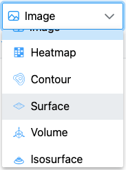
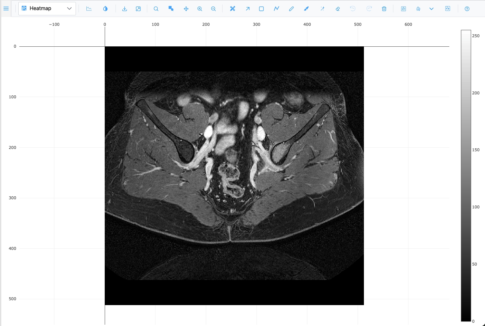
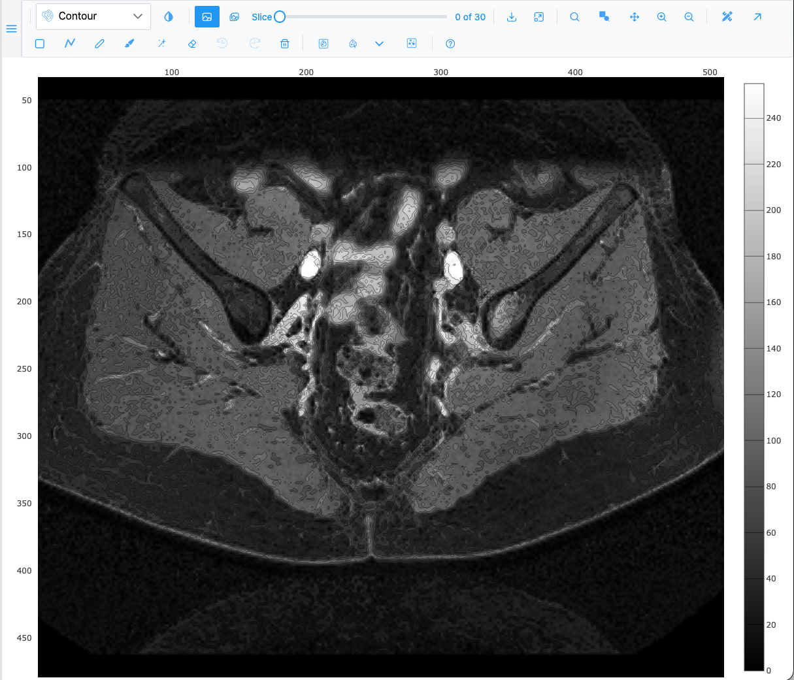
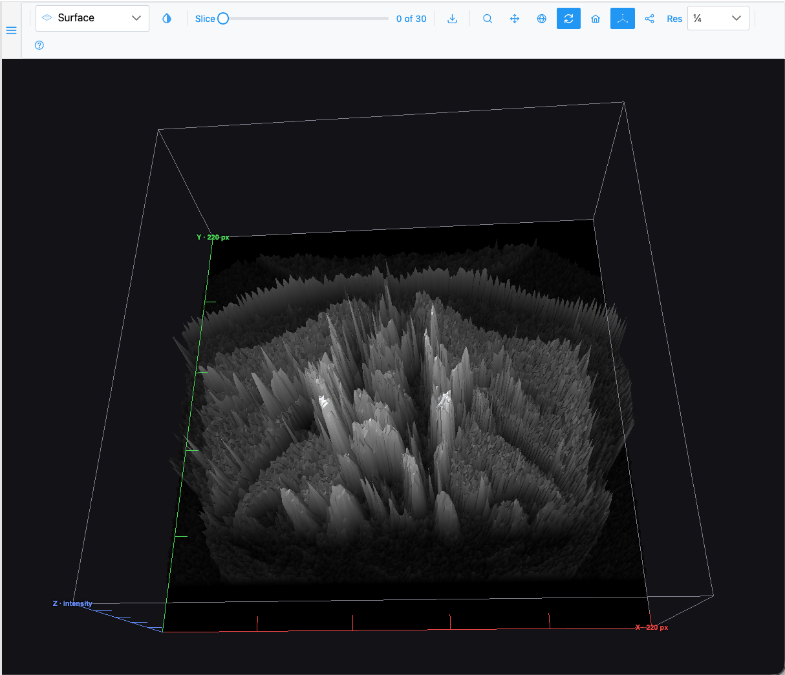
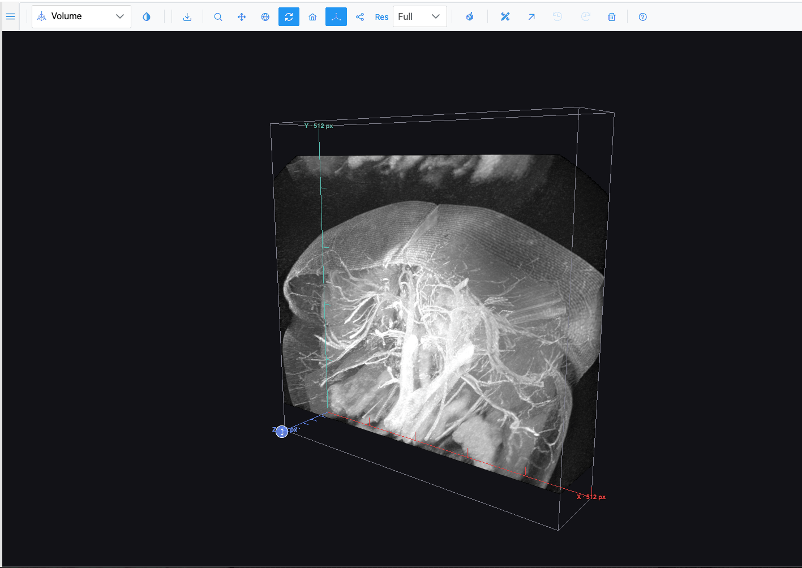
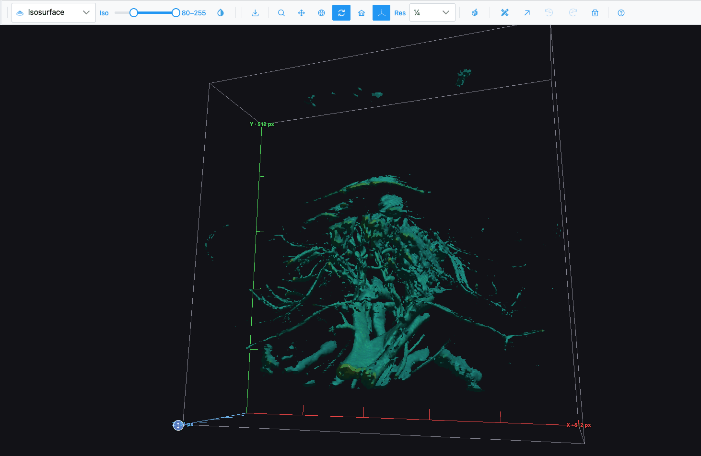

# Plot types

The **plot-type dropdown**, at the start of the toolbar, chooses how the loaded data is drawn. It offers
only the plot types the data can support, so the list changes with what is loaded.

{ width="360" }

## The plot types

| Plot type | Icon | Draws | Needs |
| --- | --- | --- | --- |
| **Image** | <i class="pi pi-image"></i> | The image as a tiled, deeply zoomable raster with a minimap and a scale bar. The default. | — |
| **Heatmap** | { .siv-icon } | The pixel values as a heatmap with a colour bar. Zooming re-fetches the visible area at screen resolution. | — |
| **Contour** | { .siv-icon } | Iso-intensity contour lines. | A grayscale or multichannel image (not RGB) |
| **Surface** | { .siv-icon } | The image as a 3D height field (brightness = height). RGB images use their luminance. | — |
| **Volume** | { .siv-icon } | A z-stack as a 3D volume (maximum-intensity projection). | A z-stack, grayscale or multichannel |
| **Isosurface** | { .siv-icon } | Surfaces through the volume at the intensity band set by the **Iso** slider. | A z-stack, grayscale or multichannel |
| **Spatial omics** | { .siv-icon } | Cells or spots of a spatial-omics dataset at their coordinates, over the tissue. | A spatial-omics dataset |
| **Spatial omics 3D** | { .siv-icon } | The dataset's cells as a 3D point cloud. | A dataset whose coordinates carry a z |

=== "Heatmap"

    

=== "Contour"

    

=== "Surface"

    

=== "Volume"

    

=== "Isosurface"

    

## Availability rules

- **Grayscale-only types** (Contour, Volume, Isosurface) accept a grayscale image or a multichannel image
  (more than one channel, fewer than three RGB channels). They are not offered for RGB images.
- **Stack-only types** (Volume, Isosurface) need a z-stack.
- **Spatial omics** types appear while a dataset is loaded. They disappear when it is closed.
- **Pixel types** (Image, Heatmap, Surface) are withheld while a spatial-omics dataset with no tissue
  image or volume is open (for example seqFISH), since there are no pixels to draw.
- The host application may add its own plot types after the built-in ones.

## What happens when you switch

- Switching plot type turns off the active region tool.
- Picking a 3D type sets the camera to **Turntable rotation**.
- If the selected type is not available for the next image (for example Contour, then an RGB image), the
  view falls back to **Image**.
- Opening another file while a 3D type is shown resets the view to **Image**. A 2D type (such as Heatmap)
  carries over if the new image supports it.

## Which renderer draws what

SIV picks a renderer per plot type and falls back silently if one cannot draw:

| Plot type | Renderer | Falls back to |
| --- | --- | --- |
| Image | OpenSeadragon (tiled 2D viewer) | Plotly |
| Heatmap, Contour | Plotly | — |
| Surface, Volume, Isosurface, Spatial omics 3D | napari-js (WebGPU) | Plotly |
| Spatial omics | napari-js (WebGPU) | OpenSeadragon + WebGL markers |

A fallback lasts for the current image only. WebGPU availability is checked once per page. See
[Limits and requirements](limits.md#browser-and-graphics).

!!! info "Test mode"
    Developers and QA can open the viewer in **test mode** (in the demo and JIT, add `?test=1` to the URL
    when the host supports it). The dropdown then shows every renderer explicitly, such as "Image (OSD)",
    "Heatmap (Plotly)" and "Volume (napari · WebGPU)". It also adds test-only types: Scatter 2D (Plotly),
    Surface (Plotly), Scatter 3D (Plotly), Isosurface (Plotly), Image (napari · WebGPU),
    Scatter 2D (napari · WebGPU) and Scatter 3D (napari · WebGPU).
