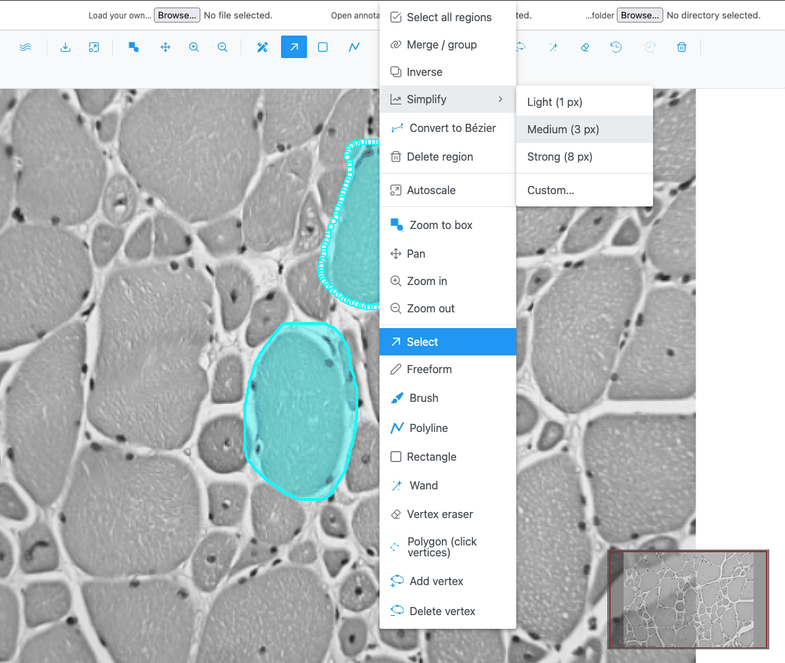
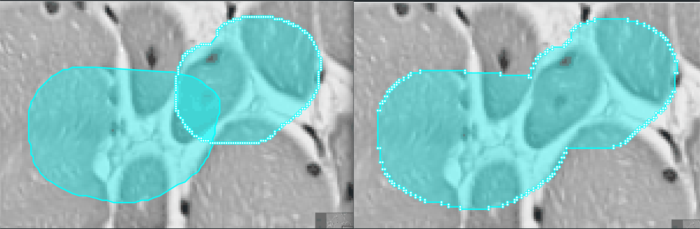
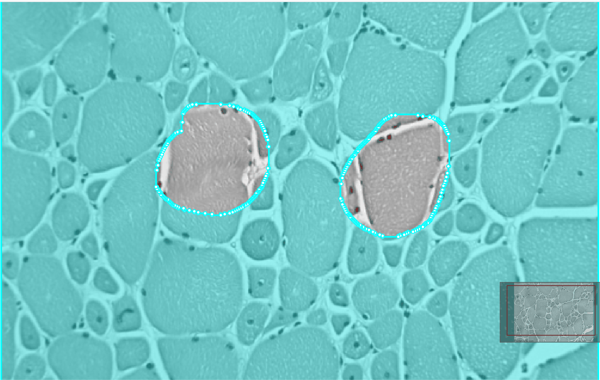
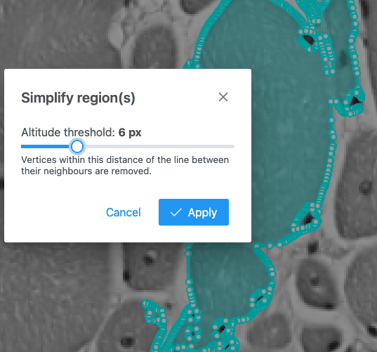

# Region actions (context menu)

Region actions act at once on the selected regions. They are not drawing modes. Right-click the image to
open them at the top of the context menu.

{ width="420" }

!!! note
    Right-clicking does not select the region under the pointer: the actions apply to the **current
    selection**. Select the regions first (click, ++shift++-click or a rubber band in Selection mode).

| Action | Icon | Shown when | What it does |
| --- | --- | --- | --- |
| **Select all regions** | <i class="pi pi-check-square"></i> | The image has regions | Selects every region (intensity lines excluded). |
| **Merge / group** | <i class="pi pi-link"></i> | 2 or more closed regions selected | Combines them into one region. If they do not touch, the result is one multi-part region. |
| **Ungroup** | <i class="pi pi-sitemap"></i> | A multi-part region is selected | Splits it into one region per part. |
| **Inverse** | <i class="pi pi-clone"></i> | 1 or more closed regions selected | Replaces the selection with everything outside it: the image rectangle, with the selected regions as holes. |
| **Simplify** | <i class="pi pi-chart-line"></i> | Regions selected | Reduces the number of vertices. Submenu: **Light (1 px)**, **Medium (3 px)**, **Strong (8 px)**, **Custom…** |
| **Convert to Bézier** | { .siv-icon } | Image view; a polygon or rectangle selected | Turns it into a smooth curve with handles. |
| **Convert to polygon** | { .siv-icon } | Image view; a Bézier region selected | Turns it back into a straight-edged polygon. |
| **Delete region** | <i class="pi pi-trash"></i> | Regions selected | Deletes the selected regions. |

Each action is one undo step, and its result is selected afterwards.

## Merge / group

- Works on closed regions: rectangles, polygons and multi-part regions. Polylines are ignored.
- The merged region keeps the class and colour of the first selected region.
- Holes are kept, and overlapping areas are counted once.
- Very large selections (more than 16 megapixels across) are merged at reduced resolution, so their edge
  is slightly less exact.

## Inverse

The result is the whole image with each selected area cut out as a hole. A selected region's own holes
become solid islands in the result. It works at any image size. If no closed region is selected, a warning
says "Nothing to invert — select one or more closed regions first."

## Simplify

Simplify removes vertices that lie within a distance (in pixels) of the line between their neighbours, using
the Douglas–Peucker method. It applies to the outline, the holes and every part of a multi-part region.

{ width="360" }

**Custom…** opens the **Simplify region(s)** dialog with an **Altitude threshold** slider, 1–20 px (default
3). Click **Apply**.

- An outline that would drop below 3 vertices keeps its original points.
- Rectangles and polylines are not changed.
- Simplifying a Bézier region turns it into a plain polygon.

Use Simplify on wand, brush or AI regions with thousands of vertices to make them lighter to edit and export.
