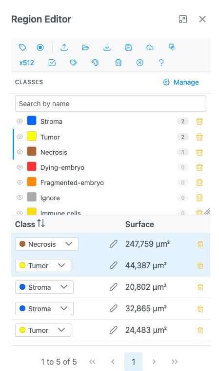
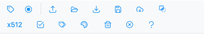
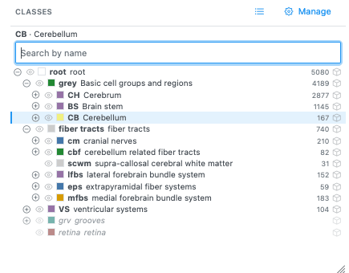
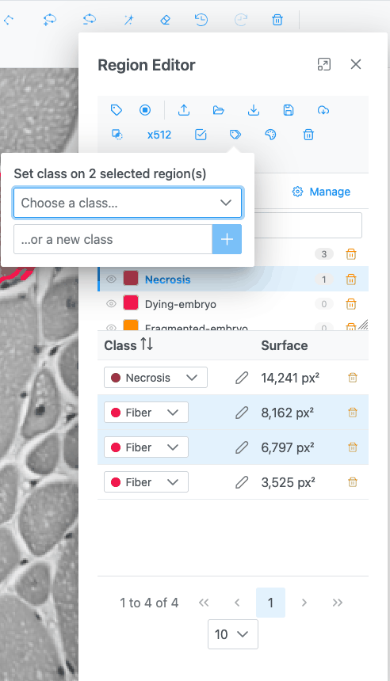
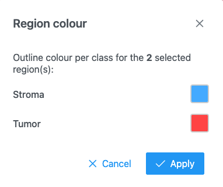

# Region Editor

The Region Editor lists every region on the current image, with its class and area. Use it to classify,
recolour, select, delete, import and export regions. Open it with the
{ .siv-icon } **Open the Region Editor** button in the toolbar.

- It opens as a floating dialog docked on the right. You can drag, resize and maximise it, and keep it open
  while you draw.
- Edits apply **live** to the image. There is no save or cancel. Every edit can be undone with
  ++ctrl+z++.
- Regions are tracked **per image** (and per slice for stacks). Switching images shows that image's regions.
- Regions live in memory only. [Export](geojson.md) them, or **Save regions to server** when your
  application offers it, to keep them.
- Geometry is edited on the image (see [Region tools](region-tools.md)), not in the table.

The <i class="pi pi-question"></i> button at the end of the toolbar opens this page.

## Toolbar

{ width="420" }

| Button | Icon | What it does |
| --- | --- | --- |
| **Show region labels** | <i class="pi pi-tag"></i> | Shows each region's class name on the image. Slower with many regions. |
| **Fill regions in their colour** | <i class="pi pi-stop-circle"></i> | Fills regions in their class colour (an atlas's look), with labels inside. |
| **See the regions through the volume** | <i class="pi pi-eye"></i> | Volume view only. Off: the volume hides the parts of regions behind it. On: regions show through. |
| **Import regions** | <i class="pi pi-upload"></i> | A GeoJSON file, or a label volume (`.nii`, `.nii.gz`, `.nrrd`) with its ontology JSON. See [Import](geojson.md#import). |
| **Import a folder** | <i class="pi pi-folder-open"></i> | A folder of per-slice GeoJSON files (one per slice, in name order, with its `regionset.json`), an OME-Zarr store or zip files. |
| **Download regions as geojson file** | <i class="pi pi-download"></i> | Opens **Export Regions**. See [Export](geojson.md#export). |
| **Save regions to server** | <i class="pi pi-save"></i> | Opens **Save Regions As**. Available when the host application stores regions. |
| **Import regions from server** | <i class="pi pi-cloud-download"></i> | Pick a GeoJSON file, a folder of per-slice files or a label volume on the server. Shown only when the host supports it. |
| **Download mask of the regions as PNG** | { .siv-icon } | Opens **Save Mask**. See [Masks](geojson.md#masks). |
| **x512** | — | Rounds every rectangle's width and height to the nearest multiple of 512 pixels. Polygons are unchanged. |
| **Select all regions** | <i class="pi pi-check-square"></i> | Selects every region (and up to 5,000 features of a large region set). |
| **Edit class on selected rows** | <i class="pi pi-tags"></i> | Sets one class on every selected region. |
| **Edit colour of selected regions** | <i class="pi pi-palette"></i> | Opens **Region colour**. |
| **Delete selected regions** | <i class="pi pi-trash"></i> | Deletes the selected regions from the table and the image. |
| **Delete all regions** | <i class="pi pi-times-circle"></i> | Asks "Are you sure you want to delete all regions?", then deletes every region on this image. |
| **Help** | <i class="pi pi-question"></i> | Opens this page. |

!!! warning "x512 and small rectangles"
    **x512** rounds to the *nearest* multiple, so a side shorter than 256 pixels becomes 0.

## Classes panel

The **Classes** panel above the table lists the classes with their colours and region counts. It is
described in [Annotation classes](annotation-classes.md#the-classes-panel).

### Class tree

{ width="420" }

A region set with a class hierarchy (a brain atlas, for example) shows its classes as a tree. Switch
between tree and list with <i class="pi pi-sitemap"></i> / <i class="pi pi-list"></i>.

| Action | How |
| --- | --- |
| Expand / collapse | <i class="pi pi-plus-circle"></i> / <i class="pi pi-minus-circle"></i>. Top-level classes start expanded. |
| Pick a class | Click its row (or press ++enter++): the class and all its subclasses are picked and their regions selected. The header shows "**name** · title". |
| Add to the pick | ++shift++, ++ctrl++ or ++cmd++ + click. |
| Find a class | Type in **Search by name**; ++enter++ picks the first match. |
| Show or hide | The eye hides or shows the class and its subclasses. A partly hidden subtree shows a partial eye. |
| Show in 3D | <i class="pi pi-box"></i> **Show in the volume, in 3D** (volume views). |
| One surface or each cell | <i class="pi pi-th-large"></i> (Spatial omics 3D, classes of cells). |

Classes not present on the current slice are greyed out. Hover a row to see its full title. Picking a class
selects at most 5,000 features from a large region set.

Picked classes drive **Select from ROIs** in [Spatial omics 3D](spatial-omics.md#regions-and-selection).
Selecting anything else (a region on the image, a table row) replaces the pick.

## The table

| Column | What it shows |
| --- | --- |
| **Class** | The region's class. Pick one from the dropdown (the colour follows), or click <i class="pi pi-pencil"></i> **Rename / free-form label** to type a name (++enter++ applies, ++esc++ cancels). |
| **Surface** | The region's area on this slice. |
| **Volume** | Volume views: the volume of the region's class over the whole stack (its area on every slice, one slice thick). |
| <i class="pi pi-trash"></i> | Deletes that region. |

The table shows 10 rows per page by default (10, 25 or 50).

### Area units

| Image | Unit |
| --- | --- |
| No physical pixel size | px² |
| With a pixel size | µm², switching to mm² from 1,000,000 µm² |
| Volumes | voxels, µm³ or mm³ |

Holes are subtracted and the parts of a multi-part region are added. Values of 1,000 or more are rounded to
whole numbers; smaller values show two decimals.

### Selecting rows

| Action | How |
| --- | --- |
| Select a row | Click it. The region is highlighted on the image. |
| Add or remove a row | ++ctrl++ / ++cmd++ + click. |
| Select a range | ++shift++ + click. |

Selecting a region on the image selects its row (the table turns to its page). Clicks on a colour picker,
a trash icon or the class editor do not change the selection.

### Large region sets

A very large annotation file (for example thousands of cells from QuPath) loads as a **region set**: it is
drawn at a level of detail that suits the zoom, and its features are listed after your regions in the table.
Selecting, reclassifying or renaming a feature turns it into an ordinary region. See
[Limits](limits.md#regions).

## Set class on selected regions

{ width="420" }

Select rows, then click <i class="pi pi-tags"></i>. The panel **Set class on *N* selected region(s)** offers:

- **Choose a class…**: applies a class at once (with a filter when there are more than 8 classes);
- **…or a new class**: type a name and press ++enter++ or <i class="pi pi-plus"></i> **Add class & set it**.

## Region colour

{ width="360" }

Select rows, then click <i class="pi pi-palette"></i>. The **Region colour** dialog shows one colour picker
per class among the selected regions (unclassified regions appear as "Unclassified"). **Apply** sets the
outline colour of those regions only. A colour set this way is kept: the class colour no longer overrides
it.

## Regions in 3D

In the Volume view (and with the slice editor), regions drawn on slices can be shown as 3D surfaces per
class:

- <i class="pi pi-box"></i> **Show in the volume, in 3D** on a class row reconstructs that class (and its
  subclasses) from every slice's outlines into a translucent surface. Open lines become sheets.
- With the **Selection** tool, click a surface in the 3D view to pick its class; ++shift++-click adds to the
  pick. Picked classes turn nearly opaque and the others fade.
- The **Volume** column gives each class's volume.

## Messages

| Message | Meaning |
| --- | --- |
| Regions imported | The import worked; the detail says how many slices were annotated. |
| Import discarded | You switched images while the file was being read, so it was not applied. |
| Different size | A label volume's slices do not match the image size. |
| Error importing regions / Error importing the file | The file could not be read; the detail says why. |
| Regions saved | Saved to the server. |
| Error saving regions / Error exporting regions | Saving or exporting failed. |
| Could not show the region in 3D | The class surface could not be built. |
