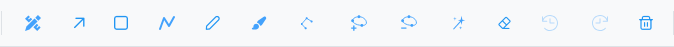
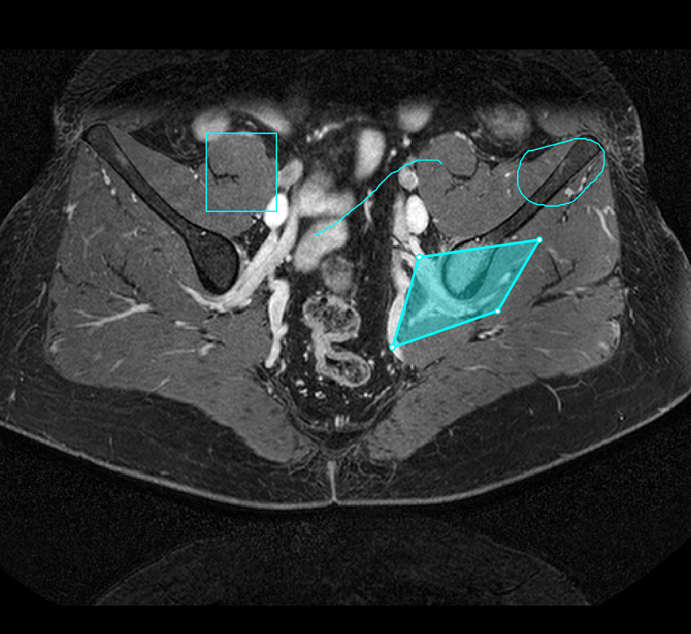
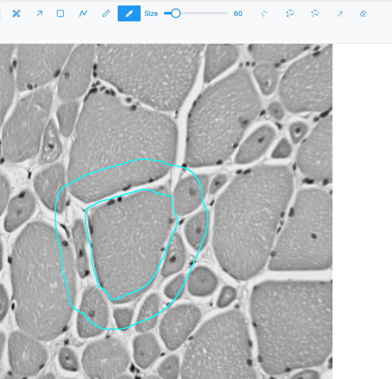
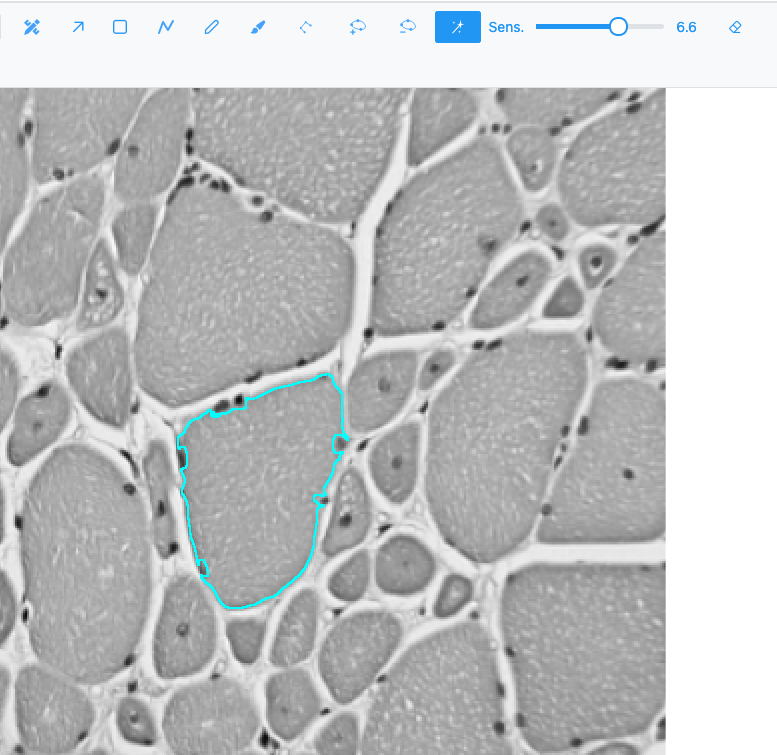
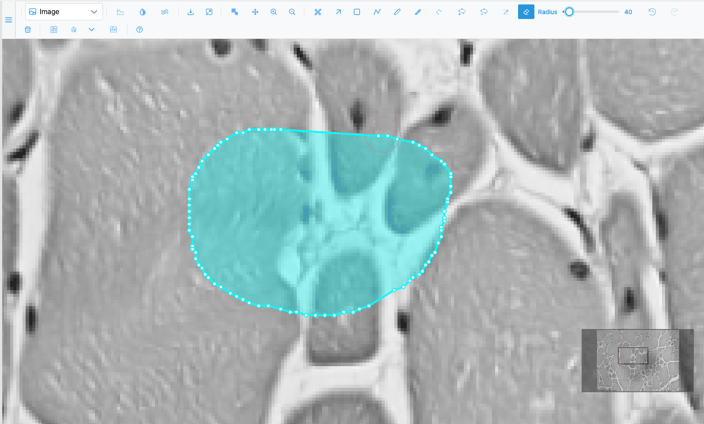
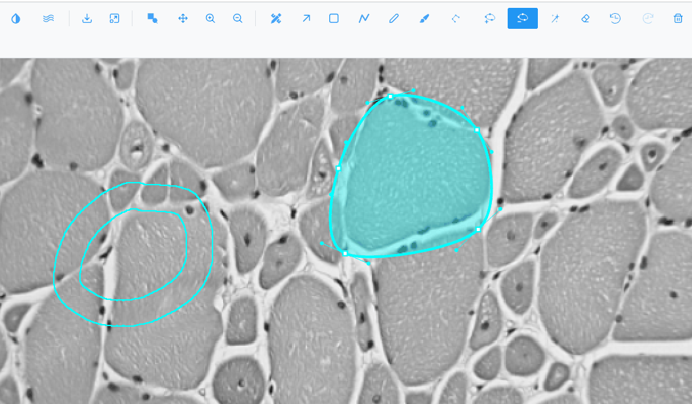

# Region tools

Regions (also called annotations or ROIs) are shapes drawn on the image: rectangles, lines, polygons and
painted areas. They can be classified, measured, exported and used to select spatial-omics observations.

## General behaviour

- **No tool is active at first.** Clicking a tool activates it and highlights its button. Clicking it again,
  or pressing its key again, turns it off.
- New regions are listed in the [Region Editor](region-editor.md) with the class **Region** (cyan).
- Regions belong to the **image** (and to the slice, for stacks). Switching images shows that image's
  regions; switching back restores yours. They are kept in memory only, so [export](geojson.md) or save
  them to keep them after a reload.
- Every action can be undone (up to 10 steps).
- Switching plot type turns the active tool off.

### Where each tool is available

| Tools | Image | Heatmap / Contour | Spatial omics 2D | Spatial omics 3D | Volume slice editor |
| --- | --- | --- | --- | --- | --- |
| Selection, Rectangle, Freeform, Wand, Vertex eraser, Undo, Redo, Delete | yes | yes | yes | yes | yes |
| Polyline, Brush | yes | yes | yes | — | yes |
| Polygon, Add vertex, Delete vertex | yes | — | — | — | yes |

In the Volume and Isosurface views with the slice editor closed, only Selection, Undo, Redo and Delete are
available.

## Selection mode

<i class="pi pi-arrow-up-right"></i> **Selection mode** ++s++ turns off any drawing tool.

| Action | How |
| --- | --- |
| Select a region | Click it. |
| Add to or remove from the selection | ++shift++, ++ctrl++ or ++cmd++ + click. |
| Select several at once | Drag a rubber band over empty space: every region it touches is selected. |
| Move a region | Drag its body. |
| Resize a rectangle | Drag its handles. |
| Reshape a polygon | Drag its vertices (including the vertices of a hole). Bézier regions also show curve handles. |

Selected regions are drawn thicker and filled. The selection is shared with the Region Editor table.

## Drawing tools

| Tool | Key | How to draw | Result |
| --- | --- | --- | --- |
| <i class="pi pi-stop"></i> **Draw a rectangle** | ++r++ | Click and drag. | Rectangle |
| { .siv-icon } **Draw a polyline** | ++l++ | Click and drag. | Open line (exported as a GeoJSON `LineString`) |
| <i class="pi pi-pencil"></i> **Draw a freeform region** | ++f++ | Click and drag; the shape closes when you release. | Polygon |
| { .siv-icon } **Draw a polygon** | — | Click to place each vertex; click the first point again to close (at least 3 vertices). | Polygon |

### Editing vertices (Image view)

| Tool | How |
| --- | --- |
| { .siv-icon } **Add a vertex** | Select a polygon, then click one of its edges to insert a vertex. |
| { .siv-icon } **Delete a vertex** | Select a polygon, then click a vertex to remove it. |

## Brush

{ .siv-icon } **Brush** paints a region with a round brush: the painted
stroke is the region.

| Control | Range | Default |
| --- | --- | --- |
| **Size** (brush diameter) | 5–300, step 5 | 40 |

- Paint over an existing region to extend it. Painting across two regions merges them.
- Hold ++shift++ while painting to **erase** from a region.
- A stroke that encloses an unpainted area, or erasing a pocket inside a region, leaves a **hole**: the
  region becomes a donut.
- The stroke stays editable until you pick another tool. Starting a drag away from the current stroke
  starts a new region.

!!! note
    In the Image view the brush size is measured in screen pixels of the current view, so the same size
    covers more of the image when you are zoomed out.

## Wand

{ .siv-icon } **Wand** ++w++ grows a region from the pixels around the click
that have similar values (like QuPath's wand).

| Control | Range | Default | Effect |
| --- | --- | --- | --- |
| **Sens.** | 0.5–10.0, step 0.1 | 2.0 | Higher is stricter (smaller region); lower is looser. Applies from the next click. |

| Action | How |
| --- | --- |
| Grow a region | Click. Drag to keep extending it as you move. |
| Extend the same region | Click again; the new area joins the region. |
| Adopt an existing region | Click inside it, then keep clicking to extend it. |
| Merge regions | Grow into another region. |
| Exact-match fill | Hold ++ctrl++ / ++cmd++ while clicking: fills only pixels with exactly the same value, without smoothing. |
| Erase | Hold ++shift++ while clicking or dragging on a region. |

!!! tip
    In the Image view the wand reads the pixels **as displayed**, so brightness, contrast, colormap and
    zoom level all change what it selects. Adjust the display first to make the object stand out.

## Vertex eraser

<i class="pi pi-eraser"></i> **Vertex eraser** ++e++ removes the vertices inside its circle cursor, from any
region, and rejoins the outline at the circle's edge. Click or drag.

| Control | Range | Default |
| --- | --- | --- |
| **Radius** | 5–300, step 5 | 20 |

A polygon left with fewer than 3 vertices, or a polyline with fewer than 2, is deleted. A hole left with
fewer than 3 vertices is removed.

## Holes and Bézier curves

- **Donuts**: regions can have holes, made with the brush, the wand, [Inverse](region-actions.md) or by
  importing them. A hole's vertices can be edited like the outer ring. Areas exclude the holes.
- **Bézier curves** (Image view): right-click a selected polygon or rectangle and choose
  **Convert to Bézier** to turn it into a smooth curve with handles. **Convert to polygon** turns it back.

## Undo, redo and delete

| Control | Keys | Notes |
| --- | --- | --- |
| { .siv-icon } **Undo** | ++ctrl+z++ | Up to the last 10 actions. A whole brush, wand or eraser drag counts as one. Greyed out when there is nothing to undo. |
| { .siv-icon } **Redo** | ++ctrl+shift+z++ or ++ctrl+y++ | A new action clears what can be redone. |
| <i class="pi pi-trash"></i> **Delete selected region** | ++del++, ++backspace++ or ++d++ | Deletes every selected region. |

Edits made in the Region Editor (class, colour, delete) can be undone too. The history is cleared when you
switch to another image.

## Related

- [Region actions (context menu)](region-actions.md): merge, ungroup, inverse, simplify.
- [Region Editor](region-editor.md): list, classify and measure.
- [AI segmentation](segmentation.md): let a model draw regions for you.
