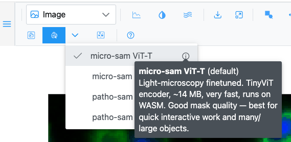
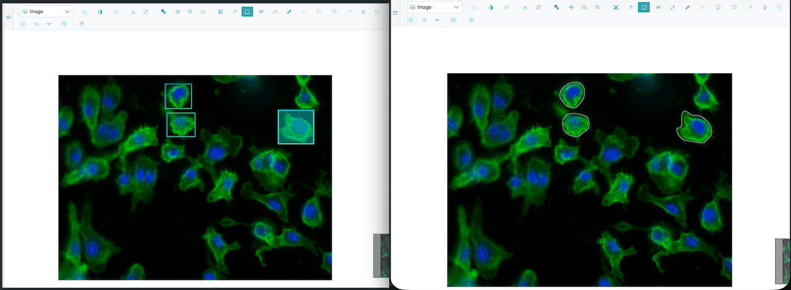
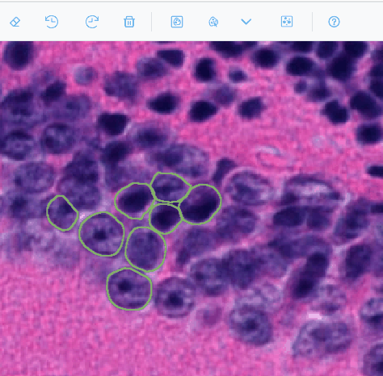
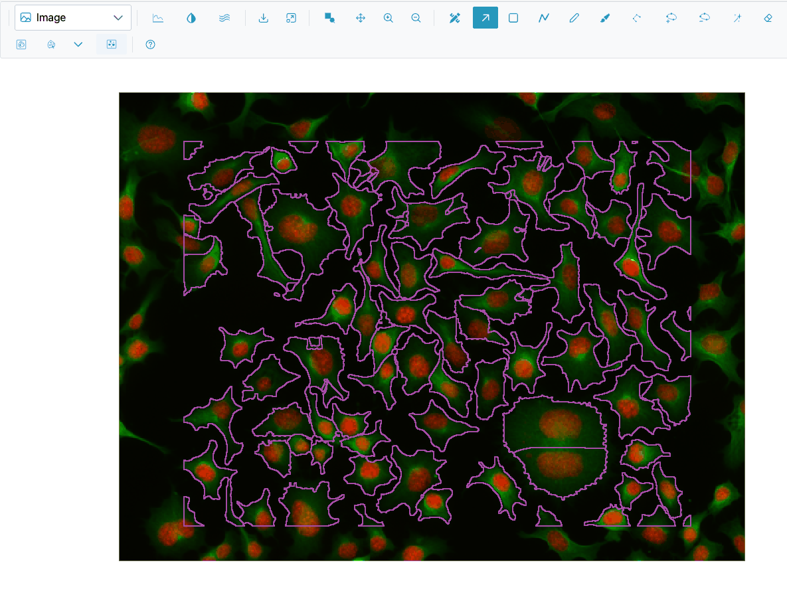
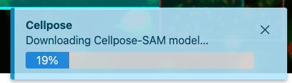

# AI segmentation

SIV can draw regions for you with AI models that run **entirely in your browser**: no image leaves your
computer. The first run of a model downloads it, with a progress bar. It is then cached by the browser, so
later runs start quickly, even offline.

There are two kinds of tool:

- **Prompted** tools act on what you show them: **Segment** and **Cellpose** use the rectangles you draw;
  **SAM point prompts** uses your clicks.
- **No-prompt** tools, when your application adds them (for example a detection model in JAX Image Tools),
  sweep the whole current view, so there is nothing to draw first.

!!! info "What the models see"
    In the Image view, the models read the pixels **as displayed**: the visible part of the image, with
    your brightness, contrast and colours. Only the on-screen part of a rectangle is segmented. Zoom so
    the objects are clearly visible and fill a good part of the view, and set the contrast first.

## Segment (SAM box prompt)

{ .siv-icon } **Segment with SAM (box prompt)**:

1. Draw one or more **rectangles** (++r++) around objects.
2. Click **Segment**.
3. Each rectangle that produced a mask is replaced by the outline of the object inside it. Rectangles that
   found nothing stay, so you can adjust them and retry.

New regions get the class **sam**. The image is encoded once; each box is then quick.

## SAM point prompts

{ .siv-icon } **SAM point prompts** is a tool you switch on:

| Action | Effect |
| --- | --- |
| Click an object | Segments it as a **new** region. Each plain click starts a new object. |
| ++shift++ or ++alt++ + click | Adds an **exclude** point that refines the current object. |
| ++enter++ | Commits the current object. |
| ++esc++ | Removes the current object. |

The model loads when you switch the tool on. Clicks made while it is busy are ignored.

## Choosing the SAM model

Click <i class="pi pi-chevron-down"></i> **Pick the SAM model** next to Segment. The choice applies to both
SAM tools, which share one loaded model. Hover <i class="pi pi-info-circle"></i> beside a model for its size,
speed and domain.

| Model | Best for | Download | Runs on |
| --- | --- | --- | --- |
| **micro-sam ViT-T** (default) | Light microscopy; small and fast | ~14 MB | CPU (WebAssembly) |
| **micro-sam ViT-B** | Light microscopy; highest accuracy | ~172 MB | GPU (WebGPU) |
| **patho-sam ViT-B** | Histopathology (H&E, stained tissue) | ~180 MB | GPU (WebGPU) |
| **patho-sam ViT-B (int8)** | Histopathology on slow connections | ~100 MB | CPU (WebAssembly) |

All are Segment Anything models fine-tuned for biomedical images. They differ in the image encoder (the
heavy step, done once per image) and the training domain; prompting works the same. The first run after
switching model or image downloads and encodes once. The choice is not remembered after a reload.

## Cellpose

{ .siv-icon } **Segment cells (cellpose-SAM)** finds every cell in each drawn
rectangle:

1. Draw one or more rectangles over areas with cells.
2. Click **Cellpose**.
3. Each cell becomes a region with the class **cell**. Rectangles that produced cells are removed.

The Cellpose-SAM model is large (about 588 MB) and downloads on first use.

## Progress and results

{ width="360" }

A toast at the bottom right (titled **SAM**, **Cellpose**, **SAM point segmentation** or the tool's name)
shows what is happening: the download progress, then steps such as "Encoding image…", "Segmenting 2/3…",
"Running inference (tile 1/4)…", "Tracing cells…". When it finishes, a result toast says how many regions
were added ("Added 3 region(s).", "Added 42 cell region(s).") or that nothing was found ("No masks found.",
"No cells found.").

| Message | What to do |
| --- | --- |
| Draw one or more rectangles, then press Segment. / …then run Cellpose. | Draw rectangles first. |
| No masks found. / No mask for these points. / No cells found. | Zoom in, adjust contrast, or redraw the boxes tighter. |
| SAM model unavailable. | The model could not be loaded (network, or the application has not configured it). |
| Segmentation failed. / Cellpose segmentation failed. | Retry; see [Troubleshooting](../troubleshooting.md). |

Segmentation results are ordinary regions: undo them with ++ctrl+z++, edit them, classify them, export them.

## Tools added by your application

Applications can add their own segmentation or detection tools next to these, each with a model picker
<i class="pi pi-chevron-down"></i> and a **Parameters** button <i class="pi pi-sliders-h"></i>. The parameters
dialog has **Reset to model defaults**. Some tools open their own dialog instead (Image view only). Those
tools are documented by your application.
