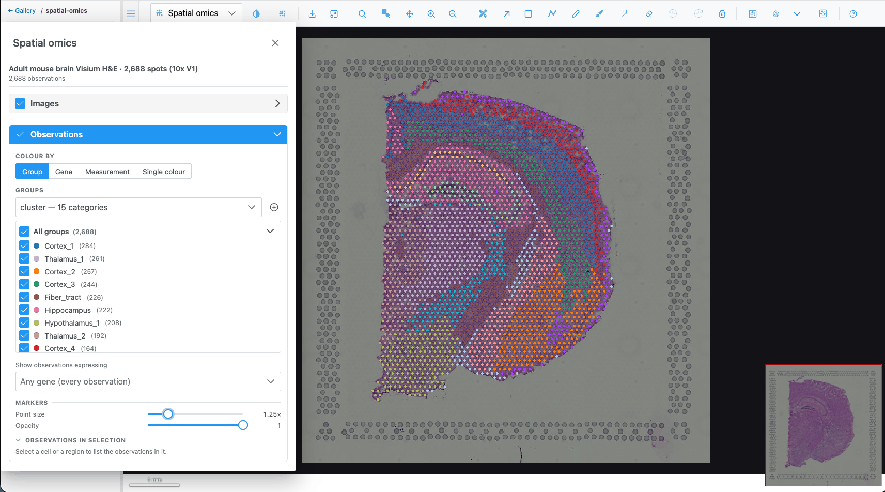
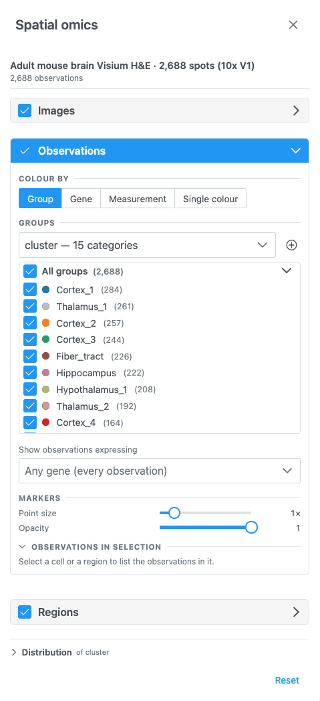
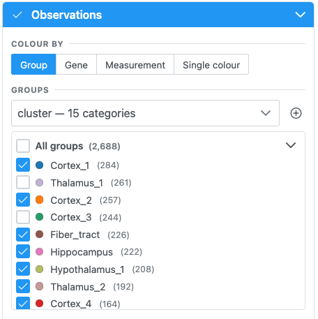
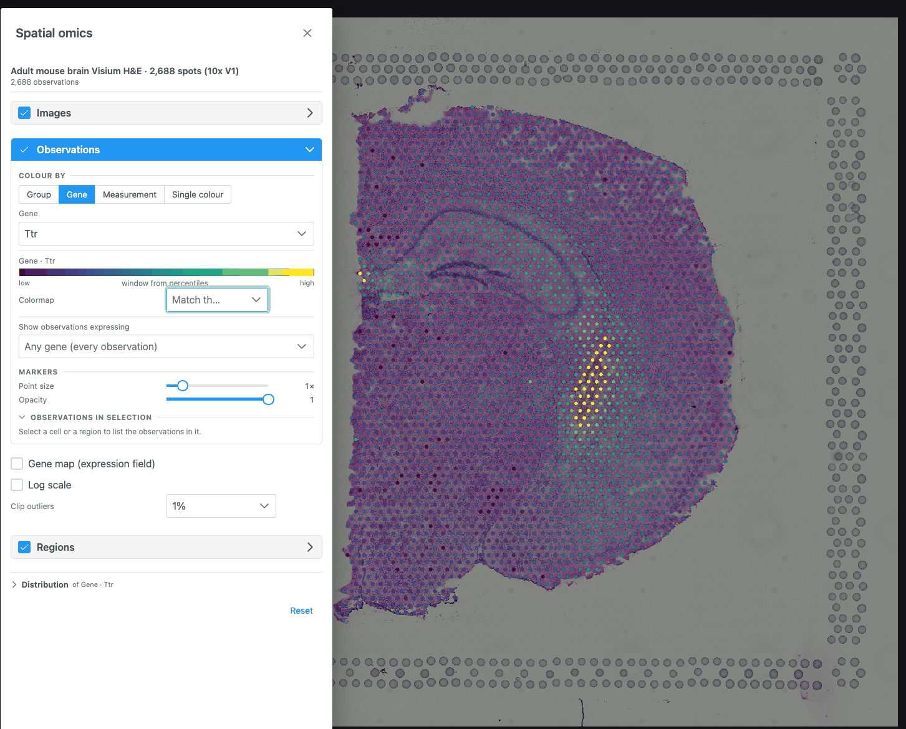
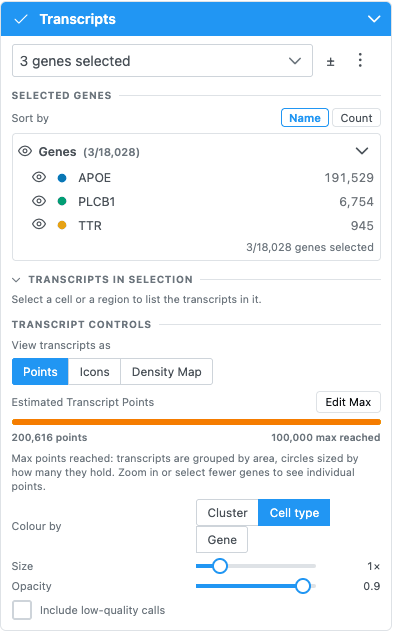

# Spatial omics

In the **Spatial omics** plot types each observation — a cell or a Visium spot — is drawn at its own
coordinates, over the tissue image when the dataset registers onto one. You colour the observations by a
group, a gene or a measurement. You can select them from the regions you draw, and you can chart their
distributions.

## Opening a dataset

A spatial-omics dataset is loaded by the host application (in the demo, from the **spatial-omics** gallery
folder). Two plot types then appear in the plot-type dropdown:

| Plot type | Icon | Offered when |
| --- | --- | --- |
| **Spatial omics** | { .siv-icon } | a dataset is loaded |
| **Spatial omics 3D** | { .siv-icon } | the dataset's coordinates carry a z |

Both disappear when the dataset is closed, and the view falls back to another plot type. What opens first
depends on the dataset:

| Dataset brings | What you see first |
| --- | --- |
| A tissue image (Visium H&E, demo brain) | The tissue in the **Image** view. Pick **Spatial omics** in the dropdown. |
| No image but a reference volume (Allen Brain Cell Atlas) | The volume in the **Image** view, as a z-stack. Pick **Spatial omics 3D**. |
| Neither (seqFISH) | **Spatial omics 3D** if the cells have a z, otherwise **Spatial omics**, directly. |

When the dataset brings no tissue image or volume, the pixel plot types (**Image**, **Heatmap**,
**Surface**) are not offered, because they would have nothing to draw.

### Graphics requirements

Spatial omics is drawn with **WebGPU** when the browser supports it. Without WebGPU:

- **Spatial omics** (2D) falls back to a WebGL drawing over the image. Markers, gene colouring, the gene
  filter, selection, hover and click-to-select all work. Cell outlines and fills, transcripts and the
  density map are not drawn, every marker is a plain disc, and a dataset without a tissue image cannot be
  shown.
- **Spatial omics 3D** needs WebGPU.

See [Limits and requirements](limits.md#browser-and-graphics).

## The Spatial omics panel

Open it with the { .siv-icon } **Spatial omics
controls** button. The button is only in the toolbar while a Spatial omics plot type is shown. The panel
is a floating, resizable window that opens on the left. Its header shows the dataset name and the number
of observations.

{ width="420" }

The panel has these sections, top to bottom. Each one can be folded with its chevron, and most have a
switch in the header that shows or hides that layer.

| Section | Shown when | Header switch | Open by default |
| --- | --- | --- | --- |
| **Images** | 2D, the dataset has a tissue image | Show the image (on) | no |
| **Volume** | 3D, the dataset has a reference volume | Show the volume (on) | no |
| **Transcripts** | the dataset has transcripts or a transcript density | View transcripts (off) | no |
| **Observations** | always | Show the observations (on) | yes |
| **Regions** | always | Show the regions (**off**) | no |
| **Distribution** | always | — | no |

**Reset**, at the bottom, puts every setting back to its default and clears the selection. That means flat
colour, no gene filter and regions hidden.

When you open another dataset, the selection is cleared, the gene filter is emptied and custom group
colours are reset. A colour source the new dataset does not have is dropped. A dataset with cell
segmentations and no colour source starts coloured by its cell-type column.

### Images and Volume

- **Images**: holds a single note. The tissue image's channels, colours and contrast are set in the
  [Channels & Histogram](channels-histogram.md) dialog.
- **Volume** (3D): **Opacity** of the registered reference volume, 0.05–1, default 0.5.

## Observations

### Show as

If the dataset has cell segmentations, **Show as** switches between **Markers** (one dot per cell) and
**Cell segmentations** (each cell's outline or fill). Only one is drawn at a time.

### Colour by

**Colour by** chooses what drives the colours. Only the options the dataset supports are offered:

| Option | Offered when | Pick |
| --- | --- | --- |
| **Group** | the dataset has a categorical column (cell type, cluster, region) | a column |
| **Gene** | the dataset has gene expression | a gene, by searching its name |
| **Measurement** | the dataset has a numeric column (total counts, area) | a column, shown with its unit |
| **Single colour** | always | one colour for every observation (default `#4fc3f7`) |

With nothing chosen, every observation is drawn in one neutral blue.

=== "Group"

    { width="420" }

    - The **Groups** dropdown lists the categorical columns. A family of related columns (for example k-means
      with k = 2 … 10) is listed once, with a second dropdown for the variant.
    - The list below it is the legend. Groups are sorted largest first, and **All groups (total)** shows or
      hides every group at once. Each row has:
        - a checkbox to show or hide that group's observations;
        - a colour dot that opens a colour picker (hex input, presets, **Reset to default**);
        - the group name: click it to **select** that group's observations, and click again to clear;
        - the number of observations.
    - <i class="pi pi-plus-circle"></i> **Import cell groups (CSV of cell_id, group)** adds a new column from
      a `.csv`, `.tsv` or `.txt` file, named after the file. It is available only when the host supports it.

=== "Gene"

    { width="420" }

    - Type in **Search {N} genes…** to find a gene. Long lists scroll virtually.
    - If the dataset hints that its values are counts, **Log scale** is turned on for you.
    - The **key** below shows the colour bar from low to high, with the contrast window taken at the
      percentiles set by **Clip outliers**.

=== "Measurement"

    - Pick a column in **Pick a measurement**. Options read `name (unit)`.
    - **Log scale** is preset from the column's own hint.

=== "Single colour"

    - One colour input. It applies to markers and to cell segmentations.

#### Colour key and colormap (Gene, Measurement)

- **Colormap**: the colour scale for genes and numeric values, used by the markers, the gene map and the
  key. Leave it empty (**Match the image**) to follow the image's colormap. If that colormap is grayscale,
  Viridis is used instead.
- **Log scale**: compresses counts, which otherwise collapse against their outliers on a linear ramp.
- **Clip outliers**: the percentile the contrast window is taken at: **None**, **1%** (default), **2%**
  or **5%**.

### Show observations expressing

*Shown when the dataset has gene expression.*

Pick one or more genes in **Any gene (every observation)** to draw only the observations that express
them. Expressing means a value above 0. All other observations are hidden, together with their cell
outlines and transcripts.

- With two or more genes, choose **Any gene** (express at least one) or **All genes** (express every one).
- Each picked gene has an icon and a colour. Click its swatch to change them; icons show on 2D markers.
  Click × to remove the gene.
- **Colour by these genes** (on by default): each observation takes the colour (and in 2D the icon) of the
  picked gene it expresses most, relative to that gene's highest value. Turn it off to keep the **Colour
  by** colours.
- While this filter is on, the transcript density map, and transcripts grouped by area when zoomed out,
  are hidden, because they carry no cells to filter by.

If the expression cannot be read, the previous filter stays and the panel offers **Try again**.

### Markers

| Control | Range | Default |
| --- | --- | --- |
| **Point size** | 0.25× – 5× (step 0.25) | 1× |
| **Opacity** | 0.1 – 1 (step 0.05) | 1 |

Markers are never drawn smaller than 2 screen pixels, so they stay visible when zoomed out. Point size and
opacity change how markers look, not what is selected.

### Cell segmentations

| Control | Where | Choices |
| --- | --- | --- |
| **Boundaries** | 2D | One switch per boundary set (for example cell and nucleus), or a selector when there are more than two |
| **View cells as** | 2D | **Fill**, **Outline**, **Both** |
| **Cell fill opacity** / **Cell opacity** | 2D / 3D | 5 – 100 % (default 55 %). Hidden for Outline only. |
| **In 3D** | 3D | **By cell type** (one surface per type) or **Individual cells** |

In 3D, individual cells are built progressively ("Building cells… *n* shown so far"). When there are too
many, the ones nearest the centre of the view are shown. Zoom in or move to see others.

### Observations in selection

When something is selected, this sub-section summarises it: the selection's label, the plane (2D) or
"whole volume" (3D), the number of observations and of groups, one bar per group in the legend colours,
the mean of the measurements, and the cell id for a single cell.
<i class="pi pi-copy"></i> copies the counts per group as tab-separated text.

## Gene map, sections and density volumes

These controls appear below the observations, depending on the colouring and the plot type.

**Gene map (expression field)**: *shown while colouring by a gene.* Draws the gene's expression as a smooth
field under the cells. It is an estimate between the cells, transparent where nothing was measured. It is a
kernel-weighted mean per cell, not a sum, so crowded areas do not glow just for being crowded.

| Control | Range | Default |
| --- | --- | --- |
| **Smoothing** | 0.5× – 4× | 1× |
| **Map opacity** | 0.1 – 1 | 0.85 |
| **Volume rendering (interpolate along z)** (3D) | on/off | off |
| **One map section at a time** (3D, sectioned data, no interpolation) + **Map section** slider | section *k* of *n* | middle section |

**One section at a time** (3D, sectioned data, observations shown) draws a single imaged section's cells,
selected with the **Section** slider (opens on the middle section).

**Cluster density volumes** (3D): renders each cluster as a smooth density volume. It is an estimate between
the imaged sections, not measured cells. It covers the 6 largest clusters, the selected cells, or all cells.
**Smoothing** ranges 0.5× – 4×.

## Regions and selection

The **Regions** section shows the regions drawn on the view (off by default) and turns them into a
selection of observations.

<i class="pi pi-object-group"></i> **Select from ROIs** selects every observation inside the regions.
After that:

- the rest are **muted** (drawn faintly), and the hint reads "*n* of *N* selected — the rest are muted";
- the [distribution charts](distribution-charts.md), the **Observations in selection** summary and the
  embedding highlight follow the selection;
- **Clear** removes the selection.

How regions select:

| View | Selects |
| --- | --- |
| 2D | Every observation inside the union of all drawn regions (any tool; holes are respected). On a volume-backed dataset, only the cells of the shown slice. |
| 3D, lasso | Each region cuts through the cloud's full depth, as seen from the current camera. Orbit and draw again to cut from another angle. |
| 3D, class volumes | When classes are picked in the [Region Editor's class tree](region-editor.md#class-tree), every observation inside those classes' volumes. Available for datasets with a reference volume and no tissue image (Allen Brain Cell Atlas). |

Selecting works even while regions are hidden. If nothing falls inside, the panel says so.

Other ways to select:

- Click a **group name** in the Groups list (click again to clear).
- **Click a marker** on the map to select its group (click again to clear). This does not work while
  colouring by a gene. Dragging to pan or orbit is not a click.
- **Lasso or box-select** points in the [Embedding](distribution-charts.md#embedding) chart.

!!! note
    Click-to-zoom is off in the Spatial omics plot types, so a click can select. The mouse wheel, zoom
    buttons and **Zoom box** still zoom.

## Hover

Hovering an observation shows a tooltip. With a group colouring it shows the group and column; with a gene
or measurement it shows the value (and unit) and its name. In 3D, cells show their type, id, value and
measurements, and a cell-type surface shows its cell count.

## Transcripts

*Shown when the dataset has transcript positions or a transcript density (for example Xenium).*

{ width="420" }

- Search and pick genes in **Search for genes to visualize…**. **±** selects every gene, then goes back to
  the picked ones. The **⋮** menu can **Add marker genes of clusters…** (top 3/5/10/20 per cluster, default
  5), save the picked genes as a group, import gene groups from a `group,gene` CSV, remove groups, or clear
  the selection.
- **Selected genes** lists the picked genes as a tree, sortable by **Name** or **Count**. Each gene has its
  own colour and icon.
- **View transcripts as**: **Points**, **Icons** or **Density Map**.
- **Points / Icons**: **Colour by** Cluster, Cell type or Gene; **Size** 0.5–3; **Opacity** 0.1–1;
  **Include low-quality calls**.
- **Max markers** (25k / 50k / **100k** / 200k / 400k) caps the points drawn at once. Above it, transcripts
  are grouped by area into circles sized by count. Zoom in or pick fewer genes to see individual points.
- **Density Map**: opacity (5–100 %), **bin size** (10, 20, 40 or 80 µm), the **scale threshold** in
  transcripts per µm² (**Auto** derives it from the data), and the colormap (default Inferno).
- **Transcripts in selection** counts transcripts, genes and cells inside the selection, with a copy button.
  On large sections the counts are a lower bound, and the panel says so.

In 3D, transcripts are loaded at the detail the camera distance needs ("Loading transcripts…").

## Related

- Tutorial: [Explore a spatial-omics dataset](../tutorials/spatial-omics.md)
- How-to: [Spatial omics recipes](../how-to/spatial-omics.md)
- QA: [Spatial omics test cases](../qa/spatial-omics.md)
