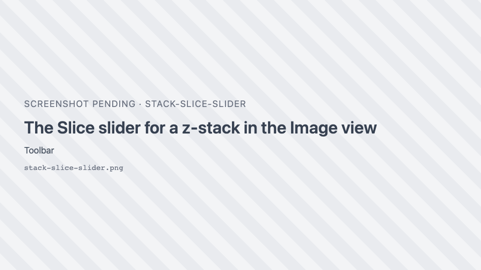
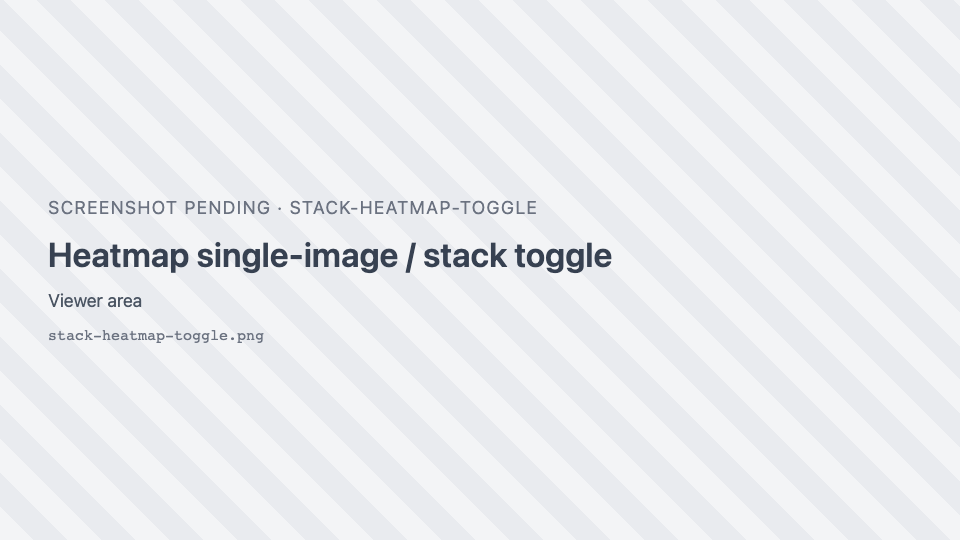
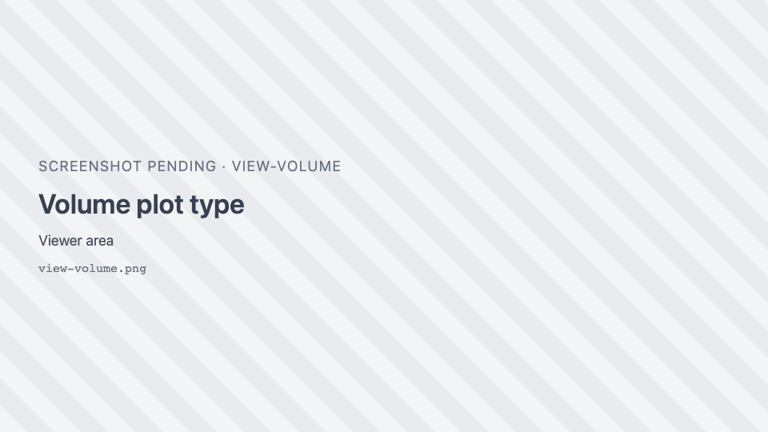
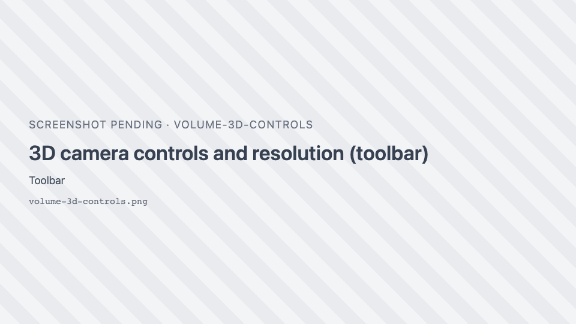
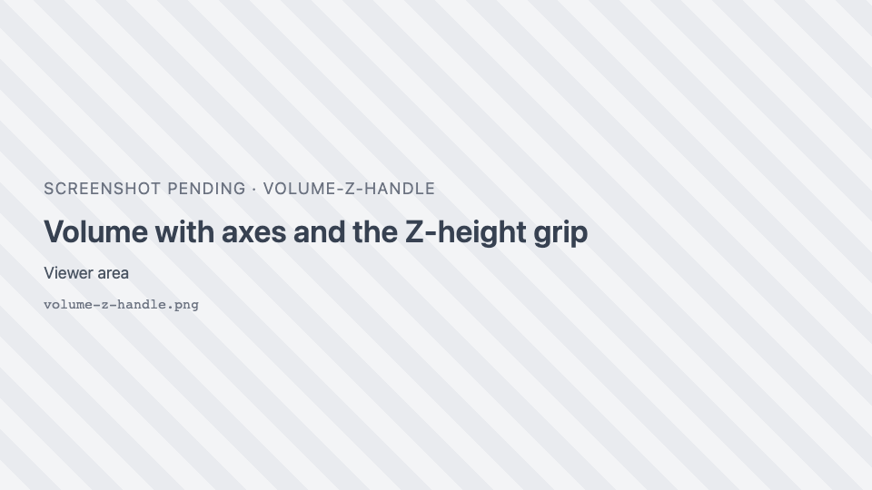
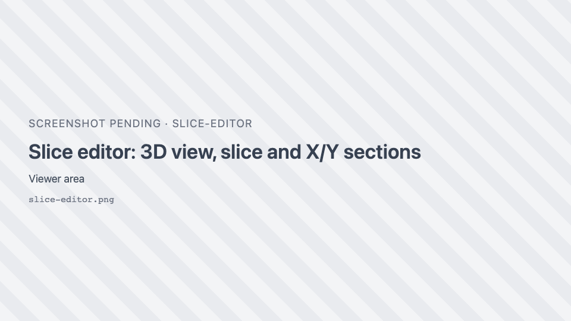

# Stacks, volumes and 3D

SIV handles z-stacks (confocal series, micro-CT, DICOM series) as a slice-by-slice image, as a 3D volume,
or both side by side.

## The slice slider

When a stack is open, the toolbar shows **Slice**, a slider with a "*z* of *max*" readout. Both numbers
count from 0, so the last slice of a 30-slice stack reads "29 of 29".

| Action | How |
| --- | --- |
| Go to a slice | Drag the slider. The view updates as you drag and settles when you release. |
| Step one slice | ++arrow-left++ / ++arrow-right++ in the Image view or the slice editor, or while the slider has focus. |

The Slice slider is shown in the Image view, Surface (the surface is rebuilt from the chosen slice),
Spatial omics on sliced data, and the Volume and Isosurface views while the slice editor is open. Slices
you have visited are kept in memory, so going back is instant, and zoom and position are kept.

!!! note
    In the Heatmap, Surface and Spatial omics views, the arrow keys step slices only while the slider itself
    has focus (click it first).

## Heatmap: single image or stack

In the Heatmap and Contour views a stack can be shown two ways:

| Button | Mode | Behaviour |
| --- | --- | --- |
| <i class="pi pi-image"></i> **Single image mode** | One slice (default) | The Slice slider chooses the slice; the plot redraws when you release it (or 400 ms after the last arrow key). High-definition zoom works. |
| <i class="pi pi-images"></i> **Stack mode** | Every slice | Loads all frames ("Loading frames..." with a **Cancel** button), then Plotly's own **Z-plane:** slider below the plot steps through them. It counts from 1. |

## Loading and cancelling

While a stack or volume loads, the view shows a progress bar and **Loading frames...**. **Cancel** stops
loading and goes back to slice 0.

## 3D views

Surface, Volume, Isosurface and Spatial omics 3D are drawn in 3D with WebGPU.

| View | Draws |
| --- | --- |
| **Surface** | The current slice as a height field. |
| **Volume** | The stack as a volume, with maximum-intensity projection. A multichannel stack is drawn with one coloured layer per channel. |
| **Isosurface** | Surfaces at the intensity band set by the **Iso** slider. |

While a 3D view builds, a badge at the bottom centre shows what is happening ("Building … in 3D…").

### 3D camera

| Control | What dragging does |
| --- | --- |
| <i class="pi pi-search"></i> **Zoom** | Zooms the camera. |
| <i class="pi pi-arrows-alt"></i> **Pan** | Moves the camera sideways. |
| <i class="pi pi-globe"></i> **Orbital rotation** | Rotates freely. |
| <i class="pi pi-sync"></i> **Turntable rotation** | Rotates around the vertical axis. The default. |
| <i class="pi pi-home"></i> **Reset camera to default** | (button) Fits the scene again. |

The mouse wheel zooms in every camera mode.

!!! note
    In the WebGPU 3D views, **Orbital rotation** and **Turntable rotation** behave the same: both rotate.

### Axes, wireframe and resolution

| Control | Default | What it does |
| --- | --- | --- |
| { .siv-icon } **Toggle 3D axes / scale** | on | X, Y and Z axes with their lengths (µm when the image carries a pixel size). |
| <i class="pi pi-share-alt"></i> **Toggle wireframe** | off | Draws surfaces as wireframes (Surface, Volume region-class surfaces, Spatial omics 3D). |
| **Res** | ¼ | Resolution of the 3D build. Changing it rebuilds the view. |

| Res | Volume / Isosurface (in-plane, pixels) | Surface mesh grid |
| --- | --- | --- |
| Full | up to 1024 | up to 880 |
| ½ | up to 512 | up to 440 |
| ¼ (default) | up to 256 | up to 220 |
| ⅛ | up to 128, every 2nd slice | up to 110 |

Resolution changes detail, not proportions. Use Full on a capable GPU for the sharpest view.

### Volume height (Z stretch)

A round blue ↕ grip sits at the centre of the volume's top face. Drag it to stretch or squash the volume
along Z: 180 px of drag doubles or halves the height, between 0.1× and 10×. Double-click it to reset.
This helps when slices are far apart compared to the pixel size.

## Isosurface band

In the Isosurface view the toolbar shows **Iso**, a range slider from 0 to 255 (default 0–255). The band is
mapped onto the volume's actual intensity range. Narrow it to isolate structures of a given brightness, and
widen it to see the whole object.

## Slice editor

In the Volume and Isosurface views, the { .siv-icon } **Slice editor** button
splits the view in four:

| Pane | Shows |
| --- | --- |
| Top left | The 3D volume, with three translucent planes marking the slice and the two sections. Drag the Z plane to change the slice. |
| Top right | The slice being edited (**Z · slice N**), with every region tool. |
| Bottom left | The section through **X** at the current position. |
| Bottom right | The section through **Y**. |

- The **Slice** slider and ++arrow-left++ / ++arrow-right++ step the edited slice.
- In a section pane: scroll to zoom about the pointer, drag to pan, double-click to fit, and click to move
  the slice and the other section to that point.
- Drag the dividers to resize the panes (20–80%). With a divider focused, the arrow keys move it by 5%.
- Regions you draw on the slice show as outlines in the sections and, per class, in 3D (see
  [Region Editor](region-editor.md#regions-in-3d)).
- Region tools work on the slice pane; zoom, fit, colours and export stay with the 3D view.

Click the button again (**Close the slice editor**) to go back to the full 3D view. The editor stays open
if you switch to another plot type and come back.

With the slice editor closed, the Volume and Isosurface views show only the Region Editor, Selection, Undo,
Redo and Delete region tools. Selection then picks class surfaces in the 3D view.
