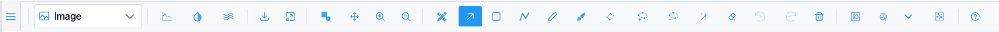
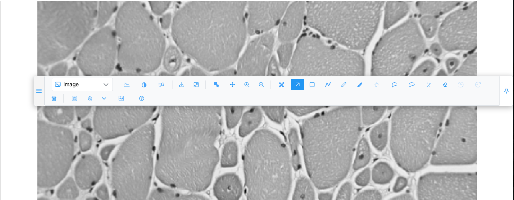
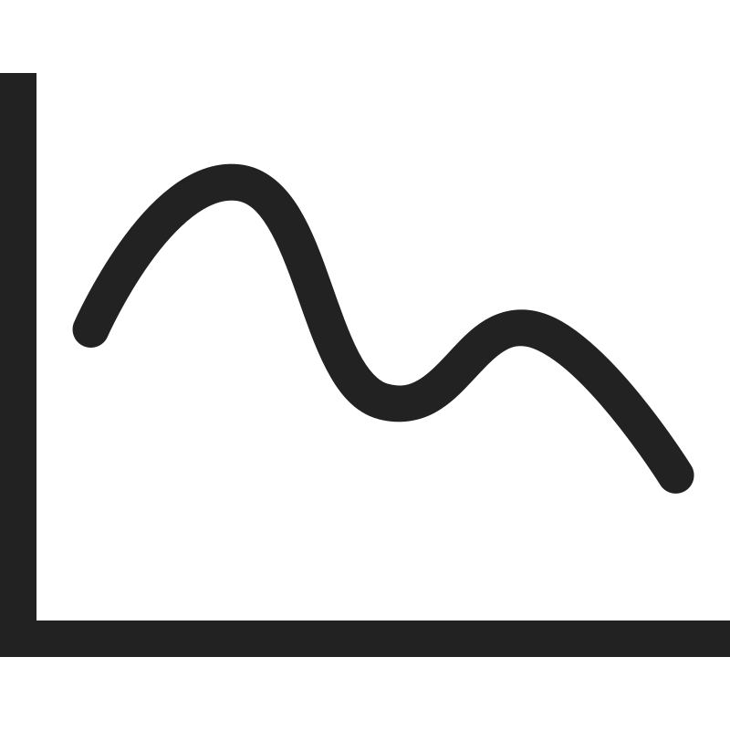

# Toolbar

The toolbar sits above the image. Every control is listed here in toolbar order, with what it does, when
it is shown, and its keyboard shortcut. Hover any button to see its tooltip.

Which buttons you see depends on the plot type and the image. For example, the Slice slider appears only
for stacks, and the 3D camera buttons replace the zoom buttons in 3D views. The host application can also
hide whole groups (see [Hidden groups](#hidden-groups)).

## Moving the toolbar

| Control | Icon | What it does |
| --- | --- | --- |
| **Drag to float the toolbar** | <i class="pi pi-bars"></i> | Press and drag to detach the toolbar into a floating window you can place anywhere over the page. |
| **Dock to top** | <i class="pi pi-thumbtack"></i> | Shown while the toolbar floats. Puts it back above the image. |

!!! tip
    The floating toolbar can be dragged partly off-screen. If you lose it, use **Dock to top**. Its
    position is not remembered after a reload.

## View group

| Control | Icon | What it does | Shown |
| --- | --- | --- | --- |
| **Plot type** dropdown | <i class="pi pi-image"></i> Image | Chooses how the data is drawn. See [Plot types](plot-types.md). | An image or a spatial dataset is loaded |
| **Iso** band slider | — | The intensity band drawn as surfaces (0–255, mapped onto the volume's range). See [Isosurface](stacks-3d.md#isosurface-band). | Isosurface |
| **Add an intensity line** | { .siv-icon } | Adds a coloured line and plots the intensity along it. See [Intensity profile lines](intensity-profiles.md). | Image and Heatmap |
| **Channels & Histogram** | { .siv-icon } | Opens the brightness/contrast, channel and colormap dialog. See [Channels & Histogram](channels-histogram.md). | Always |
| **Spatial omics controls** | { .siv-icon } | Opens the Spatial omics panel. See [Spatial omics](spatial-omics.md). | Spatial omics plot types |
| **Smoothen** | { .siv-icon } | Switches between raw pixels (default, crisp blocks when zoomed in) and smoothed (bilinear) rendering. The icon turns white while smoothing is on. | Image |
| **Slice** slider | — | Steps through the slices of a stack. See [Stacks](stacks-3d.md#the-slice-slider). | Stacks |
| **Single image mode** / **Stack mode** | <i class="pi pi-image"></i> / <i class="pi pi-images"></i> | Heatmap and Contour only: one slice at a time (with high-definition zoom), or every slice with Plotly's own Z-plane slider. | Stacks, Heatmap/Contour |
| **Download image as PNG** | <i class="pi pi-download"></i> | Saves what the view shows as a PNG. See [Download](navigation.md#download). | Always |
| **Fit to view** | <i class="pi pi-window-maximize"></i> | Fits the whole image (or the 3D scene) into the view. | 2D views |

## Zoom group (2D views)

| Control | Icon | Key | What it does |
| --- | --- | --- | --- |
| **Zoom drag** | <i class="pi pi-search"></i> | — | Heatmap and Contour: drag a rectangle to zoom into it. Not shown in the Image view. |
| **Zoom box** | { .siv-icon } | ++b++ | Drag a box to zoom into it. Stays active until you pick another tool. |
| **Pan the image** | <i class="pi pi-arrows-alt"></i> | ++p++ | Drag to pan. |
| **Zoom in** | <i class="pi pi-search-plus"></i> | ++plus++ or ++equal++ | Zooms in one step (×1.3) about the centre. |
| **Zoom out** | <i class="pi pi-search-minus"></i> | ++minus++ or ++underscore++ | Zooms out one step. |

See [Navigation](navigation.md) for mouse zoom, click-to-zoom, the minimap and the scale bar.

## 3D group (3D views)

Replaces the zoom group in Surface, Volume, Isosurface and Spatial omics 3D.

| Control | Icon | What it does |
| --- | --- | --- |
| **Zoom** | <i class="pi pi-search"></i> | Dragging zooms the camera. |
| **Pan** | <i class="pi pi-arrows-alt"></i> | Dragging pans the camera. |
| **Orbital rotation** | <i class="pi pi-globe"></i> | Dragging rotates freely around the scene. |
| **Turntable rotation** | <i class="pi pi-sync"></i> | Dragging rotates around the vertical axis (default). |
| **Reset camera to default** | <i class="pi pi-home"></i> | Puts the camera back to fit the scene. |
| **Toggle 3D axes / scale** | { .siv-icon } | Shows or hides the axes with their lengths (on by default). |
| **Toggle wireframe** | <i class="pi pi-share-alt"></i> | Draws surfaces as wireframes (off by default). |
| **Res** | — | Resolution of the 3D build: Full, ½, ¼ (default) or ⅛. Changing it rebuilds the view. |
| **Slice editor** | { .siv-icon } | Volume and Isosurface: splits the view into the 3D volume, the slice being edited and two sections. See [Slice editor](stacks-3d.md#slice-editor). |

The mouse wheel always zooms in 3D. Details in [Stacks, volumes and 3D](stacks-3d.md#3d-camera).

## Region group

| Control | Icon | Key | What it does |
| --- | --- | --- | --- |
| **Open the Region Editor** | { .siv-icon } | — | Opens the [Region Editor](region-editor.md) as a floating dialog. |
| **Selection mode** | <i class="pi pi-arrow-up-right"></i> | ++s++ | Neutral mode: select, move and reshape regions. |
| **Draw a rectangle** | <i class="pi pi-stop"></i> | ++r++ | Drag to draw a rectangle. |
| **Draw a polyline** | { .siv-icon } | ++l++ | Drag to draw an open line. |
| **Draw a freeform region** | <i class="pi pi-pencil"></i> | ++f++ | Drag to draw a closed shape. |
| **Brush** | { .siv-icon } | — | Paint a region; ++shift++ erases. Shows a **Size** slider. |
| **Draw a polygon** | { .siv-icon } | — | Click each vertex; click the first point to close. Image view. |
| **Add a vertex** | { .siv-icon } | — | Click an edge of the selected polygon. Image view. |
| **Delete a vertex** | { .siv-icon } | — | Click a vertex of the selected polygon. Image view. |
| **Wand** | { .siv-icon } | ++w++ | Grow a region from similar pixels. Shows a **Sens.** slider. |
| **Vertex eraser** | <i class="pi pi-eraser"></i> | ++e++ | Remove vertices under a circle cursor. Shows a **Radius** slider. |
| **Undo** | { .siv-icon } | ++ctrl+z++ | Undo the last region action (up to 10). |
| **Redo** | { .siv-icon } | ++ctrl+shift+z++ / ++ctrl+y++ | Redo the last undone action. |
| **Delete selected region** | <i class="pi pi-trash"></i> | ++del++ / ++backspace++ / ++d++ | Delete every selected region. |

Each tool is described in full in [Region tools](region-tools.md). Clicking the active tool again turns it
off.

In the Volume and Isosurface views, with the slice editor closed, only the Region Editor, Selection,
Undo, Redo and Delete are shown. Selection then picks class surfaces in 3D.

## Segmentation group

| Control | Icon | What it does |
| --- | --- | --- |
| **Segment with SAM (box prompt)** | { .siv-icon } | Replaces each drawn rectangle with the object SAM finds inside it. |
| **SAM point prompts** | { .siv-icon } | Click an object to segment it; ++shift++/++alt++-click excludes; ++enter++ commits; ++esc++ undoes. |
| **Pick the SAM model** | <i class="pi pi-chevron-down"></i> | Chooses the SAM model used by both SAM tools; <i class="pi pi-info-circle"></i> shows each model's size, speed and domain. |
| **Segment cells (cellpose-SAM)** | { .siv-icon } | Segments every cell inside each drawn rectangle. |

The host application may add its own tools here (for example detection models), each with a model picker
<i class="pi pi-chevron-down"></i> and a parameters button <i class="pi pi-sliders-h"></i>. See
[AI segmentation](segmentation.md).

## Help

| Control | Icon | What it does |
| --- | --- | --- |
| **Help** | <i class="pi pi-question-circle"></i> | Opens this page of the user guide in a new tab. |

## Hidden groups

An application embedding SIV can hide groups of controls:

| Group hidden | Controls removed |
| --- | --- |
| Special tools | Plot type (with Iso and intensity line), Channels & Histogram, Spatial omics, Smoothen, Download, Fit to view |
| Zoom tools | Zoom drag, Zoom box, Pan, Zoom in, Zoom out |
| Region tools | Every region and segmentation tool, and the Slice editor button |
| Help | The Help button |

The 3D camera controls, stack controls, the right-click menu and the keyboard shortcuts are never hidden.
The host can also add its own buttons at the start of the toolbar.

## Related

- [Keyboard shortcuts](keyboard-shortcuts.md)
- [Region actions (context menu)](region-actions.md)
