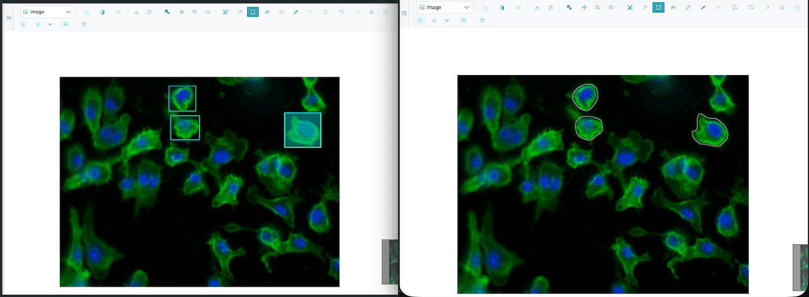
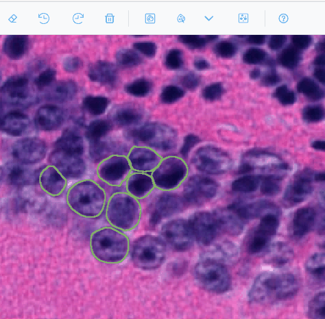
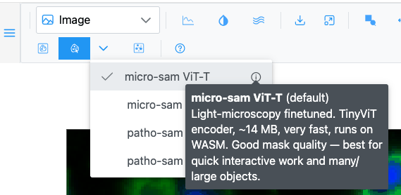
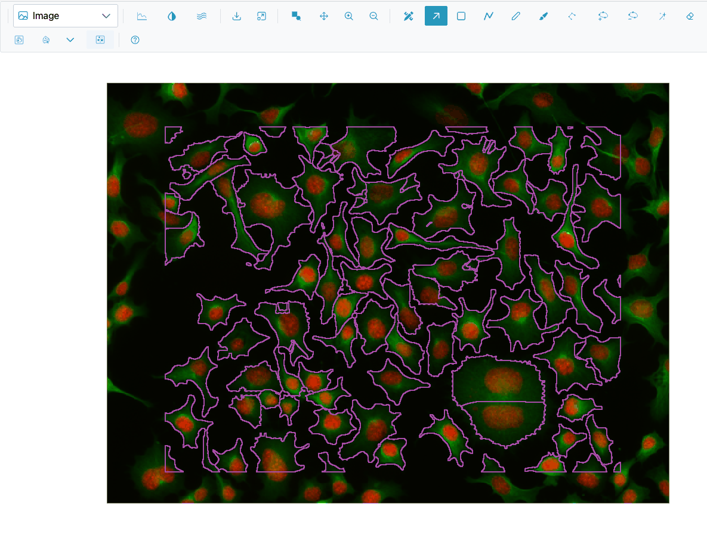

# Segment cells with AI

SIV can segment objects with AI models that run in your browser: nothing is sent to a server. In this
tutorial you use **Segment Anything** (SAM) with box and point prompts to outline individual cells, then
**Cellpose** to outline every cell in an area at once.

**Time:** about 15 minutes, plus model downloads the first time. **You need:** the
[live demo](https://thejacksonlaboratory.github.io/sci-image-visualizer/) and a good connection. The first
run of each model downloads it (14 MB for the default SAM model, about 588 MB for Cellpose); after that it
is cached by the browser.

## 1. Segment with box prompts

1. Open the sample **img04.png** (cells with blue nuclei and green cytoplasm).
2. Press ++r++ and draw a rectangle loosely around one cell. Draw two more rectangles around two other
   cells.
3. Click { .siv-icon } **Segment with SAM (box prompt)**.

**What you should see:** a progress toast at the bottom right titled **SAM**. The first time it shows the
model download, then "Encoding image…" and "Segmenting 1/3…". When it finishes it reports "Added 3
region(s)", and each rectangle has been replaced by the outline of the cell inside it.

A rectangle that produced no mask is kept, so you can adjust it and click **Segment** again.

!!! note "What SAM sees"
    SAM reads the image as it is displayed. Only the part of a rectangle that is on screen is segmented, and
    the contrast you set in Channels & Histogram affects the result. Zoom so the objects are comfortably
    visible before you segment.

## 2. Segment with point prompts

1. Click { .siv-icon } **SAM point prompts**. The button stays
   pressed while the tool is active.
2. Click in the middle of a cell that has no region yet.

**What you should see:** after a moment a new region outlines the cell.

3. If the region includes too much, for example a neighbouring cell, hold ++shift++ (or ++alt++) and click
   on the part that should be excluded. The outline is recomputed.
4. Press ++enter++ to keep the object. Press ++esc++ instead to discard it.
5. Click another cell: each plain click starts a new object.

6. Click the point-prompt button again to turn the tool off.

## 3. Choose a model

1. Click the <i class="pi pi-chevron-down"></i> arrow next to the Segment button. The model menu lists the
   available SAM checkpoints; a check marks the active one.
2. Hover the <i class="pi pi-info-circle"></i> next to a model to read its size, speed and the images it
   was trained on.

| Model | Best for | Download |
| --- | --- | --- |
| micro-sam ViT-T (default) | Light microscopy; small and fast | about 14 MB |
| micro-sam ViT-B | Light microscopy; highest accuracy | about 172 MB |
| patho-sam ViT-B | Histopathology (H&E and other stains) | about 180 MB |
| patho-sam ViT-B (int8) | Histopathology on slow connections | about 100 MB |

The choice applies to both the box and the point tool. For this tutorial keep **micro-sam ViT-T**.

## 4. Segment every cell in an area with Cellpose

1. Open the sample **002_img.png**.
2. Press ++r++ and draw one large rectangle over a group of 20 to 50 cells.
3. Click { .siv-icon } **Segment cells (cellpose-SAM)**.

**What you should see:** a **Cellpose** toast showing "Downloading Cellpose-SAM model…" the first time, then
"Running inference…", "Computing flow dynamics…" and "Tracing cells…". It ends with "Added *N* cell
region(s)". The rectangle is replaced by one region per cell.

## 5. Review the results

1. Open the Region Editor. Regions from SAM have the class **sam** and regions from Cellpose the class
   **cell**. Both classes appear in the **Classes** panel, each drawn in its class's colour.
2. Delete wrong detections: select them and press ++delete++ (or ++d++).
3. Fix outlines with the vertex tools or the brush, as in [Annotate your first image](first-annotation.md).
4. Give the good ones a meaningful class with <i class="pi pi-tags"></i> **Edit class on selected rows**.

Every segmentation run is a single step in the undo history, so ++ctrl+z++ removes everything it added.

## What you learned

- Box prompts: draw rectangles, then **Segment**.
- Point prompts: click to add an object, ++shift++-click to exclude, ++enter++ to keep, ++esc++ to discard.
- How to pick a SAM model for your kind of images.
- Cellpose: draw a rectangle, get one region per cell.

## Next

- [AI segmentation how-tos](../how-to/segmentation.md): working with large images, slow connections and
  pre-caching models.
- [AI segmentation reference](../reference/segmentation.md) for every option and message.
