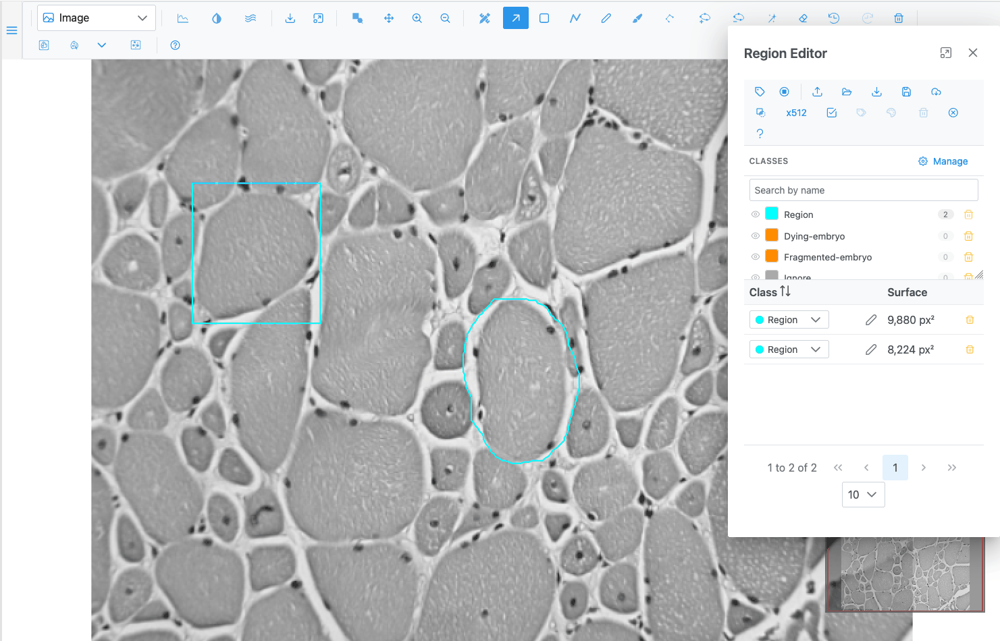
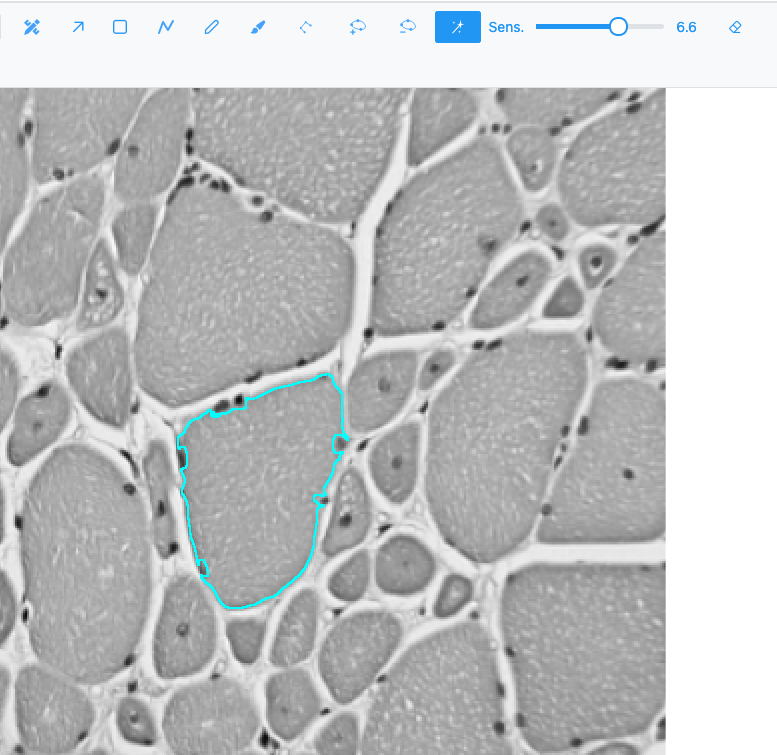
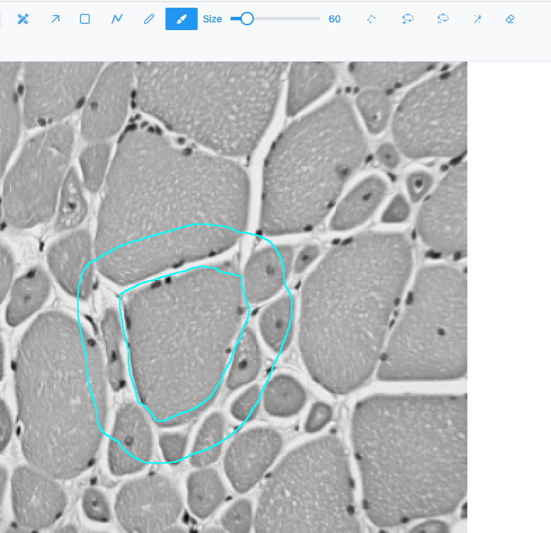
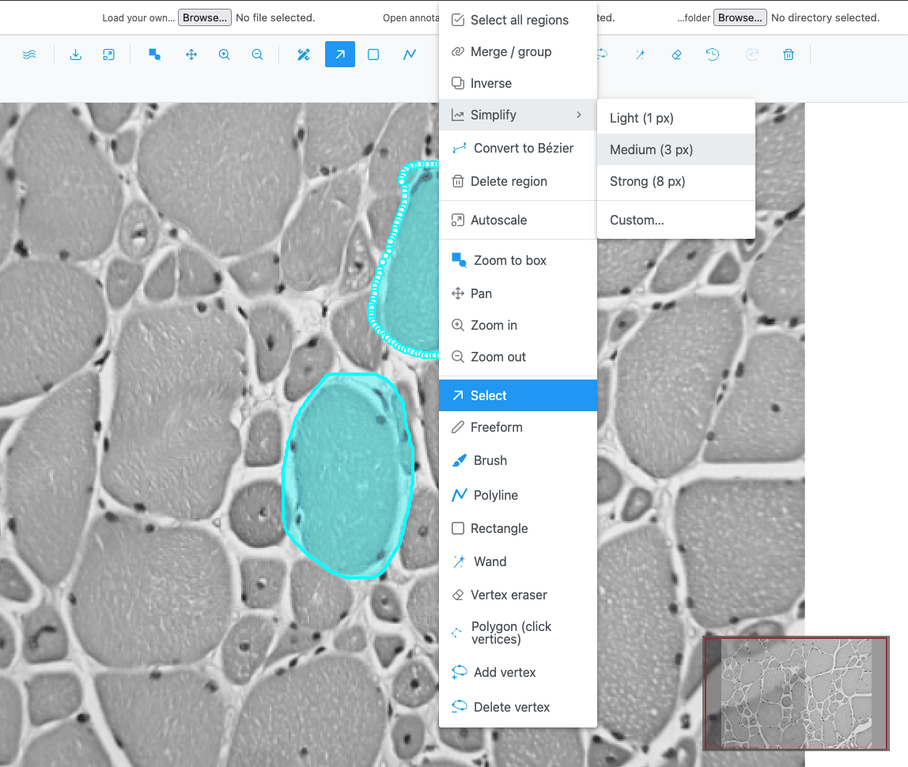
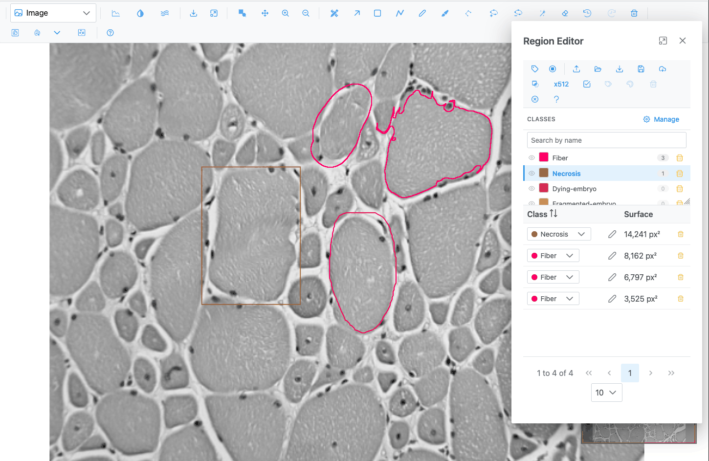
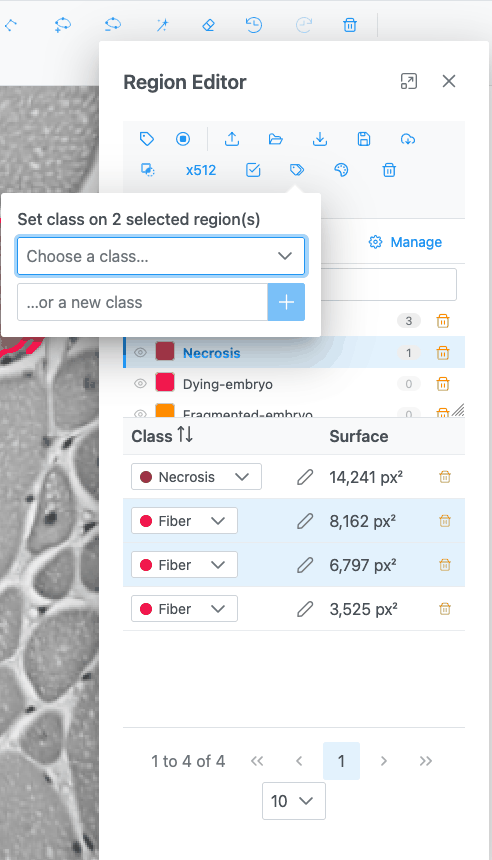

# Annotate your first image

In this tutorial you draw regions on a muscle image with several tools, edit their outlines, group them
into classes in the Region Editor, and export them as a GeoJSON file that QuPath and other tools can read.

**Time:** about 20 minutes. **You need:** the [live demo](https://thejacksonlaboratory.github.io/sci-image-visualizer/).

## 1. Open the image and the Region Editor

1. Open the live demo and click the sample **img01.png**.
2. Click { .siv-icon } **Open the Region Editor** in the toolbar.

**What you should see:** the **Region Editor** opens as a floating window on the right. It has its own
toolbar, a **Classes** panel and an empty table. You can drag it by its title bar and leave it open while
you draw.

## 2. Draw a rectangle and a freeform region

1. Press ++r++ (or click <i class="pi pi-stop"></i> **Draw a rectangular region**).
2. Drag a rectangle around one muscle fibre.
3. Press ++f++ (**Draw a freeform region**) and drag around another fibre, following its edge. Release to
   close the shape.

**What you should see:** both regions appear on the image and as two rows in the Region Editor, each with
the class **Region** and its area in the **Surface** column. The area is in px² here, because this PNG
does not record its pixel size; on a calibrated image it is in µm² or mm².

## 3. Let the wand find a fibre

1. Press ++w++ (or click { .siv-icon } **Wand**). A **Sens.** slider appears
   next to the button.
2. Click inside a third fibre. The wand grows a region over the pixels similar to the one you clicked.
3. If the region spills into the background, raise **Sens.** (stricter) and click again; if it covers
   only part of the fibre, lower it. A click inside the existing wand region extends that same region.
4. To remove a bit that leaked out, hold ++shift++ and click or drag over it.

!!! note
    The wand reads the pixels as they are displayed, so the result depends on the zoom level and on the
    contrast set in Channels & Histogram.

## 4. Paint with the brush and make a donut

1. Click { .siv-icon } **Brush**. A **Size** slider appears; set it to
   about 40.
2. Paint a ring along the inside edge of a fibre, all the way round, without painting its centre.

**What you should see:** one region shaped like a ring. The unpainted centre is a **hole**: the region is a
donut, and its area in the table excludes the hole.

3. Hold ++shift++ and paint over part of the ring to erase it.

## 5. Edit outlines

1. Press ++s++ (**Selection mode**) and click the freeform region. It is drawn thicker and its vertices
   show.
2. Drag a vertex to move it. Drag the region's body to move the whole region.
3. Click { .siv-icon } **Add a vertex** and click on the edge of the
   selected region to insert a point.
4. Click { .siv-icon } **Delete a vertex** and click a vertex to
   remove it.
5. Press ++e++ (**Vertex eraser**). Click or drag the circle over part of an outline: the vertices inside
   the circle are removed and the outline is rejoined at its edge. The **Radius** slider sets the circle's
   size.

Made a mistake? Press ++ctrl+z++ to undo, and ++ctrl+shift+z++ or ++ctrl+y++ to redo. Up to 10 actions can be
undone.

## 6. Combine regions

1. Press ++s++, click the rectangle, then ++shift++-click the freeform region. Both are selected.
2. Right-click on the image. The menu starts with the region actions.
3. Choose **Merge / group**.

**What you should see:** one region replaces the two. If they did not touch, the result is a single region
in several parts; **Ungroup** in the same menu splits it again.

4. Press ++ctrl+z++ to undo the merge; you will classify the regions separately.

## 7. Classify the regions

1. In the Region Editor, click the first row's **Class** cell and pick **Necrosis** from the dropdown. The
   region takes that class's colour on the image.
2. Click a row, then ++ctrl++-click two more rows to select three regions at once. They are highlighted on
   the image too.
3. Click <i class="pi pi-tags"></i> **Edit class on selected rows**, type `Fibre` in **…or a new class**
   and press ++enter++. All three regions are now in the new class **Fibre**, and **Fibre** appears in the
   **Classes** panel with a colour of its own.
4. In the **Classes** panel, click the colour swatch next to **Fibre** and pick another colour. Every
   region of that class changes colour.

!!! tip
    Clicking a class name in the **Classes** panel while rows are selected applies that class to them.
    Newly drawn regions always start in the class **Region**; classify them afterwards.

## 8. Export the regions

1. In the Region Editor toolbar, click <i class="pi pi-download"></i> **Download regions as geojson
   file**.
2. In **Export Regions**, keep the suggested name `img01.geojson` and click **Export**.

**What you should see:** your browser saves a GeoJSON file. Each region is a feature whose
`classification` holds its class name and colour. Rectangles and freeform shapes are `Polygon`s, the donut
keeps its hole, and polylines would be `LineString`s.

!!! warning "Regions are not saved automatically"
    In the demo, regions live in the browser's memory. They survive switching to another image and back, but
    not a page reload. Export them (or, in an application with a server, use
    <i class="pi pi-save"></i> **Save regions to server**) to keep them.

## 9. Bring them back

1. Click <i class="pi pi-times-circle"></i> **Delete all regions** in the Region Editor and confirm.
2. Click <i class="pi pi-upload"></i> **Import regions** and pick the file you exported.

**What you should see:** all regions are back, with their classes and colours.

## What you learned

- Drawing with the rectangle, freeform, wand and brush tools, and making a region with a hole.
- Editing outlines with Selection, the vertex tools and the vertex eraser; undo and redo.
- Merging regions from the right-click menu.
- Classifying regions one at a time or in bulk, and recolouring a class.
- Exporting to and importing from GeoJSON.

## Next

- [Segment cells with AI](ai-segmentation.md) lets a model draw the regions for you.
- [Annotation classes](../how-to/classes.md) shows how to set up class presets you can reuse and share.
- The [Region tools](../reference/region-tools.md) and [Region Editor](../reference/region-editor.md)
  reference pages list every option.
