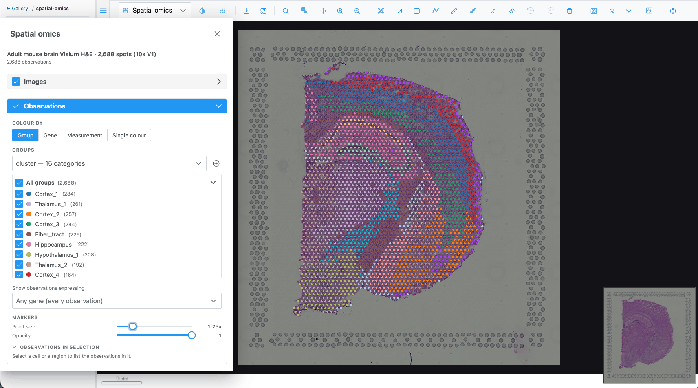
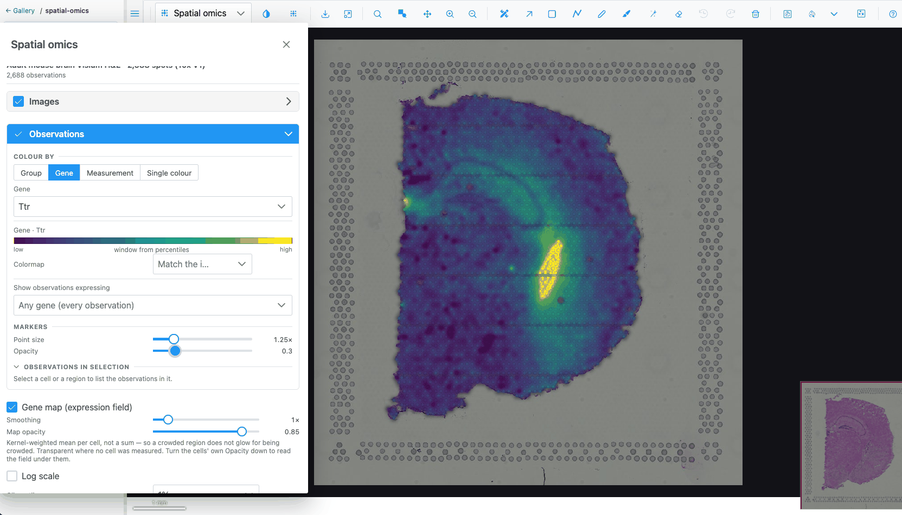
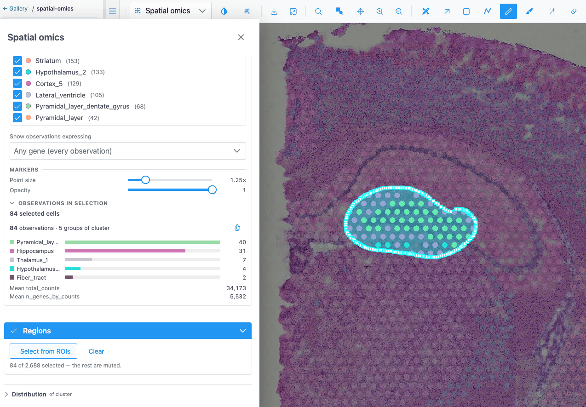
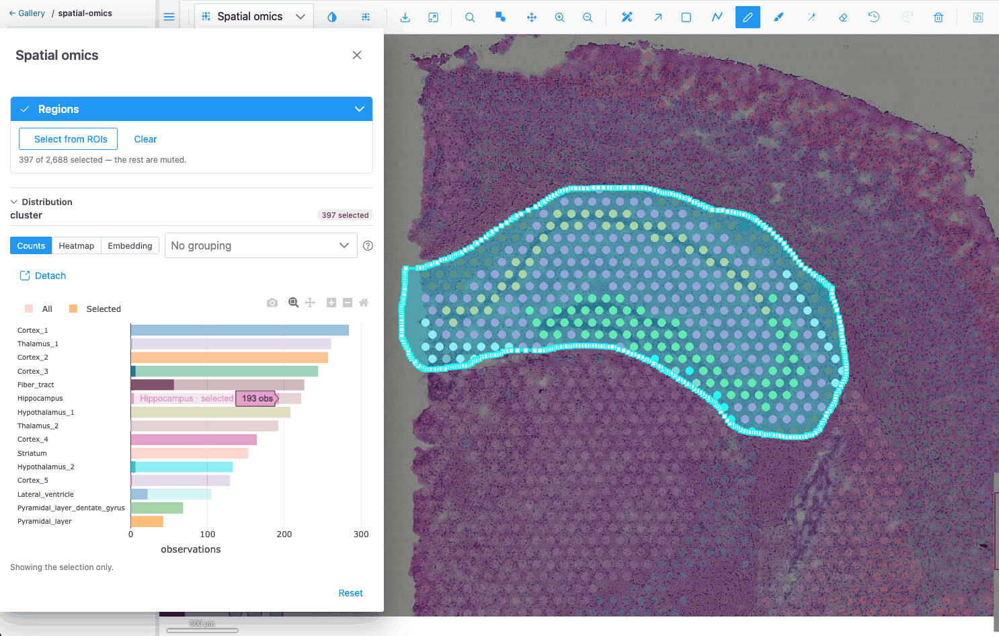
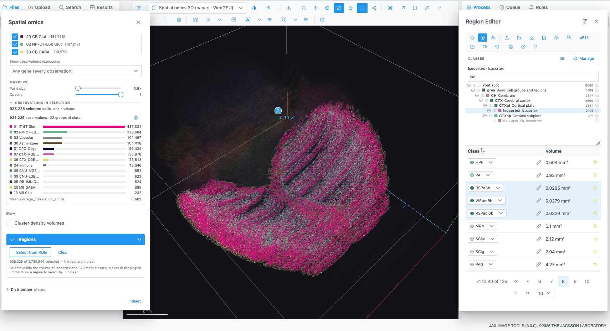
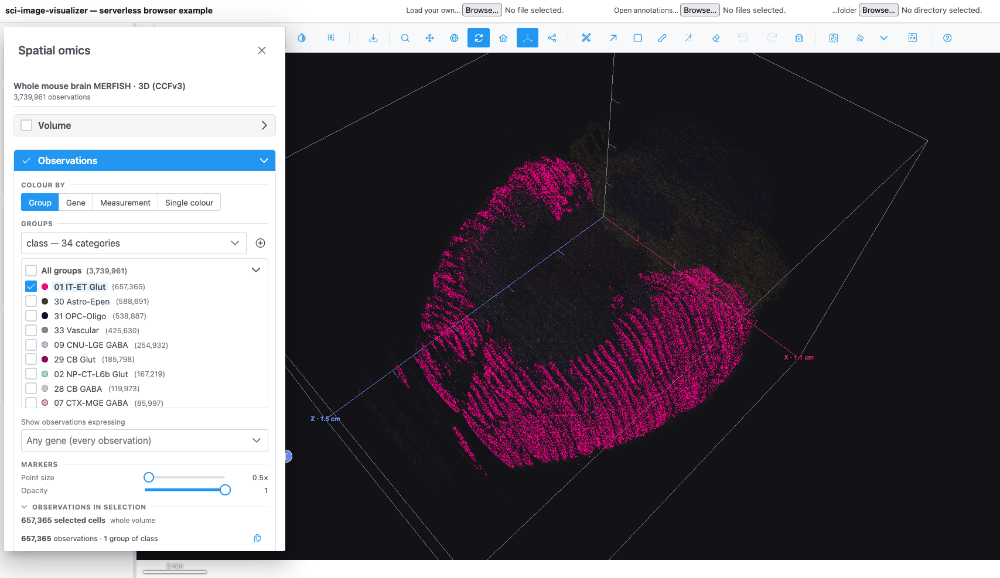

# Explore a spatial-omics dataset

Spatial transcriptomics measures gene expression at known positions in a tissue section. In this tutorial
you open a 10x Visium dataset of the adult mouse brain, colour its spots by cluster and by gene, select the
spots inside a region you draw, and compare them with the rest of the section in the distribution charts.
You finish with a quick look at a 3D whole-brain atlas.

**Time:** about 20 minutes. **You need:** the [live demo](https://thejacksonlaboratory.github.io/sci-image-visualizer/)
in a browser with WebGPU (recent Chrome or Edge). See [Limits and requirements](../reference/limits.md).

## 1. Open the dataset

1. In the gallery, open the **spatial-omics** folder.
2. Click **Adult mouse brain Visium H&E · 2,688 spots**. The tissue image loads first.
3. Open the plot-type dropdown and pick **Spatial omics**.
4. Click { .siv-icon } **Spatial omics controls** in the toolbar.

**What you should see:** one marker per Visium spot over the H&E image, coloured by the first group column
(the clusters). The **Spatial omics** panel opens on the left; its header shows the dataset name and
"2688 observations".

## 2. Colour by cluster

1. In the panel, look at **Observations → Colour by**. **Group** is active, with the **cluster** column.
2. Below it, the **Groups** list is the legend: one row per cluster with its colour and number of spots,
   largest first.
3. Untick a cluster's checkbox. Its spots disappear from the map. Tick it again.
4. Click a cluster's colour dot and pick another colour. The map updates.
5. Click a cluster's **name**. Its spots are selected and every other spot is muted. Click the name again
   to clear the selection.

## 3. Colour by a gene

1. Under **Colour by**, choose **Gene**.
2. In the search box type `Ttr` and pick it. Ttr is strongly expressed in the choroid plexus.

**What you should see:** spots coloured on a continuous scale, with a **key** showing the colour bar from
low to high. **Log scale** may switch on by itself, because the dataset says its values are counts.

3. Change **Clip outliers** from **1%** to **5%**. The colour window narrows, so mid-level spots stand out
   more.
4. Pick a different scale in **Colormap**, for example **Viridis**. Clear it to go back to matching the
   image.
5. Tick **Gene map (expression field)** and lower the markers' **Opacity** to about 0.3. A smooth estimate
   of the gene's expression is drawn under the spots.

6. Untick **Gene map** and set **Opacity** back to 1.

## 4. Select spots with a region

1. Switch **Colour by** back to **Group**.
2. Press ++f++ and draw a freeform region around one anatomical structure, for example the hippocampus.
3. In the panel, expand **Regions** and click <i class="pi pi-object-group"></i> **Select from ROIs**.

**What you should see:** the spots inside your region stay bright and the others are muted. The hint reads
"*n* of 2688 selected — the rest are muted". The **Observations in selection** summary lists how many
spots of each cluster are inside.

!!! tip
    **Select from ROIs** uses every region on the image, holes included, whichever tool drew it. The regions
    do not need to be visible: the **Regions** switch only shows or hides them.

## 5. Compare the selection with the whole section

1. Expand **Distribution** at the bottom of the panel. With a group colouring it shows **Counts**: the
   number of spots per cluster, with your selection drawn over the totals.

2. Switch **Colour by** to **Gene** and pick `Ttr` again. The chart switches to a **Histogram** of Ttr,
   with the selection overlaid on the full distribution.
3. Choose **Violin** and set the grouping to **cluster**. You see Ttr's distribution in every cluster.
   With a selection, only the selected spots are charted.
4. Choose **Heatmap**. Pick four or five genes in **Pick genes for the rows**, for example `Ttr`, `Mbp`,
   `Plp1`, `Nrgn` and `Hbb-bs`. Each cell is the mean of a gene in a cluster, z-scored per gene by
   default.
5. Click <i class="pi pi-question-circle"></i> next to the chart tabs to read what the current chart shows,
   and what it must not be read for.
6. Click <i class="pi pi-external-link"></i> **Detach** to move the chart into its own window next to the
   map. Click **Put back** to return it.

Click **Clear** in the **Regions** section to clear the selection.

## 6. Select in an embedding

1. Go back to the gallery's **spatial-omics** folder and open **Mouse embryo seqFISH · 19,416 cells**. It
   has no tissue image, so it opens directly in a spatial view.
2. Open the **Spatial omics** panel. Under **Colour by → Group**, pick the cell-type column.
3. In **Distribution**, choose **Embedding** and, if there is a choice, the UMAP.
4. In the chart's toolbar choose the lasso, and draw around one cluster of points.

**What you should see:** the lassoed cells are highlighted on the map as well. The map and the embedding
read the same selection.

## 7. A 3D atlas

1. Open **spatial-omics → Allen Brain Cell Atlas → Whole mouse brain MERFISH · 3D · 1-in-10**. The
   reference volume opens first in the **Image** view.
2. Pick **Spatial omics 3D** in the plot-type dropdown. About 374,000 cells are drawn in 3D.
3. Drag to rotate, scroll to zoom, and use <i class="pi pi-home"></i> **Reset camera** to start again.
4. Load the atlas regions. Open the Region Editor, click <i class="pi pi-upload"></i> **Import regions**
   and choose two files together: the label volume `resampled_annotation.nii.gz` and its ontology
   `structure_graph_1.json`, both from the Allen Brain Cell Atlas download. In JAX Image Tools your
   administrator may have attached them already.
5. The **Classes** panel now shows the atlas's brain-region tree. Click a region, for example a cortical
   area, to pick it.
6. In the **Spatial omics** panel, expand **Regions** and click **Select from ROIs**. The cells inside the
   picked region's volume are selected.

## What you learned

- Opening a dataset and switching to the **Spatial omics** plot types.
- Colouring by group or gene, tuning the colour scale, and hiding or recolouring groups.
- Selecting observations from a drawn region, a group name, an embedding lasso or an atlas region.
- Reading the selection in **Counts**, **Histogram**, **Violin**, **Heatmap** and **Embedding**.

## Next

- [Spatial omics how-tos](../how-to/spatial-omics.md) cover gene filters, importing cell groups and
  computing a t-SNE in the browser.
- The [Spatial omics](../reference/spatial-omics.md) and [Distribution charts](../reference/distribution-charts.md)
  reference pages describe every control.
