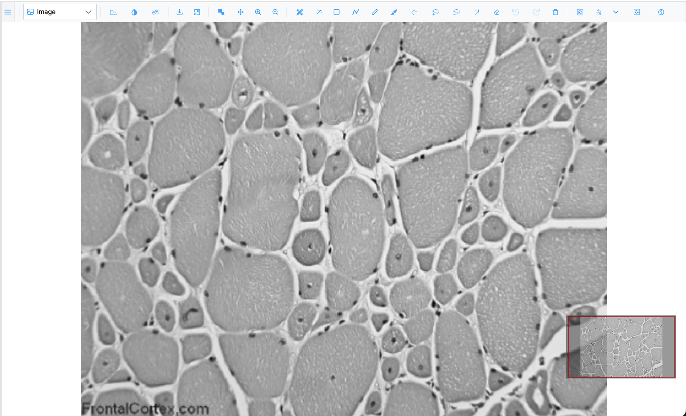
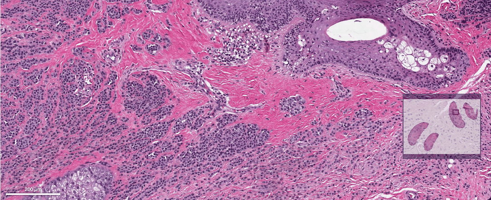
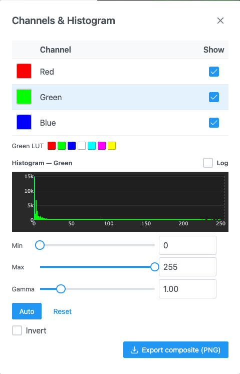
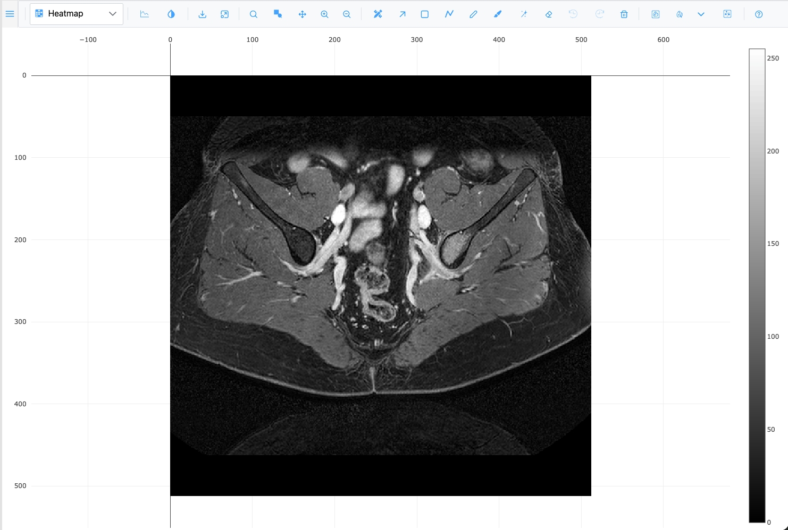
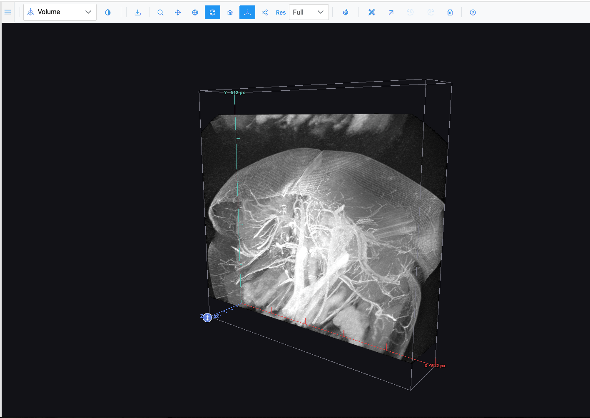

# Tour of the viewer

In this tutorial you open several kinds of images, move around them, change how they are displayed and
look at them as a heatmap and in 3D. By the end you will know where every group of toolbar buttons is and
what it is for.

**Time:** about 10 minutes. **You need:** the [live demo](https://thejacksonlaboratory.github.io/sci-image-visualizer/).

## 1. Open an image

1. Open the live demo. The gallery of samples is on the left and the viewer on the right.
2. Click the sample **img01.png** (grey muscle tissue).

**What you should see:** the image fills the viewer. Above it is the toolbar. At the bottom right is the
**minimap**, a small copy of the whole image with a red rectangle marking the part you are looking at.

The toolbar is organised in groups, left to right:

| Group | What it holds |
| --- | --- |
| Plot type | The dropdown that switches between Image, Heatmap, Surface and the other views |
| Display | Intensity lines, Channels & Histogram, Smoothen |
| Image actions | Download as PNG, Fit to view |
| Zoom | Zoom box, Pan, Zoom in, Zoom out |
| Regions | Region Editor, Selection and the drawing tools, Undo, Redo, Delete |
| Segmentation | Segment (SAM), SAM point prompts, model picker, Cellpose |
| Help | Opens this guide |

Hover over any button to see its name and keyboard shortcut. The [toolbar reference](../reference/toolbar.md)
describes them all.

## 2. Zoom and pan

1. Scroll the mouse wheel over a muscle fibre. The image zooms in and out around the pointer.
2. Click once on the image. It zooms in towards the point you clicked.
3. Press and drag the image to pan.
4. Press ++plus++ and ++minus++ to zoom in and out one step at a time, around the centre of the view.
5. Drag the red rectangle in the minimap, or click elsewhere in it, to jump to another part of the image.
6. Click <i class="pi pi-window-maximize"></i> **Fit to view** to see the whole image again.

Now try the zoom box:

1. Press ++b++ (or click { .siv-icon } **Zoom box**).
2. Drag a rectangle around a few fibres and release.

**What you should see:** the view zooms to exactly the box you drew. The tool stays active so you can draw
another box. Press ++b++ again to turn it off.

## 3. A gigapixel image and the scale bar

1. In the gallery, click the tile **WSI · CMU-1 · 1.5 Gpx (CC0)**, an H&E whole-slide image of 1.5 billion
   pixels.
2. Zoom in on the tissue. Sharp tiles load as you zoom; you never download the whole image.

**What you should see:** a **scale bar** at the bottom left, in µm or mm. It shows only for images that
record their pixel size, and its length always stays a round number (1, 2 or 5 times a power of ten).

## 4. Raw pixels or smooth

1. Open **img01.png** again and zoom in until you can see individual pixels as blocks.
2. Click { .siv-icon } **Smoothen**. The blocks are blended (bilinear
   smoothing) and the button's icon turns white.
3. Click it again to go back to raw pixels.

SIV opens images showing raw pixels on purpose, so you can inspect exact pixel values when zoomed in.

## 5. Brightness, contrast and colours

1. Click the sample **img04.png** (cells with blue nuclei and green cytoplasm).
2. Click { .siv-icon } **Channels & Histogram**. A floating dialog opens.

**What you should see:** a table with the **Red**, **Green** and **Blue** channels, each with a colour
swatch and a **Show** checkbox, then a histogram of the selected channel and the **Min**, **Max** and
**Gamma** sliders.

{ width="460" }

3. Untick **Show** for **Green**. Only the nuclei remain. Tick it again.
4. Click the **Green** row, then drag **Max** down to about 120. The cytoplasm becomes brighter.
5. Click **Auto**. Min and max are set so that 0.1% of pixels are saturated at each end.
6. Click **Reset** to undo your contrast changes.
7. Close the dialog with its ×.

Grayscale images have a **Colormap** list in the same dialog; you will use it in the
[how-to guides](../how-to/viewing.md).

## 6. Other plot types

1. Open **img01.png** and pick **Heatmap** in the plot-type dropdown. The image is drawn as a heatmap with
   a colour bar.

2. Pick **Surface**. The intensities become a 3D height field. Drag to rotate it; scroll to zoom.
3. Notice that the zoom buttons were replaced by 3D camera buttons: Zoom, Pan, Orbital rotation,
   Turntable rotation and <i class="pi pi-home"></i> **Reset camera**.
4. Pick **Image** to return to the 2D view.

Now a 3D stack:

1. In the gallery, open the **micro-ct** folder.
2. **Right-click** any slice. The whole folder loads as a z-stack.

**What you should see:** a **Slice** slider in the toolbar, reading "*z* of *max*". Press ++left++ and
++right++ to step through the slices.

3. Pick **Volume** in the plot-type dropdown. After a few seconds the stack is drawn as a 3D volume.
4. Drag to rotate it.

The plot-type dropdown only offers what the open image can show. **Volume** and **Isosurface** need a
z-stack, and **Contour** needs a grayscale or multichannel image. See [Plot types](../reference/plot-types.md).

## 7. Move the toolbar out of the way

1. Press and drag the <i class="pi pi-bars"></i> handle at the far left of the toolbar.
2. Drop it anywhere over the image. The toolbar now floats.
3. Click <i class="pi pi-thumbtack"></i> **Dock to top** to put it back.

## What you learned

- How to open images and find your way around them: wheel, click-to-zoom, drag, zoom box, minimap and
  **Fit to view**.
- Where the scale bar comes from and how to switch between raw and smoothed pixels.
- How to show or hide channels and adjust min, max and gamma.
- How the plot-type dropdown changes the view, including the 3D ones.

## Next

Continue with [Annotate your first image](first-annotation.md), or read the
[Navigation](../reference/navigation.md) and [Channels & Histogram](../reference/channels-histogram.md)
reference pages.
